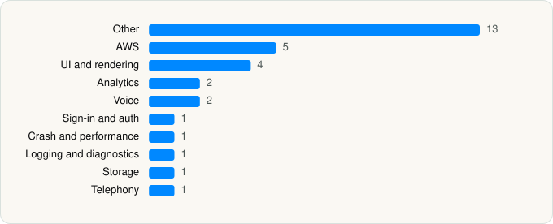

<picture><source media="(prefers-color-scheme: dark)" srcset="../../../../assets/logo/logo-dark.svg"></picture> [Tech Stack](../../../../README.md) / [Granola inc](../../../../companies/granola-inc.md) / Granola

# Granola - AI Meeting Notes

<picture><source media="(prefers-color-scheme: dark)" srcset="../../../../assets/badges/ios-dark.svg"></picture> <picture><source media="(prefers-color-scheme: dark)" srcset="../../../../assets/badges/active-dark.svg"></picture> <picture><source media="(prefers-color-scheme: dark)" srcset="../../../../assets/badges/floor-dark.svg"></picture> <picture><source media="(prefers-color-scheme: dark)" srcset="../../../../assets/badges/encrypted-dark.svg"></picture>

[App Store](https://apps.apple.com/app/id6739429409) · [latest.json](latest.json)

| | |
|---|---|
| Company | [Granola inc](../../../../companies/granola-inc.md) |
| Store id | `6739429409` |
| Bundle / package id | `com.granola.ios-prod` |
| Latest version | 1.15.11 (analysed 2026-10-24) |
| Versions tracked | 1 |
| SDKs in latest version | 31 |
| Languages | C/C++, Metal (shaders), Objective-C, Swift |
| UI | Lottie (animations), SwiftUI, UIKit |
| Build | Swift Package Manager (SwiftPM) |
| Minimum OS | iOS 18.0 (built with Xcode 27.1, SDK iphoneos27.1) |
| Devices / ABIs | iPhone, iPad |
| Localisations | 1 |
| Capabilities | 9 |
| Declares tracking | Yes |
| Tracked | Yes |

## SDKs by category

<picture><source media="(prefers-color-scheme: dark)" srcset="../../../../assets/charts/apps/ios/granola-inc/granola-dark.svg"></picture>

- **Other** (13): CAtomic 1.0, Chia 1.0, ClientRuntime, CodeScanner 1.0, CryptoSwift, CustomDump 1.0, FactoryKit 1.0, Flax 1.0, IntuneMAMSwift 21.6.0, IntuneMAMSwiftStub 21.6.0, IssueReporting 1.0, MCEmojiPicker, Pow
- **AWS** (5): AWSClientRuntime, AWSCloudWatchLogs, AWSCognitoIdentity, AwsCommonRuntimeKit, AWSSTS
- **UI and rendering** (4): Lottie, Markdown 1.0, MarkdownUI 1.0, NetworkImage 1.0
- **Analytics** (2): Amplitude 1.0, AppsFlyerLib 1.0
- **Voice** (2): LiveKit 1.0, TwilioVoice 6.13.5
- **Sign-in and auth** (1): MSAL 2.12.1
- **Crash and performance** (1): Sentry 8.57.1
- **Logging and diagnostics** (1): CocoaLumberjack
- **Storage** (1): GRDB
- **Telephony** (1): PhoneNumberKit

Frameworks (34)

ActivityKit (Live Activities), App Intents, Authentication Services (Sign in with Apple / passkeys), AVFoundation (audio/video), AVKit, Background Tasks, CallKit (VoIP), Combine (reactive), Contacts, Core Data, Core Image, Core Location, Core Motion, CryptoKit, EventKit (Calendar / Reminders), Group Activities (SharePlay), Local Authentication (Face ID / Touch ID), MessageUI (mail / SMS compose), MetalKit, MetricKit (diagnostics), Network.framework, PDFKit, PencilKit, Photos, PhotosUI, SafariServices, SiriKit (Intents), StoreKit (in-app purchase), SwiftUI, UIKit, User Notifications, VisionKit (document/data scanning), Watch Connectivity, WidgetKit (widgets)

Capabilities (9)

App Groups, Background App Refresh, Background Audio, Background Processing, Background Push, Keychain Sharing, Push Notifications (APNs), Time-Sensitive Notifications, VoIP

## Version history

| Version | Analysed | Store update | SDKs | Change | SDK list is a floor | Binary encrypted | File |
|---|---|---|---|---|---|---|---|
| 1.15.11 | 2026-10-24 | 2026-10-22 | 31 |  | Yes | Yes | [1.15.11.json](1.15.11.json) |

---

Generated by `scripts/build_readme.py` from the JSON files. Do not edit by hand.
