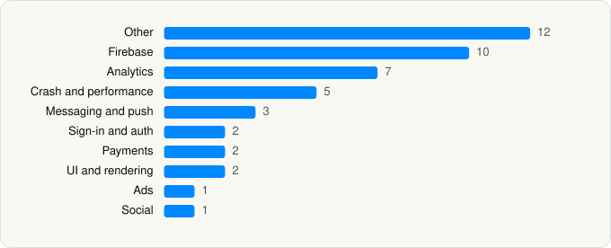

<picture><source media="(prefers-color-scheme: dark)" srcset="../../../../assets/logo/logo-dark.svg"></picture> [Tech Stack](../../../../README.md) / [Gymshark Ltd](../../../../companies/gymshark-ltd.md) / Gymshark

# Gymshark: Shop Black Friday

<picture><source media="(prefers-color-scheme: dark)" srcset="../../../../assets/badges/ios-dark.svg"></picture> <picture><source media="(prefers-color-scheme: dark)" srcset="../../../../assets/badges/inactive-dark.svg"></picture> <picture><source media="(prefers-color-scheme: dark)" srcset="../../../../assets/badges/floor-dark.svg"></picture> <picture><source media="(prefers-color-scheme: dark)" srcset="../../../../assets/badges/encrypted-dark.svg"></picture>

[App Store](https://apps.apple.com/app/id1139155460) · [latest.json](latest.json)

| | |
|---|---|
| Company | [Gymshark Ltd](../../../../companies/gymshark-ltd.md) |
| Store id | `1139155460` |
| Bundle / package id | `com.gymshark.store` |
| Latest version | 1.92.3 (analysed 2026-11-15) |
| Versions tracked | 1 |
| SDKs in latest version | 45 |
| Languages | C/C++, Objective-C, Swift |
| UI | Intercom UI, Lottie (animations), SwiftUI, UIKit |
| Build | Swift Package Manager (SwiftPM) |
| Minimum OS | iOS 16.0 (built with Xcode 27.1, SDK iphoneos27.1) |
| Devices / ABIs | iPhone |
| Localisations | 6 |
| Capabilities | 6 |
| Declares tracking | No |
| Tracked | No. Kept for history. |

## SDKs by category

<picture><source media="(prefers-color-scheme: dark)" srcset="../../../../assets/charts/apps/ios/gymshark-ltd/gymshark-dark.svg"></picture>

- **Other** (12): AppIconChangerUI, GSAddress, GSDesignSystem, GSDesignSystemShop, GSMerchandisingUI, GSOnboardingUI, GSWishlistButton, GSWishlistUI, Lokalise 1.0.2, MembershipLoyaltyPresentation, SearchFiltersUI, ShopComponents
- **Firebase** (10): FBLPromises, Firebase, FirebaseCore, FirebaseCoreInternal, FirebaseInstallations, FirebaseRemoteConfig, GoogleDataTransport, GoogleUtilities, nanopb, Promises
- **Analytics** (7): BrazeKit 12.1.0, BrazeLocation 12.1.0, FBSDKCoreKit, GoogleAppMeasurementIdentitySupport 12.19.2, mParticle, mParticle-Appboy, mParticle-AppsFlyer
- **Crash and performance** (5): DatadogCore, DatadogCrashReporting, DatadogRUM, FirebaseCrashlytics, KSCrash
- **Messaging and push** (3): BrazeUI, FirebaseMessaging, Intercom 18.8.1
- **Sign-in and auth** (2): Auth0, FBSDKLoginKit
- **Payments** (2): ShopifyAcceleratedCheckouts, ShopifyCheckoutSheetKit
- **UI and rendering** (2): Lottie 4.6.0, SDWebImage
- **Ads** (1): GoogleAdsOnDeviceConversion 3.7.0
- **Social** (1): FBSDKShareKit

Frameworks (25)

ActivityKit (Live Activities), AdServices (Apple Search Ads attribution), AdSupport (IDFA), App Tracking Transparency (ATT), Authentication Services (Sign in with Apple / passkeys), AVFoundation (audio/video), AVKit, Combine (reactive), Contacts, Core Data, Core Image, Core Location, CryptoKit, Local Authentication (Face ID / Touch ID), MapKit, MetricKit (diagnostics), Network.framework, PassKit (Wallet / Apple Pay), Photos, PhotosUI, SafariServices, StoreKit (in-app purchase), SwiftUI, UIKit, User Notifications

Capabilities (6)

App Groups, Apple Pay, Associated Domains (Universal Links), Background Push, Keychain Sharing, Push Notifications (APNs)

## Version history

| Version | Analysed | Store update | SDKs | Change | SDK list is a floor | Binary encrypted | File |
|---|---|---|---|---|---|---|---|
| 1.92.3 | 2026-11-15 |  | 45 |  | Yes | Yes | [1.92.3.json](1.92.3.json) |

---

Generated by `scripts/build_readme.py` from the JSON files. Do not edit by hand.
