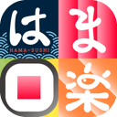
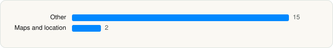

<picture><source media="(prefers-color-scheme: dark)" srcset="../../../../assets/logo/logo-dark.svg"></picture> [Tech Stack](../../../../README.md) / [HAMAZUSHI CO., LTD.](../../../../companies/hamazushi-co-ltd.md) / はま楽

# はま楽

<picture><source media="(prefers-color-scheme: dark)" srcset="../../../../assets/badges/ios-dark.svg"></picture> <picture><source media="(prefers-color-scheme: dark)" srcset="../../../../assets/badges/inactive-dark.svg"></picture> <picture><source media="(prefers-color-scheme: dark)" srcset="../../../../assets/badges/floor-dark.svg"></picture> <picture><source media="(prefers-color-scheme: dark)" srcset="../../../../assets/badges/encrypted-dark.svg"></picture>

[App Store](https://apps.apple.com/app/id1630058362) · [latest.json](latest.json)

| | |
|---|---|
| Company | [HAMAZUSHI CO., LTD.](../../../../companies/hamazushi-co-ltd.md) |
| Store id | `1630058362` |
| Bundle / package id | `jp.co.hamasushi.entame` |
| Latest version | 1.12 (analysed 2026-11-15) |
| Versions tracked | 1 |
| SDKs in latest version | 17 |
| Languages | C/C++, Metal (shaders), Objective-C, Swift |
| UI | UIKit |
| Build | Unknown / Xcode native |
| Minimum OS | iOS 13.0 (built with Xcode 26.0, SDK iphoneos26.0) |
| Devices / ABIs | iPhone |
| Localisations | 0 |
| Capabilities | 3 |
| Declares tracking | No |
| Tracked | No. Kept for history. |

## SDKs by category

<picture><source media="(prefers-color-scheme: dark)" srcset="../../../../assets/charts/apps/ios/hamazushi-co-ltd/app-dark.svg"></picture>

- **Other** (15): Capacitor 5.6.0, CapacitorApp 5.0.6, CapacitorAppLauncher 5.0.6, CapacitorBrowser 5.1.0, CapacitorDevice 5.0.6, CapacitorDialog 5.0.6, CapacitorFilesystem 5.2.0, CapacitorGeolocation 5.0.6, CapacitorHaptics 5.0.6, CapacitorKeyboard 5.0.7, CapacitorPushNotifications 5.1.0, CapacitorStorage 1.2.5, Cordova 5.6.0, CordovaPlugins 5.6.0, Lodash
- **Maps and location** (2): GMSCore 6.51.0, GoogleMaps 7.4.0

Frameworks (8)

Core Data, Core Image, Core Location, MessageUI (mail / SMS compose), Photos, SafariServices, UIKit, User Notifications

Capabilities (3)

Associated Domains (Universal Links), Background App Refresh, Push Notifications (APNs)

## Version history

| Version | Analysed | Store update | SDKs | Change | SDK list is a floor | Binary encrypted | File |
|---|---|---|---|---|---|---|---|
| 1.12 | 2026-11-15 |  | 17 |  | Yes | Yes | [1.12.json](1.12.json) |

---

Generated by `scripts/build_readme.py` from the JSON files. Do not edit by hand.
