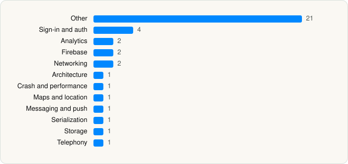

<picture><source media="(prefers-color-scheme: dark)" srcset="../../../../assets/logo/logo-dark.svg"></picture> [Tech Stack](../../../../README.md) / [Hudhud Information Technology Company](../../../../companies/hudhud-information-technology-company.md) / Hudhud

# Hudhud: Accurate KSA Maps

<picture><source media="(prefers-color-scheme: dark)" srcset="../../../../assets/badges/ios-dark.svg"></picture> <picture><source media="(prefers-color-scheme: dark)" srcset="../../../../assets/badges/inactive-dark.svg"></picture> <picture><source media="(prefers-color-scheme: dark)" srcset="../../../../assets/badges/floor-dark.svg"></picture> <picture><source media="(prefers-color-scheme: dark)" srcset="../../../../assets/badges/encrypted-dark.svg"></picture>

[App Store](https://apps.apple.com/app/id6477774492) · [latest.json](latest.json)

| | |
|---|---|
| Company | [Hudhud Information Technology Company](../../../../companies/hudhud-information-technology-company.md) |
| Store id | `6477774492` |
| Bundle / package id | `sa.hudhud.map` |
| Latest version | 26.45.3 (analysed 2026-11-13) |
| Versions tracked | 1 |
| SDKs in latest version | 38 |
| Languages | C/C++, Metal (shaders), Objective-C, Swift |
| UI | SwiftUI, UIKit |
| Build | Swift Package Manager (SwiftPM) |
| Minimum OS | iOS 17.0 (built with Xcode 27.1, SDK iphoneos27.1) |
| Devices / ABIs | iPhone |
| Localisations | 2 |
| Capabilities | 10 |
| Declares tracking | No |
| Tracked | No. Kept for history. |

## SDKs by category

<picture><source media="(prefers-color-scheme: dark)" srcset="../../../../assets/charts/apps/ios/hudhud-information-technology-company/hudhud-dark.svg"></picture>

- **Other** (21): CCryptoBoringSSL, CCryptoBoringSSLShims, Crypto, CryptoBoringWrapper, CryptoExtras, EmojiKit, FeatureFlags, Feedback, HHLocationManager 1.0, MapLibre 6.27.3, MapLibrePlugins 1.0, MediaPresentation, PHPLCrashReporter, PlaceStreetViewPresentation, PointOfInterest, PointOfInterestSheet, SharingLink, StreetViewer, SwiftUIPanoramaViewer, TalsecRuntime 6.14.5, VoiceRecognition
- **Sign-in and auth** (4): AppAuth, GoogleSignIn, GTMAppAuth, GTMSessionFetcher
- **Analytics** (2): BrazeKit 13.3.0, PostHog
- **Firebase** (2): FBLPromises, GoogleUtilities
- **Networking** (2): NIOPosix, NIOSSL
- **Architecture** (1): ComposableArchitecture
- **Crash and performance** (1): Sentry 9.30.2
- **Maps and location** (1): Mapbox
- **Messaging and push** (1): BrazeUI
- **Serialization** (1): SwiftProtobuf
- **Storage** (1): GRDB
- **Telephony** (1): PhoneNumberKit

Frameworks (35)

ActivityKit (Live Activities), App Intents, Authentication Services (Sign in with Apple / passkeys), AVFoundation (audio/video), AVKit, CloudKit, Combine (reactive), Contacts, Core Data, Core Image, Core Location, Core Motion, CryptoKit, DeviceCheck / App Attest, Local Authentication (Face ID / Touch ID), MapKit, MessageUI (mail / SMS compose), MetalKit, MetricKit (diagnostics), Network.framework, PDFKit, PencilKit, Photos, PhotosUI, RealityKit, SafariServices, SceneKit, SiriKit (Intents), Speech (recognition), Swift Charts, SwiftData (persistence), SwiftUI, UIKit, User Notifications, WidgetKit (widgets)

Capabilities (10)

App Groups, Associated Domains (Universal Links), Background Audio, Background Location, Bluetooth (central), CarPlay, Keychain Sharing, Push Notifications (APNs), Sign in with Apple, Time-Sensitive Notifications

## Version history

| Version | Analysed | Store update | SDKs | Change | SDK list is a floor | Binary encrypted | File |
|---|---|---|---|---|---|---|---|
| 26.45.3 | 2026-11-13 |  | 38 |  | Yes | Yes | [26.45.3.json](26.45.3.json) |

---

Generated by `scripts/build_readme.py` from the JSON files. Do not edit by hand.
