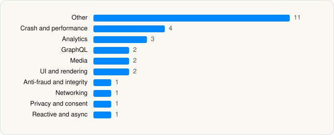

<picture><source media="(prefers-color-scheme: dark)" srcset="../../../../assets/logo/logo-dark.svg"></picture> [Tech Stack](../../../../README.md) / [Hulu, LLC](../../../../companies/hulu-llc.md) / Hulu

# Hulu: Stream TV shows & movies

<picture><source media="(prefers-color-scheme: dark)" srcset="../../../../assets/badges/ios-dark.svg"></picture> <picture><source media="(prefers-color-scheme: dark)" srcset="../../../../assets/badges/active-dark.svg"></picture> <picture><source media="(prefers-color-scheme: dark)" srcset="../../../../assets/badges/floor-dark.svg"></picture> <picture><source media="(prefers-color-scheme: dark)" srcset="../../../../assets/badges/encrypted-dark.svg"></picture>

[App Store](https://apps.apple.com/app/id376510438) · [latest.json](latest.json)

| | |
|---|---|
| Company | [Hulu, LLC](../../../../companies/hulu-llc.md) |
| Store id | `376510438` |
| Bundle / package id | `com.hulu.plus` |
| Latest version | 9.34.0 (analysed 2026-06-19) |
| Versions tracked | 1 |
| SDKs in latest version | 28 |
| Languages | C/C++, Objective-C, React Native / JavaScript, Swift |
| UI | Lottie (animations), SwiftUI, UIKit |
| Build | Swift Package Manager (SwiftPM) |
| Minimum OS | iOS 16.4 (built with Xcode 26.2, SDK iphoneos26.2) |
| Devices / ABIs | iPhone, iPad |
| Localisations | 0 |
| Capabilities | 8 |
| Declares tracking | Yes |
| Tracked | Yes |

## SDKs by category

<picture><source media="(prefers-color-scheme: dark)" srcset="../../../../assets/charts/apps/ios/hulu-llc/hulu-dark.svg"></picture>

- **Other** (11): Bond 1.0, Clocks 1.0, Dependencies 1.0, Differ 1.0, FlexUIComponents, IssueReporting 1.0, MyDisneyFramework, StorageKit, TealiumCore, TrustKit, XCTestDynamicOverlay 1.0
- **Crash and performance** (4): Datadog 1.0, DatadogCore, DatadogRUM, NewRelic 7.6.0
- **Analytics** (3): AppsFlyerLib 1.0, ConvivaSDK 4.3.0, NielsenAppApi 9.1.0
- **GraphQL** (2): Apollo, ApolloAPI
- **Media** (2): GoogleCast 4.8.1, mamba
- **UI and rendering** (2): Lottie, Nuke 1.0
- **Anti-fraud and integrity** (1): RecaptchaEnterprise 1.0
- **Networking** (1): Reachability
- **Privacy and consent** (1): OTPublishersHeadlessSDK 202503.2.0
- **Reactive and async** (1): ReactiveKit 1.0

Frameworks (24)

AdServices (Apple Search Ads attribution), AdSupport (IDFA), App Tracking Transparency (ATT), AVFoundation (audio/video), AVKit, Background Tasks, Combine (reactive), Core Bluetooth, Core Data, Core Image, Core Location, CryptoKit, DeviceCheck / App Attest, Group Activities (SharePlay), Media Player, MetricKit (diagnostics), Network.framework, SafariServices, SiriKit (Intents), StoreKit (in-app purchase), SwiftUI, UIKit, User Notifications, WidgetKit (widgets)

Capabilities (8)

App Groups, Associated Domains (Universal Links), Background App Refresh, Background Audio, Background Processing, Background Push, Keychain Sharing, Push Notifications (APNs)

## Version history

| Version | Analysed | Store update | SDKs | Change | SDK list is a floor | Binary encrypted | File |
|---|---|---|---|---|---|---|---|
| 9.34.0 | 2026-06-19 |  | 28 |  | Yes | Yes | [9.34.0.json](9.34.0.json) |

---

Generated by `scripts/build_readme.py` from the JSON files. Do not edit by hand.
