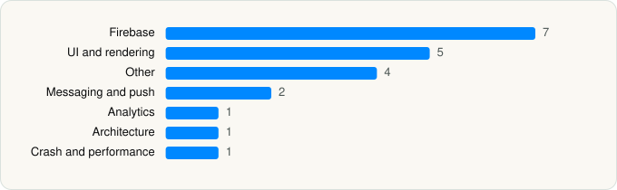

<picture><source media="(prefers-color-scheme: dark)" srcset="../../../../assets/logo/logo-dark.svg"></picture> [Tech Stack](../../../../README.md) / [iBoxen Infrastruktur Sverige AB](../../../../companies/iboxen-infrastruktur-sverige-ab.md) / iBoxen

# iBoxen

<picture><source media="(prefers-color-scheme: dark)" srcset="../../../../assets/badges/ios-dark.svg"></picture> <picture><source media="(prefers-color-scheme: dark)" srcset="../../../../assets/badges/inactive-dark.svg"></picture> <picture><source media="(prefers-color-scheme: dark)" srcset="../../../../assets/badges/floor-dark.svg"></picture> <picture><source media="(prefers-color-scheme: dark)" srcset="../../../../assets/badges/encrypted-dark.svg"></picture>

[App Store](https://apps.apple.com/app/id1553931951) · [latest.json](latest.json)

| | |
|---|---|
| Company | [iBoxen Infrastruktur Sverige AB](../../../../companies/iboxen-infrastruktur-sverige-ab.md) |
| Store id | `1553931951` |
| Bundle / package id | `com.iboxen.consumer` |
| Latest version | 2.20.21 (analysed 2026-11-18) |
| Versions tracked | 1 |
| SDKs in latest version | 21 |
| Languages | C/C++, Metal (shaders), Objective-C, React Native / JavaScript, Swift |
| UI | Intercom UI, UIKit |
| Build | Swift Package Manager (SwiftPM) |
| Minimum OS | iOS 15.1 (built with Xcode 26.2, SDK iphoneos26.2) |
| Devices / ABIs | iPhone |
| Localisations | 0 |
| Capabilities | 5 |
| Declares tracking | No |
| Tracked | No. Kept for history. |

## SDKs by category

<picture><source media="(prefers-color-scheme: dark)" srcset="../../../../assets/charts/apps/ios/iboxen-infrastruktur-sverige-ab/iboxen-dark.svg"></picture>

- **Firebase** (7): FBLPromises 2.4.1, FirebaseCore 12.4.0, FirebaseCoreInternal 12.4.0, FirebaseInstallations 12.4.0, GoogleDataTransport 10.1.1, GoogleUtilities 8.1.3, nanopb 3.30910.0
- **UI and rendering** (5): hermes 0.12.0, React Native, React Native Reanimated, react-native-svg, RNSVGFilters 15.12.1
- **Other** (4): Lodash, ReactNativeMapsPrivacy 1.20.1, RNDeviceInfoPrivacyInfo 10.14.0, RNPermissionsPrivacyInfo 5.4.4
- **Messaging and push** (2): FirebaseMessaging 12.4.0, Intercom 10.4.0
- **Analytics** (1): Amplitude
- **Architecture** (1): React Navigation
- **Crash and performance** (1): Sentry 8.57.0

Frameworks (19)

AVFoundation (audio/video), AVKit, Core Bluetooth, Core Data, Core Image, Core Location, Core Motion, DeviceCheck / App Attest, Local Authentication (Face ID / Touch ID), MapKit, MetricKit (diagnostics), Network.framework, PDFKit, Photos, PhotosUI, SiriKit (Intents), StoreKit (in-app purchase), UIKit, User Notifications

Capabilities (5)

App Attest, Background Push, Bluetooth (central), Keychain Sharing, Push Notifications (APNs)

## Version history

| Version | Analysed | Store update | SDKs | Change | SDK list is a floor | Binary encrypted | File |
|---|---|---|---|---|---|---|---|
| 2.20.21 | 2026-11-18 |  | 21 |  | Yes | Yes | [2.20.21.json](2.20.21.json) |

---

Generated by `scripts/build_readme.py` from the JSON files. Do not edit by hand.
