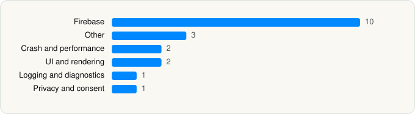

<picture><source media="(prefers-color-scheme: dark)" srcset="../../../../assets/logo/logo-dark.svg"></picture> [Tech Stack](../../../../README.md) / [ICA Sverige AB](../../../../companies/ica-sverige-ab.md) / ICA

# ICA – recept och erbjudanden

<picture><source media="(prefers-color-scheme: dark)" srcset="../../../../assets/badges/ios-dark.svg"></picture> <picture><source media="(prefers-color-scheme: dark)" srcset="../../../../assets/badges/inactive-dark.svg"></picture> <picture><source media="(prefers-color-scheme: dark)" srcset="../../../../assets/badges/floor-dark.svg"></picture> <picture><source media="(prefers-color-scheme: dark)" srcset="../../../../assets/badges/encrypted-dark.svg"></picture>

[App Store](https://apps.apple.com/app/id458324110) · [latest.json](latest.json)

| | |
|---|---|
| Company | [ICA Sverige AB](../../../../companies/ica-sverige-ab.md) |
| Store id | `458324110` |
| Bundle / package id | `se.ica.shoppinglista` |
| Latest version | 5.85.0 (analysed 2026-11-17) |
| Versions tracked | 1 |
| SDKs in latest version | 19 |
| Languages | C/C++, Objective-C, Swift |
| UI | Lottie (animations), SwiftUI, UIKit |
| Build | Swift Package Manager (SwiftPM) |
| Minimum OS | iOS 17.0 (built with Xcode 26.6, SDK iphoneos26.5) |
| Devices / ABIs | iPhone, iPad |
| Localisations | 0 |
| Capabilities | 6 |
| Declares tracking | No |
| Tracked | No. Kept for history. |

## SDKs by category

<picture><source media="(prefers-color-scheme: dark)" srcset="../../../../assets/charts/apps/ios/ica-sverige-ab/ica-dark.svg"></picture>

- **Firebase** (10): FBLPromises, Firebase, FirebaseCore, FirebaseCoreInternal, FirebaseInstallations, FirebaseRemoteConfig, GoogleDataTransport, GoogleUtilities, nanopb, Promises
- **Other** (3): IDSFoundation, MobileMessaging, Siren
- **Crash and performance** (2): FirebaseCrashlytics, NewRelic 7.7.8
- **UI and rendering** (2): Kingfisher 8.13.0, Lottie
- **Logging and diagnostics** (1): Pulse 1.0
- **Privacy and consent** (1): OTPublishersHeadlessSDK 6.33.0

Frameworks (23)

App Tracking Transparency (ATT), Authentication Services (Sign in with Apple / passkeys), AVFoundation (audio/video), Background Tasks, Combine (reactive), Core Data, Core Image, Core Location, CryptoKit, Local Authentication (Face ID / Touch ID), MapKit, MetricKit (diagnostics), Network.framework, PassKit (Wallet / Apple Pay), PDFKit, Photos, SafariServices, StoreKit (in-app purchase), Swift Charts, SwiftUI, UIKit, User Notifications, Watch Connectivity

Capabilities (6)

App Groups, Associated Domains (Universal Links), Background App Refresh, Background Processing, Background Push, Push Notifications (APNs)

## Version history

| Version | Analysed | Store update | SDKs | Change | SDK list is a floor | Binary encrypted | File |
|---|---|---|---|---|---|---|---|
| 5.85.0 | 2026-11-17 |  | 19 |  | Yes | Yes | [5.85.0.json](5.85.0.json) |

---

Generated by `scripts/build_readme.py` from the JSON files. Do not edit by hand.
