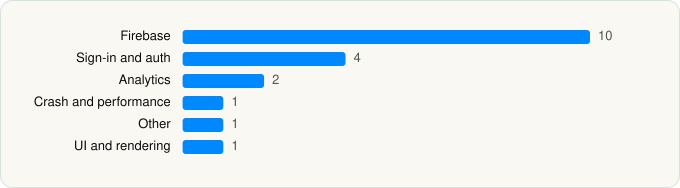

<picture><source media="(prefers-color-scheme: dark)" srcset="../../../../assets/logo/logo-dark.svg"></picture> [Tech Stack](../../../../README.md) / [Ideogram AI Inc](../../../../companies/ideogram-ai-inc.md) / Ideogram AI

# Ideogram AI - Image Generator

<picture><source media="(prefers-color-scheme: dark)" srcset="../../../../assets/badges/ios-dark.svg"></picture> <picture><source media="(prefers-color-scheme: dark)" srcset="../../../../assets/badges/active-dark.svg"></picture> <picture><source media="(prefers-color-scheme: dark)" srcset="../../../../assets/badges/floor-dark.svg"></picture> <picture><source media="(prefers-color-scheme: dark)" srcset="../../../../assets/badges/encrypted-dark.svg"></picture>

[App Store](https://apps.apple.com/app/id6476790495) · [latest.json](latest.json)

| | |
|---|---|
| Company | [Ideogram AI Inc](../../../../companies/ideogram-ai-inc.md) |
| Store id | `6476790495` |
| Bundle / package id | `ai.ideogram.ideogram-ui` |
| Latest version | 2026.41 (analysed 2026-10-24) |
| Versions tracked | 1 |
| SDKs in latest version | 19 |
| Languages | C/C++, Objective-C, Swift |
| UI | SwiftUI, UIKit |
| Build | Swift Package Manager (SwiftPM) |
| Minimum OS | iOS 16.6 (built with Xcode 27.0, SDK iphoneos27.0) |
| Devices / ABIs | iPhone, iPad |
| Localisations | 1 |
| Capabilities | 1 |
| Declares tracking | No |
| Tracked | Yes |

## SDKs by category

<picture><source media="(prefers-color-scheme: dark)" srcset="../../../../assets/charts/apps/ios/ideogram-ai-inc/ideogram-ai-dark.svg"></picture>

- **Firebase** (10): FBLPromises, Firebase, FirebaseAuth, FirebaseCore, FirebaseCoreInternal, FirebaseInstallations, GoogleDataTransport, GoogleUtilities, nanopb, Promises
- **Sign-in and auth** (4): AppAuth, GoogleSignIn, GTMAppAuth, GTMSessionFetcher
- **Analytics** (2): FirebaseAnalytics 10.28.0, GoogleAppMeasurement 10.28.0
- **Crash and performance** (1): FirebaseCrashlytics
- **Other** (1): Theme
- **UI and rendering** (1): Kingfisher

Frameworks (12)

Authentication Services (Sign in with Apple / passkeys), AVFoundation (audio/video), Combine (reactive), Core Image, CryptoKit, Local Authentication (Face ID / Touch ID), MetricKit (diagnostics), Photos, SafariServices, StoreKit (in-app purchase), SwiftUI, UIKit

Capabilities (1)

Sign in with Apple

## Version history

| Version | Analysed | Store update | SDKs | Change | SDK list is a floor | Binary encrypted | File |
|---|---|---|---|---|---|---|---|
| 2026.41 | 2026-10-24 | 2026-10-24 | 19 |  | Yes | Yes | [2026.41.json](2026.41.json) |

---

Generated by `scripts/build_readme.py` from the JSON files. Do not edit by hand.
