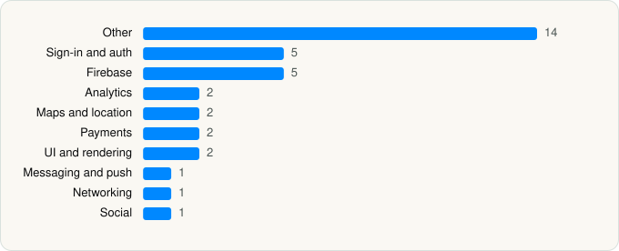

<picture><source media="(prefers-color-scheme: dark)" srcset="../../../../assets/logo/logo-dark.svg"></picture> [Tech Stack](../../../../README.md) / [iFood](../../../../companies/ifood.md) / iFood

# iFood: pedir delivery em casa

<picture><source media="(prefers-color-scheme: dark)" srcset="../../../../assets/badges/ios-dark.svg"></picture> <picture><source media="(prefers-color-scheme: dark)" srcset="../../../../assets/badges/inactive-dark.svg"></picture> <picture><source media="(prefers-color-scheme: dark)" srcset="../../../../assets/badges/floor-dark.svg"></picture> <picture><source media="(prefers-color-scheme: dark)" srcset="../../../../assets/badges/encrypted-dark.svg"></picture>

[App Store](https://apps.apple.com/app/id483017239) · [latest.json](latest.json)

| | |
|---|---|
| Company | [iFood](../../../../companies/ifood.md) |
| Store id | `483017239` |
| Bundle / package id | `br.com.brainweb.ifood` |
| Latest version | 10.148.0 (analysed 2026-11-22) |
| Versions tracked | 1 |
| SDKs in latest version | 35 |
| Languages | C/C++, Metal (shaders), Objective-C, Swift |
| UI | Lottie (animations), SwiftUI, UIKit |
| Build | Swift Package Manager (SwiftPM) |
| Minimum OS | iOS 15.0 (built with Xcode 26.2, SDK iphoneos26.2) |
| Devices / ABIs | iPhone, iPad |
| Localisations | 2 |
| Capabilities | 10 |
| Declares tracking | Yes |
| Tracked | No. Kept for history. |

## SDKs by category

<picture><source media="(prefers-color-scheme: dark)" srcset="../../../../assets/charts/apps/ios/ifood/ifood-dark.svg"></picture>

- **Other** (14): AdsSdk 1.0, CardinalMobile 2.2.5, CryptoSwift, CSBehavior 3.0.1, FaceTecSDK 9.7.135, GooglePlaces 9.4.1, GooglePlacesTarget, IncogniaCoreWrapper, IncogniaTrialWrapper, IncogniaWrapper, RLTMXProfiling 1.0, RLTMXProfilingConnections 1.0, runtime 1.0, SendbirdChatSDK 4.17.0
- **Sign-in and auth** (5): AppAuth, FacebookLogin, GoogleSignIn, GTMAppAuth, GTMSessionFetcher
- **Firebase** (5): FBLPromises, FirebaseCore, FirebaseCoreInternal, FirebaseInstallations, GoogleUtilities 1.0
- **Analytics** (2): FacebookAEM, FacebookCore
- **Maps and location** (2): GMSCore 25.0.0, GoogleMaps
- **Payments** (2): Adyen, Braintree
- **UI and rendering** (2): Kingfisher, Lottie 4.6.0
- **Messaging and push** (1): BrazeUI 1.0
- **Networking** (1): Alamofire
- **Social** (1): FacebookShare

Frameworks (34)

ActivityKit (Live Activities), AdSupport (IDFA), App Intents, App Tracking Transparency (ATT), Authentication Services (Sign in with Apple / passkeys), AVFoundation (audio/video), CallKit (VoIP), Combine (reactive), Contacts, Core Data, Core Image, Core Location, Core Motion, Core NFC, CryptoKit, DeviceCheck / App Attest, Local Authentication (Face ID / Touch ID), MapKit, MessageUI (mail / SMS compose), MetricKit (diagnostics), Network.framework, PassKit (Wallet / Apple Pay), PDFKit, PencilKit, Photos, SafariServices, SiriKit (Intents), Speech (recognition), StoreKit (in-app purchase), SwiftUI, UIKit, User Notifications, Vision, WidgetKit (widgets)

Capabilities (10)

App Groups, Apple Pay, Associated Domains (Universal Links), Background Push, iCloud, iCloud Key-Value Storage, Keychain Sharing, Push Notifications (APNs), Sign in with Apple, Time-Sensitive Notifications

## Version history

| Version | Analysed | Store update | SDKs | Change | SDK list is a floor | Binary encrypted | File |
|---|---|---|---|---|---|---|---|
| 10.148.0 | 2026-11-22 |  | 35 |  | Yes | Yes | [10.148.0.json](10.148.0.json) |

---

Generated by `scripts/build_readme.py` from the JSON files. Do not edit by hand.
