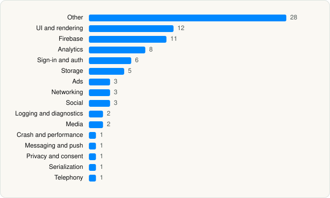

<picture><source media="(prefers-color-scheme: dark)" srcset="../../../../assets/logo/logo-dark.svg"></picture> [Tech Stack](../../../../README.md) / [iHeartMedia Management Services, Inc.](../../../../companies/iheartmedia-management-services-inc.md) / iHeart

# iHeart: Radio, Music, Podcasts

<picture><source media="(prefers-color-scheme: dark)" srcset="../../../../assets/badges/ios-dark.svg"></picture> <picture><source media="(prefers-color-scheme: dark)" srcset="../../../../assets/badges/inactive-dark.svg"></picture> <picture><source media="(prefers-color-scheme: dark)" srcset="../../../../assets/badges/floor-dark.svg"></picture> <picture><source media="(prefers-color-scheme: dark)" srcset="../../../../assets/badges/encrypted-dark.svg"></picture>

[App Store](https://apps.apple.com/app/id290638154) · [latest.json](latest.json)

| | |
|---|---|
| Company | [iHeartMedia Management Services, Inc.](../../../../companies/iheartmedia-management-services-inc.md) |
| Store id | `290638154` |
| Bundle / package id | `com.clearchannel.iheartradio` |
| Latest version | 10.64.0 (analysed 2026-06-23) |
| Versions tracked | 1 |
| SDKs in latest version | 88 |
| Languages | C/C++, Objective-C, Swift |
| UI | Lottie (animations), SwiftUI, UIKit |
| Build | Swift Package Manager (SwiftPM) |
| Minimum OS | iOS 15.0 (built with Xcode 26.5, SDK iphoneos26.5) |
| Devices / ABIs | iPhone, iPad |
| Localisations | 4 |
| Capabilities | 14 |
| Declares tracking | Yes |
| Tracked | No. Kept for history. |

## SDKs by category

<picture><source media="(prefers-color-scheme: dark)" srcset="../../../../assets/charts/apps/ios/iheartmedia-management-services-inc/iheart-dark.svg"></picture>

- **Other** (28): BAPromiseKit 1.0, BrazePushStory 14.0.1, ContentsquareModule 4.32.0, CryptoSwift 1.8.4, CSCrashReporter 1.0, DACircularProgress 2.3.1, DeviceKit, GenuinCore 0.0.1, GenuinUI 0.0.1, IDMPhotoBrowser 1.11.3, JLRoutes 2.1.0, MDFInternationalization 3.0.0, MetaWearablesSDK 14.0.0, MetricsReporter 2.0.0, MozIMSDK 1.7.1, NSHash 1.2.0, objc 3.0.6, only 1, PMKVObserver 4.1.3, Prebidorg 1.5.5, RSCrashReporter 1.0.1, Rudder 1.7.1, RudderKit 1.4.0, Shake 1.2.1, URLEmbeddedView 0.18.0, VizbeeHomeOSKit 1.0.2, VizbeeKit 6.7.2, WazeAudio 1.3
- **UI and rendering** (12): EasyTipView 2.1.0, Hero 1.6.4, Kingfisher 5.15.8, Lottie, MarqueeLabel 4.5.3, MaterialComponents 124.2.0, pop 1.0.12, SDWebImage 5.21.3, SkeletonView 1.30.4, SnapKit 5.7.1, TOCropViewController 2.6.1, XLPagerTabStrip 9.1.0
- **Firebase** (11): FBLPromises 2.4.0, Firebase 11.6.0, FirebaseCore 11.6.0, FirebaseCoreInternal 11.6.0, FirebaseInstallations 11.6.0, FirebasePerformance 11.6.0, FirebaseRemoteConfig 11.6.0, GoogleDataTransport 10.1.0, GoogleUtilities 8.0.2, nanopb 3.30910.0, Promises 2.4.0
- **Analytics** (8): AppsFlyerLib 6.17.8, BrazeKit 14.0.1, ComScore 1.0, FacebookAEM, FacebookCore, FBAEMKit 1.0, FBSDKCoreKit 1.0, SCSDKCoreKit 2.5.0
- **Sign-in and auth** (6): AppAuth, FacebookLogin, FBSDKLoginKit 1.0, GoogleSignIn, GTMAppAuth, GTMSessionFetcher
- **Storage** (5): GoogleToolboxForMac 2.2.2, MotionAnimator 4.0.1, MotionInterchange 3.0.0, Realm 20.0.3, RealmSwift 20.0.3
- **Ads** (3): AppLovin 13.6.2, Google Mobile Ads (AdMob), GoogleMobileAds 12.14.0
- **Networking** (3): AFNetworking 4.0.1, SocketIO 16.1.1, Starscream 4.0.8
- **Social** (3): FacebookShare, FBSDKShareKit 1.0, SCSDKCreativeKit 2.5.0
- **Logging and diagnostics** (2): SBObjectiveCWrapper 1.5.0, SwiftyBeaver 1.7.1
- **Media** (2): GoogleCast 4.8.0, GoogleInteractiveMediaAds 3.27.4
- **Crash and performance** (1): FirebaseCrashlytics 11.6.0
- **Messaging and push** (1): BrazeUI 14.0.1
- **Privacy and consent** (1): UserMessagingPlatform 3.1.0
- **Serialization** (1): SwiftProtobuf 1.32.0
- **Telephony** (1): libPhoneNumber 1.0

Frameworks (33)

ActivityKit (Live Activities), AdSupport (IDFA), App Tracking Transparency (ATT), Authentication Services (Sign in with Apple / passkeys), AVFoundation (audio/video), AVKit, CloudKit, Combine (reactive), Contacts, Core Bluetooth, Core Data, Core Image, Core Location, Core ML, Core Motion, CryptoKit, EventKit (Calendar / Reminders), Local Authentication (Face ID / Touch ID), MapKit, Media Player, MessageUI (mail / SMS compose), MetricKit (diagnostics), Network.framework, PassKit (Wallet / Apple Pay), Photos, SafariServices, SiriKit (Intents), StoreKit (in-app purchase), SwiftUI, UIKit, User Notifications, Watch Connectivity, WidgetKit (widgets)

Capabilities (14)

App Groups, Associated Domains (Universal Links), Background App Refresh, Background Audio, Background Location, Background Push, Bluetooth (central), CarPlay, CloudKit, External Accessory, iCloud, Push Notifications (APNs), Sign in with Apple, SiriKit

## Version history

| Version | Analysed | Store update | SDKs | Change | SDK list is a floor | Binary encrypted | File |
|---|---|---|---|---|---|---|---|
| 10.64.0 | 2026-06-23 |  | 88 |  | Yes | Yes | [10.64.0.json](10.64.0.json) |

---

Generated by `scripts/build_readme.py` from the JSON files. Do not edit by hand.
