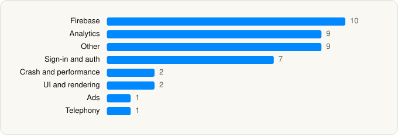

<picture><source media="(prefers-color-scheme: dark)" srcset="../../../../assets/logo/logo-dark.svg"></picture> [Tech Stack](../../../../README.md) / [Inflection AI, Inc.](../../../../companies/inflection-ai-inc.md) / Pi, your personal AI

# Pi, your personal AI

<picture><source media="(prefers-color-scheme: dark)" srcset="../../../../assets/badges/ios-dark.svg"></picture> <picture><source media="(prefers-color-scheme: dark)" srcset="../../../../assets/badges/active-dark.svg"></picture> <picture><source media="(prefers-color-scheme: dark)" srcset="../../../../assets/badges/floor-dark.svg"></picture> <picture><source media="(prefers-color-scheme: dark)" srcset="../../../../assets/badges/encrypted-dark.svg"></picture>

[App Store](https://apps.apple.com/app/id6445815935) · [latest.json](latest.json)

| | |
|---|---|
| Company | [Inflection AI, Inc.](../../../../companies/inflection-ai-inc.md) |
| Store id | `6445815935` |
| Bundle / package id | `com.harrisonstreetlabs.ios.pi` |
| Latest version | 26.1019.1 (analysed 2026-10-24) |
| Versions tracked | 1 |
| SDKs in latest version | 41 |
| Languages | C/C++, Objective-C, Swift |
| UI | Lottie (animations), SwiftUI, UIKit |
| Build | Swift Package Manager (SwiftPM) |
| Minimum OS | iOS 16 (built with Xcode 27.0, SDK iphoneos27.0) |
| Devices / ABIs | iPhone, iPad |
| Localisations | 0 |
| Capabilities | 6 |
| Declares tracking | Yes |
| Tracked | Yes |

## SDKs by category

<picture><source media="(prefers-color-scheme: dark)" srcset="../../../../assets/charts/apps/ios/inflection-ai-inc/pi-your-personal-ai-dark.svg"></picture>

- **Firebase** (10): FBLPromises, Firebase, FirebaseCore, FirebaseCoreInternal, FirebaseInstallations, FirebaseRemoteConfig, GoogleDataTransport, GoogleUtilities, nanopb, Promises
- **Analytics** (9): AppsFlyerLib 1.0, FacebookAEM, FacebookCore, FBAEMKit 1.0, FBSDKCoreKit 1.0, FirebaseAnalytics 11.15.0, GoogleAppMeasurement 11.15.0, GoogleAppMeasurementIdentitySupport 11.15.0, PostHog
- **Other** (9): AudioFoundation, Daily 0.37.0, DailyBriefViews, DeviceKit, Discover, MicrosoftCognitiveServicesSpeech 1.31.0, People, PHPLCrashReporter, ViewComponents
- **Sign-in and auth** (7): AppAuth, FacebookLogin, FBSDKLoginKit 1.0, GoogleSignIn, GTMAppAuth, GTMSessionFetcher, Login
- **Crash and performance** (2): FirebaseCrashlytics, Sentry 9.13.0
- **UI and rendering** (2): Lottie 4.6.0, SDWebImage
- **Ads** (1): GoogleAdsOnDeviceConversion 2.3.0
- **Telephony** (1): PhoneNumberKit

Frameworks (27)

AdSupport (IDFA), App Intents, App Tracking Transparency (ATT), Authentication Services (Sign in with Apple / passkeys), AVFoundation (audio/video), CallKit (VoIP), Combine (reactive), Contacts, Core Data, Core Image, Core Location, CryptoKit, Local Authentication (Face ID / Touch ID), Media Player, MessageUI (mail / SMS compose), MetricKit (diagnostics), Network.framework, PDFKit, Photos, PhotosUI, SafariServices, SiriKit (Intents), Speech (recognition), StoreKit (in-app purchase), SwiftUI, UIKit, User Notifications

Capabilities (6)

App Groups, Associated Domains (Universal Links), Background Audio, Push Notifications (APNs), Sign in with Apple, VoIP

## Version history

| Version | Analysed | Store update | SDKs | Change | SDK list is a floor | Binary encrypted | File |
|---|---|---|---|---|---|---|---|
| 26.1019.1 | 2026-10-24 | 2026-10-24 | 41 |  | Yes | Yes | [26.1019.1.json](26.1019.1.json) |

---

Generated by `scripts/build_readme.py` from the JSON files. Do not edit by hand.
