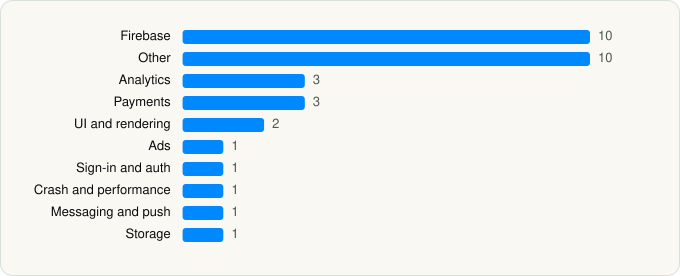

<picture><source media="(prefers-color-scheme: dark)" srcset="../../../../assets/logo/logo-dark.svg"></picture> [Tech Stack](../../../../README.md) / [InfoCert S.p.A.](../../../../companies/infocert-s-p-a.md) / My Infocert

# My Infocert

<picture><source media="(prefers-color-scheme: dark)" srcset="../../../../assets/badges/ios-dark.svg"></picture> <picture><source media="(prefers-color-scheme: dark)" srcset="../../../../assets/badges/inactive-dark.svg"></picture> <picture><source media="(prefers-color-scheme: dark)" srcset="../../../../assets/badges/floor-dark.svg"></picture> <picture><source media="(prefers-color-scheme: dark)" srcset="../../../../assets/badges/encrypted-dark.svg"></picture>

[App Store](https://apps.apple.com/app/id1300573997) · [latest.json](latest.json)

| | |
|---|---|
| Company | [InfoCert S.p.A.](../../../../companies/infocert-s-p-a.md) |
| Store id | `1300573997` |
| Bundle / package id | `it.InfoCert.MyInfoCert` |
| Latest version | 3.23.1 (analysed 2026-11-20) |
| Versions tracked | 1 |
| SDKs in latest version | 33 |
| Languages | C/C++, Objective-C, Swift |
| UI | Lottie (animations), SwiftUI, UIKit |
| Build | Swift Package Manager (SwiftPM) |
| Minimum OS | iOS 16.3 (built with Xcode 26.4.1, SDK iphoneos26.4) |
| Devices / ABIs | iPhone |
| Localisations | 10 |
| Capabilities | 6 |
| Declares tracking | No |
| Tracked | No. Kept for history. |

## SDKs by category

<picture><source media="(prefers-color-scheme: dark)" srcset="../../../../assets/charts/apps/ios/infocert-s-p-a/my-infocert-dark.svg"></picture>

- **Firebase** (10): FBLPromises, Firebase, FirebaseCore, FirebaseCoreInternal, FirebaseInstallations, FirebaseRemoteConfig, GoogleDataTransport, GoogleUtilities 7.13.3, nanopb, Promises
- **Other** (10): AssistedSelfie 5.1.2, BridgeKit, BugfenderSDK 1.0, DocumentCapture 5.1.2, EcoMindCommon 1.0, EDocID 5.1.2, ImgProc 1.2.490, Lokalise 1.0.2, OpenSSL 1.1.2301, TesseractOCR 95.0.1
- **Analytics** (3): FirebaseAnalytics 12.14.0, GoogleAppMeasurement 12.14.0, GoogleAppMeasurementIdentitySupport 12.14.0
- **Payments** (3): InfoCertWalletSDK 1.0, WalletFeatureKit, WalletUIKit
- **UI and rendering** (2): GPUImage 90.1.8, Lottie 4.5.2
- **Ads** (1): GoogleAdsOnDeviceConversion 3.6.0
- **Sign-in and auth** (1): GTMSessionFetcher 3.5.0
- **Crash and performance** (1): FirebaseCrashlytics
- **Messaging and push** (1): FirebaseMessaging
- **Storage** (1): GoogleToolboxForMac 2.3.2

Frameworks (20)

Authentication Services (Sign in with Apple / passkeys), AVFoundation (audio/video), AVKit, Background Tasks, Combine (reactive), Core Bluetooth, Core Data, Core Image, Core NFC, CryptoKit, DeviceCheck / App Attest, Local Authentication (Face ID / Touch ID), Media Player, MessageUI (mail / SMS compose), MetricKit (diagnostics), Network.framework, StoreKit (in-app purchase), SwiftUI, UIKit, User Notifications

Capabilities (6)

App Attest, App Groups, Associated Domains (Universal Links), Background Push, NFC, Push Notifications (APNs)

## Version history

| Version | Analysed | Store update | SDKs | Change | SDK list is a floor | Binary encrypted | File |
|---|---|---|---|---|---|---|---|
| 3.23.1 | 2026-11-20 |  | 33 |  | Yes | Yes | [3.23.1.json](3.23.1.json) |

---

Generated by `scripts/build_readme.py` from the JSON files. Do not edit by hand.
