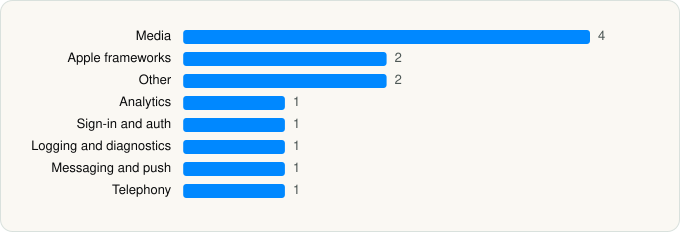

<picture><source media="(prefers-color-scheme: dark)" srcset="../../../../assets/logo/logo-dark.svg"></picture> [Tech Stack](../../../../README.md) / [Instagram, Inc.](../../../../companies/instagram-inc.md) / Instagram

# Instagram

<picture><source media="(prefers-color-scheme: dark)" srcset="../../../../assets/badges/ios-dark.svg"></picture> <picture><source media="(prefers-color-scheme: dark)" srcset="../../../../assets/badges/active-dark.svg"></picture> <picture><source media="(prefers-color-scheme: dark)" srcset="../../../../assets/badges/floor-dark.svg"></picture> <picture><source media="(prefers-color-scheme: dark)" srcset="../../../../assets/badges/encrypted-dark.svg"></picture>

[App Store](https://apps.apple.com/app/id389801252) · [latest.json](latest.json)

| | |
|---|---|
| Company | [Instagram, Inc.](../../../../companies/instagram-inc.md) |
| Store id | `389801252` |
| Bundle / package id | `com.burbn.instagram` |
| Latest version | 432.0.0 (analysed 2026-06-23) |
| Versions tracked | 1 |
| SDKs in latest version | 13 |
| Languages | C/C++, Metal (shaders), Objective-C, Swift |
| UI | SwiftUI, UIKit |
| Build | Unknown / Xcode native |
| Minimum OS | iOS 16.3 (built with Xcode 26.2, SDK iphoneos26.2) |
| Devices / ABIs | iPad, iPhone |
| Localisations | 35 |
| Capabilities | 19 |
| Declares tracking | Yes |
| Tracked | Yes |

## SDKs by category

<picture><source media="(prefers-color-scheme: dark)" srcset="../../../../assets/charts/apps/ios/instagram-inc/instagram-dark.svg"></picture>

- **Media** (4): GoogleCast 4.8.3, libavcodec 1.0, libavutil 1.0, SpotifyiOS 5.0.1
- **Apple frameworks** (2): InternalCollectionsUtilities, OrderedCollections
- **Other** (2): FBSharedFramework 1.0, IGDrawKit
- **Analytics** (1): Facebook SDK
- **Sign-in and auth** (1): Facebook Login
- **Logging and diagnostics** (1): FBBrowserIntegrityLoggingKit
- **Messaging and push** (1): Intercom
- **Telephony** (1): libPhoneNumber

Frameworks (48)

ActivityKit (Live Activities), AdServices (Apple Search Ads attribution), AdSupport (IDFA), App Intents, App Tracking Transparency (ATT), ARKit, Authentication Services (Sign in with Apple / passkeys), AVFoundation (audio/video), AVKit, Background Tasks, CallKit (VoIP), CloudKit, Combine (reactive), Contacts, Core Bluetooth, Core Data, Core Image, Core Location, Core ML, Core Motion, Core NFC, CryptoKit, DeviceCheck / App Attest, EventKit (Calendar / Reminders), Local Authentication (Face ID / Touch ID), MapKit, Media Player, MessageUI (mail / SMS compose), MetalKit, MetricKit (diagnostics), Natural Language, Network.framework, PassKit (Wallet / Apple Pay), Photos, PhotosUI, PushKit (VoIP push), RealityKit, SafariServices, SceneKit, SiriKit (Intents), SpriteKit, StoreKit (in-app purchase), SwiftUI, UIKit, User Notifications, Vision, VisionKit (document/data scanning), WidgetKit (widgets)

Capabilities (19)

App Groups, Associated Domains (Universal Links), Background App Refresh, Background Audio, Background Location, Background Processing, Background Push, Bluetooth (central), Bluetooth (peripheral), CloudKit, Communication Notifications, External Accessory, iCloud, iCloud Key-Value Storage, Keychain Sharing, Push Notifications (APNs), Sign in with Apple, Time-Sensitive Notifications, VoIP

## Version history

| Version | Analysed | Store update | SDKs | Change | SDK list is a floor | Binary encrypted | File |
|---|---|---|---|---|---|---|---|
| 432.0.0 | 2026-06-23 |  | 13 |  | Yes | Yes | [432.0.0.json](432.0.0.json) |

## Model-written summary

> SwiftUI/UIKit iOS app with App Intents, Live Activities, 76 Metal shaders, on-device ML models, and Meta backends

Written by a language model from the detected signals (`inferred[]`). It is commentary, not measurement.

---

Generated by `scripts/build_readme.py` from the JSON files. Do not edit by hand.
