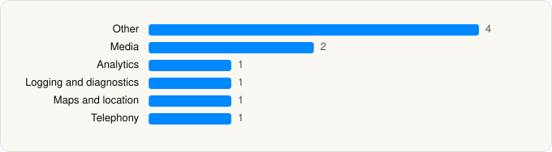

<picture><source media="(prefers-color-scheme: dark)" srcset="../../../../assets/logo/logo-dark.svg"></picture> [Tech Stack](../../../../README.md) / [Instagram, Inc.](../../../../companies/instagram-inc.md) / Threads

# Threads

<picture><source media="(prefers-color-scheme: dark)" srcset="../../../../assets/badges/ios-dark.svg"></picture> <picture><source media="(prefers-color-scheme: dark)" srcset="../../../../assets/badges/active-dark.svg"></picture> <picture><source media="(prefers-color-scheme: dark)" srcset="../../../../assets/badges/floor-dark.svg"></picture> <picture><source media="(prefers-color-scheme: dark)" srcset="../../../../assets/badges/encrypted-dark.svg"></picture>

[App Store](https://apps.apple.com/app/id6446901002) · [latest.json](latest.json)

| | |
|---|---|
| Company | [Instagram, Inc.](../../../../companies/instagram-inc.md) |
| Store id | `6446901002` |
| Bundle / package id | `com.burbn.barcelona` |
| Latest version | 452.1.0 (analysed 2026-10-23) |
| Versions tracked | 2 |
| SDKs in latest version | 10 |
| Languages | C/C++, Metal (shaders), Objective-C, Swift |
| UI | SwiftUI, UIKit |
| Build | Unknown / Xcode native |
| Minimum OS | iOS 16.3 (built with Xcode 27.1, SDK iphoneos27.1) |
| Devices / ABIs | iPhone |
| Localisations | 35 |
| Capabilities | 8 |
| Declares tracking | No |
| Tracked | Yes |

## SDKs by category

<picture><source media="(prefers-color-scheme: dark)" srcset="../../../../assets/charts/apps/ios/instagram-inc/threads-dark.svg"></picture>

- **Other** (4): BCNBasketballGameSounds, BCNGemAwardSounds, BCNRefreshSounds, IGDrawKit
- **Media** (2): libavcodec 1.0, libavutil 1.0
- **Analytics** (1): Facebook SDK
- **Logging and diagnostics** (1): FBBrowserIntegrityLoggingKit
- **Maps and location** (1): Mapbox
- **Telephony** (1): libPhoneNumber

Frameworks (43)

ActivityKit (Live Activities), AdServices (Apple Search Ads attribution), AdSupport (IDFA), App Intents, App Tracking Transparency (ATT), ARKit, Authentication Services (Sign in with Apple / passkeys), AVFoundation (audio/video), AVKit, Background Tasks, CallKit (VoIP), CloudKit, Combine (reactive), Contacts, Core Image, Core Location, Core ML, Core Motion, Core NFC, CryptoKit, DeviceCheck / App Attest, EventKit (Calendar / Reminders), Local Authentication (Face ID / Touch ID), MapKit, Media Player, MessageUI (mail / SMS compose), MetalKit, MetricKit (diagnostics), Natural Language, Network.framework, PassKit (Wallet / Apple Pay), Photos, PhotosUI, SafariServices, SceneKit, SiriKit (Intents), StoreKit (in-app purchase), Swift Charts, SwiftUI, UIKit, User Notifications, Vision, WidgetKit (widgets)

Capabilities (8)

App Groups, Associated Domains (Universal Links), Background App Refresh, Background Push, Communication Notifications, Keychain Sharing, Push Notifications (APNs), Time-Sensitive Notifications

## Version history

| Version | Analysed | Store update | SDKs | Change | SDK list is a floor | Binary encrypted | File |
|---|---|---|---|---|---|---|---|
| 452.1.0 | 2026-10-23 |  | 10 | +3 / −0 | Yes | Yes | [452.1.0.json](452.1.0.json) |
| 432.1.0 | 2026-06-23 |  | 7 |  | Yes | Yes | [432.1.0.json](432.1.0.json) |

### SDK changes between versions

- 432.1.0 → 452.1.0: added BCNGemAwardSounds, BCNRefreshSounds, Mapbox

---

Generated by `scripts/build_readme.py` from the JSON files. Do not edit by hand.
