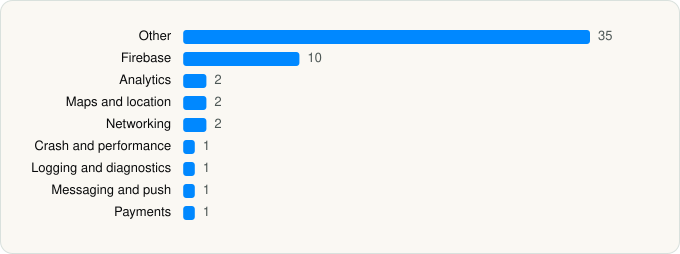

<picture><source media="(prefers-color-scheme: dark)" srcset="../../../../assets/logo/logo-dark.svg"></picture> [Tech Stack](../../../../README.md) / [JETSHR LTDA](../../../../companies/jetshr-ltda.md) / Go JET Rent Scooters

# Go JET Rent Scooters

<picture><source media="(prefers-color-scheme: dark)" srcset="../../../../assets/badges/ios-dark.svg"></picture> <picture><source media="(prefers-color-scheme: dark)" srcset="../../../../assets/badges/inactive-dark.svg"></picture> <picture><source media="(prefers-color-scheme: dark)" srcset="../../../../assets/badges/floor-dark.svg"></picture> <picture><source media="(prefers-color-scheme: dark)" srcset="../../../../assets/badges/encrypted-dark.svg"></picture>

[App Store](https://apps.apple.com/app/id6747077366) · [latest.json](latest.json)

| | |
|---|---|
| Company | [JETSHR LTDA](../../../../companies/jetshr-ltda.md) |
| Store id | `6747077366` |
| Bundle / package id | `com.gojet.app` |
| Latest version | 1.3.38 (analysed 2026-11-22) |
| Versions tracked | 1 |
| SDKs in latest version | 55 |
| Languages | C/C++, Flutter / Dart, Metal (shaders), Objective-C, Swift |
| UI | SwiftUI, UIKit |
| Build | Swift Package Manager (SwiftPM) |
| Minimum OS | iOS 16.1 (built with Xcode 26.6, SDK iphoneos26.5) |
| Devices / ABIs | iPhone, iPad |
| Localisations | 0 |
| Capabilities | 7 |
| Declares tracking | Yes |
| Tracked | No. Kept for history. |

## SDKs by category

<picture><source media="(prefers-color-scheme: dark)" srcset="../../../../assets/charts/apps/ios/jetshr-ltda/go-jet-rent-scooters-dark.svg"></picture>

- **Other** (35): activities 0.0.1, apple 1.2.0, avfoundation 0.0.1, c 1.0, darwin 10.0.0, directory 0.0.1, feedback 0.5.1, Flutter 1.0, foundation 0.0.1, light 0.0.1, links 7.0.0, messaging 3.1.0, orientation 0.0.1, patrol 0.0.1, plus 0.0.1, PushwooshBridge 7.2.8, PushwooshCore 7.2.8, PushwooshFramework 7.2.8, PushwooshInApp 7.2.8, PushwooshLiveActivities 7.2.8, review 2.0.0, scanner 7.0.0, sensor 0.0.1, task 0.0.1, test 0.0.1, wkwebview 0.0.1, ZendeskSDK 3.14.1, ZendeskSDKConversationKit 13.1.1, ZendeskSDKCoreUtilities 1.0, ZendeskSDKFayeClient 1.15.0, ZendeskSDKGuideKit 1.0, ZendeskSDKHTTPClient 0.20.1, ZendeskSDKMessaging 2.36.1, ZendeskSDKStorage 1.4.0, ZendeskSDKUIComponents 14.1.0
- **Firebase** (10): AppCheck 11.2.0, FBLPromises 2.4.0, Firebase 16.2.2, FirebaseAppCheck 12.13.0, FirebaseCore 12.13.0, FirebaseCoreInternal 12.13.0, FirebaseInstallations 12.13.0, GoogleDataTransport 10.1.0, GoogleUtilities 8.1.0, nanopb 3.30910.0
- **Analytics** (2): AppsFlyerLib 6.18.0, ZendeskSDKAnalyticsKit 1.0
- **Maps and location** (2): GMSCore 25.0.0, GoogleMaps 9.4.0
- **Networking** (2): CocoaAsyncSocket 7.6.5, ZendeskSDKSocketClient 1.13.0
- **Crash and performance** (1): Sentry 8.58.2
- **Logging and diagnostics** (1): ZendeskSDKLogger 0.11.0
- **Messaging and push** (1): FirebaseMessaging 12.13.0
- **Payments** (1): Stripe 25.9.0

Frameworks (28)

ActivityKit (Live Activities), App Tracking Transparency (ATT), Authentication Services (Sign in with Apple / passkeys), AVFoundation (audio/video), Background Tasks, Combine (reactive), Contacts, Core Data, Core Image, Core Location, Core Motion, CryptoKit, DeviceCheck / App Attest, Local Authentication (Face ID / Touch ID), MapKit, MetricKit (diagnostics), Network.framework, PassKit (Wallet / Apple Pay), PDFKit, Photos, PhotosUI, SafariServices, StoreKit (in-app purchase), SwiftUI, UIKit, User Notifications, Vision, WidgetKit (widgets)

Capabilities (7)

App Attest, App Groups, Apple Pay, Associated Domains (Universal Links), Background App Refresh, Background Push, Push Notifications (APNs)

## Version history

| Version | Analysed | Store update | SDKs | Change | SDK list is a floor | Binary encrypted | File |
|---|---|---|---|---|---|---|---|
| 1.3.38 | 2026-11-22 |  | 55 |  | Yes | Yes | [1.3.38.json](1.3.38.json) |

---

Generated by `scripts/build_readme.py` from the JSON files. Do not edit by hand.
