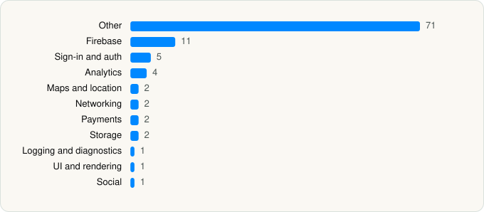

<picture><source media="(prefers-color-scheme: dark)" srcset="../../../../assets/logo/logo-dark.svg"></picture> [Tech Stack](../../../../README.md) / [Joybuy](../../../../companies/joybuy.md) / Joybuy-Don't just buy, Joybuy!

# Joybuy-Don't just buy, Joybuy!

<picture><source media="(prefers-color-scheme: dark)" srcset="../../../../assets/badges/ios-dark.svg"></picture> <picture><source media="(prefers-color-scheme: dark)" srcset="../../../../assets/badges/inactive-dark.svg"></picture> <picture><source media="(prefers-color-scheme: dark)" srcset="../../../../assets/badges/floor-dark.svg"></picture> <picture><source media="(prefers-color-scheme: dark)" srcset="../../../../assets/badges/encrypted-dark.svg"></picture>

[App Store](https://apps.apple.com/app/id6740224837) · [latest.json](latest.json)

| | |
|---|---|
| Company | [Joybuy](../../../../companies/joybuy.md) |
| Store id | `6740224837` |
| Bundle / package id | `com.joybuy.jd` |
| Latest version | 1.1.6 (analysed 2026-11-18) |
| Versions tracked | 1 |
| SDKs in latest version | 102 |
| Languages | C/C++, Metal (shaders), Objective-C, Swift |
| UI | Lottie (animations), SwiftUI, UIKit |
| Build | Swift Package Manager (SwiftPM) |
| Minimum OS | iOS 15.0 (built with Xcode 27.1, SDK iphoneos27.1) |
| Devices / ABIs | iPhone, iPad |
| Localisations | 6 |
| Capabilities | 6 |
| Declares tracking | Yes |
| Tracked | No. Kept for history. |

## SDKs by category

<picture><source media="(prefers-color-scheme: dark)" srcset="../../../../assets/charts/apps/ios/joybuy/joybuy-don-t-just-buy-joybuy-dark.svg"></picture>

- **Other** (71): ClientSecurityKit 1.7.2, CryptoLib, DataIni, de, DefaultCountryData, DefaultSiteWebUrlData, dongworker 2.32.0, fr, ISVJHCMSModule 1.1.35, JDBTalosModule, JDBUnionModule, jdcnLAPolicyAuth 0.4.0, JDGuard, JDIContentModule 1.0.0, JDIHappyHourModule 1.0.0, JDIMediaPickerModule 1.0.0, JDIMessageBoxModule 1.0.1, JDIRecommendModule 0.0.1, JDIShopModule 1.0.0, JDISVAddressModule 1.0.23, JDISVBrowseHistoryModule 1.1.2, JDISVCategoryModule 1.2.7, JDISVCouponSDKModule 1.0.12, JDISVFavoriteModule 1.4.11, JDISVHomeModule, JDISVKAAfterSaleModule 1.1.18, JDISVKAIconFontModule 1.2.18, JDISVKAUIKitModule 1.1.22, JDISVKAUserCenterModule 1.0.29, JDISVOrderDetailSDKModule 1.0.24, JDISVOrderListSDKModule 1.0.16, JDISVProductCategoryModule 1.0.5, JDISVProductDetailSDKModule 1.50.34, JDISVSearchModule 1.15.18, JDISVSettlementModule 1.0.50, JDISVShoppingCartSDKModule 1.2.30, JDISVThemeModule 1.0.2, JDISVUIKitModule 1.0.4, JDITNComponentModule 0.1.0, JDMediaMakerModule 1.0.0, JDMMFilter, JDThreeDProductModule 3.1.92, JDTSDWebImageModule, KlarnaCore 2.12.0, KlarnaCoreWebView 2.12.0, KlarnaMobileSDK 2.12.0, Legolas, LocalRes, Money 1.0.0, nl, Pandora 1.0.0, RevolutPayCoreSDK 1.0.0, RevolutPayLiteSDK 1.0.0, Sam, ThingMbedtls 3.6.5, ThingOpenSSLSDK 1.1.1, ThingSmartCryption, ThingSmartUtil, TNInternalTemplates, ZendeskSDK 3.5.0, ZendeskSDKConversationKit 9.0.0, ZendeskSDKCoreUtilities 1.0, ZendeskSDKFayeClient 1.10.0, ZendeskSDKGuideKit 1.0, ZendeskSDKHTTPClient 0.17.0, ZendeskSDKMessaging 2.27.0, ZendeskSDKStorage 1.1.0, ZendeskSDKUIComponents 11.0.0, zh-Hans 1.15.18, zh-Hant 3.1.92, Zode
- **Firebase** (11): FBLPromises 2.4.0, Firebase 11.15.0, FirebaseCore 11.15.0, FirebaseCoreInternal 11.15.0, FirebaseInstallations 11.15.0, FirebaseRemoteConfig 11.15.0, GoogleDataTransport 10.1.1, GoogleUtilities 8.1.0, leveldb 1.22.6, nanopb 3.30910.0, Promises 2.4.0
- **Sign-in and auth** (5): AppAuth 1.7.6, FBSDKLoginKit 1.0, GoogleSignIn 7.0.0, GTMSessionFetcher 3.5.0, JDILoginModule 1.0.0
- **Analytics** (4): AppsFlyerLib 6.17.7, Facebook SDK, FBAEMKit 1.0, FBSDKCoreKit 1.0
- **Maps and location** (2): GMSCore 6.86.0, GoogleMaps 8.3.1
- **Networking** (2): JDTAFNetworkingModule 2.0.12, ZendeskSDKSocketClient 1.9.0
- **Payments** (2): KlarnaPayments 2.12.0, RevolutPaymentsCoreSDK 1.0.0
- **Storage** (2): JDICommonFloorModule 1.0.0, JDISVPlatformModule 1.1.31
- **Logging and diagnostics** (1): ZendeskSDKLogger 0.10.0
- **UI and rendering** (1): JDTLottieModule
- **Social** (1): FBSDKShareKit 1.0

Frameworks (35)

ActivityKit (Live Activities), AdSupport (IDFA), App Intents, App Tracking Transparency (ATT), Authentication Services (Sign in with Apple / passkeys), AVFoundation (audio/video), AVKit, Combine (reactive), Contacts, Core Bluetooth, Core Data, Core Image, Core Location, Core Motion, CryptoKit, EventKit (Calendar / Reminders), Local Authentication (Face ID / Touch ID), MapKit, Media Player, MessageUI (mail / SMS compose), MetricKit (diagnostics), Network.framework, PassKit (Wallet / Apple Pay), Photos, PhotosUI, PushKit (VoIP push), SafariServices, SiriKit (Intents), Speech (recognition), StoreKit (in-app purchase), SwiftUI, UIKit, User Notifications, Vision, WidgetKit (widgets)

Capabilities (6)

App Groups, Apple Pay, Associated Domains (Universal Links), Background Push, Push Notifications (APNs), Sign in with Apple

## Version history

| Version | Analysed | Store update | SDKs | Change | SDK list is a floor | Binary encrypted | File |
|---|---|---|---|---|---|---|---|
| 1.1.6 | 2026-11-18 |  | 102 |  | Yes | Yes | [1.1.6.json](1.1.6.json) |

---

Generated by `scripts/build_readme.py` from the JSON files. Do not edit by hand.
