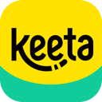
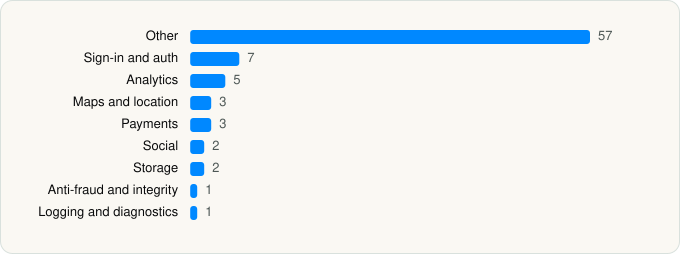

<picture><source media="(prefers-color-scheme: dark)" srcset="../../../../assets/logo/logo-dark.svg"></picture> [Tech Stack](../../../../README.md) / [Kangaroo Limited](../../../../companies/kangaroo-limited.md) / Keeta

# Keeta - Food Delivery

<picture><source media="(prefers-color-scheme: dark)" srcset="../../../../assets/badges/ios-dark.svg"></picture> <picture><source media="(prefers-color-scheme: dark)" srcset="../../../../assets/badges/inactive-dark.svg"></picture> <picture><source media="(prefers-color-scheme: dark)" srcset="../../../../assets/badges/floor-dark.svg"></picture> <picture><source media="(prefers-color-scheme: dark)" srcset="../../../../assets/badges/encrypted-dark.svg"></picture>

[App Store](https://apps.apple.com/app/id1662451643) · [latest.json](latest.json)

| | |
|---|---|
| Company | [Kangaroo Limited](../../../../companies/kangaroo-limited.md) |
| Store id | `1662451643` |
| Bundle / package id | `com.sankuai.sailor.ifooddelivery` |
| Latest version | 3.14.200 (analysed 2026-11-21) |
| Versions tracked | 1 |
| SDKs in latest version | 81 |
| Languages | C/C++, Metal (shaders), Objective-C, Swift |
| UI | SwiftUI, UIKit |
| Build | Swift Package Manager (SwiftPM) |
| Minimum OS | iOS 13.0 (built with Xcode 26.1.1, SDK iphoneos26.1) |
| Devices / ABIs | iPhone |
| Localisations | 5 |
| Capabilities | 8 |
| Declares tracking | Yes |
| Tracked | No. Kept for history. |

## SDKs by category

<picture><source media="(prefers-color-scheme: dark)" srcset="../../../../assets/charts/apps/ios/kangaroo-limited/keeta-dark.svg"></picture>

- **Other** (57): AssetsImages 3.14.200, BenefitInAppSDK 1.0.4, CIPFoundation 1.12.67, CIPPrivacy 0.0.101, CIPStorage 1.9.20, CIPTestFlightKit 1.3.4, DDDPreset, DeviceProfiling 1.0, EdfuCore 2.3.7, EdfuMBar 1.34.2, EdfuQRCodeScanner 0.0.9, facedetection 0.1.4, facetec 10.0.22, FaceTecSDK 10.0.22, GPBankCardOCR 5.0.0, IMSDKI18n 0.0.6, KNBCoreResoures 1.4.50, KSI 3.14.200, KwaiMediaPlayer 4.9.7, Minimalist, MJRefresh, MTDMapKitLibrary 4.1218.3, MTDMapRenderSDK 1.1218.501, MTDXLocalization, MTGoogleMapAdaptor 4.1218.0, MTMapFoundationKit 4.1218.1, MTMapKit 4.1218.3, MushroomNail 2.0.22, Plus 8.8.7357, SailorCompass 3.13.400, SailorDiscoveryI18n 3.14.200, SailorI18nBundles 1.3.506, SailorPromotionTikTokPrivacy 3.14.200, SailorTheme 3.14.200, SailorTransactionI18n 3.12.502, SAKGuard 5.21.10, SAKLiveActivityKit 1.2.13, SAKPickup 2.0.47, SAKPickupKit 3.0.6, SAKRecce, SAKUIKit 4.3.14, ShieldPtr 1.0, SLDXLocalization, SLLiveActivityKit 3.13.400, SOACommon 0.3.65, TIMPush 8.8.7375, TitansWidget 0.4.7, TRTC 12.9.20089, TUICore, TUICoreTheme, TXFFmpeg 1.0, TXSoundTouch 1.0, unicocheck-ios 2.24.2, UnicoSdkBase 1.0.0, UnicoSdkPlugins 1.0, USDK 1.0, Yoda 1.15.9
- **Sign-in and auth** (7): AcessoBio 2.2.1, AppAuth 1.6.0, Facebook Login, FBSDKLoginKit 1.0, GoogleSignIn 6.2.4, GTMAppAuth 2.0.0, GTMSessionFetcher 2.3.0
- **Analytics** (5): Adjust 5.7.0, Facebook SDK, FBAEMKit 1.0, FBSDKCoreKit 1.0, SCSDKCoreKit 2.5.0
- **Maps and location** (3): GMSCore 5.70.0, GoogleMaps 5.1.0, Mapbox
- **Payments** (3): MTICPaymentLauncher 5.4.0, MTICPaymentService 5.2.0, MTICPaymentServiceI18n 5.2.0
- **Social** (2): FBSDKShareKit 1.0, SCSDKCreativeKit 2.5.0
- **Storage** (2): SLPlatformI18n 3.14.200, SLSwiftInfraPlatform 3.6.300
- **Anti-fraud and integrity** (1): UnicoSdkLiveness 1.0
- **Logging and diagnostics** (1): UnicoSdkLogger 1.0

Frameworks (36)

ActivityKit (Live Activities), AdServices (Apple Search Ads attribution), AdSupport (IDFA), App Tracking Transparency (ATT), Authentication Services (Sign in with Apple / passkeys), AVFoundation (audio/video), AVKit, CloudKit, Contacts, Core Bluetooth, Core Data, Core Image, Core Location, Core ML, Core Motion, Core NFC, DeviceCheck / App Attest, EventKit (Calendar / Reminders), Local Authentication (Face ID / Touch ID), MapKit, Media Player, MessageUI (mail / SMS compose), MetalKit, MetricKit (diagnostics), Network.framework, PassKit (Wallet / Apple Pay), Photos, PhotosUI, PushKit (VoIP push), SafariServices, StoreKit (in-app purchase), SwiftUI, UIKit, User Notifications, Vision, WidgetKit (widgets)

Capabilities (8)

App Groups, Apple Pay, Associated Domains (Universal Links), Background Push, Keychain Sharing, Push Notifications (APNs), Sign in with Apple, VoIP

## Version history

| Version | Analysed | Store update | SDKs | Change | SDK list is a floor | Binary encrypted | File |
|---|---|---|---|---|---|---|---|
| 3.14.200 | 2026-11-21 |  | 81 |  | Yes | Yes | [3.14.200.json](3.14.200.json) |

---

Generated by `scripts/build_readme.py` from the JSON files. Do not edit by hand.
