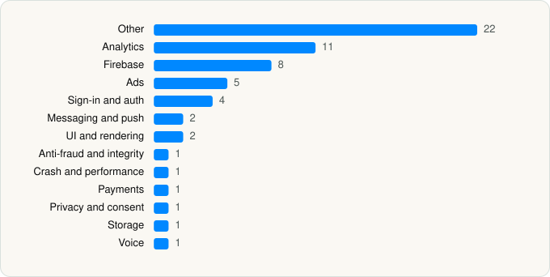

<picture><source media="(prefers-color-scheme: dark)" srcset="../../../../assets/logo/logo-dark.svg"></picture> [Tech Stack](../../../../README.md) / [Knowunity GmbH](../../../../companies/knowunity-gmbh.md) / Knowunity

# Knowunity: AI Revision App

<picture><source media="(prefers-color-scheme: dark)" srcset="../../../../assets/badges/ios-dark.svg"></picture> <picture><source media="(prefers-color-scheme: dark)" srcset="../../../../assets/badges/inactive-dark.svg"></picture> <picture><source media="(prefers-color-scheme: dark)" srcset="../../../../assets/badges/floor-dark.svg"></picture> <picture><source media="(prefers-color-scheme: dark)" srcset="../../../../assets/badges/encrypted-dark.svg"></picture>

[App Store](https://apps.apple.com/app/id1484296272) · [latest.json](latest.json)

| | |
|---|---|
| Company | [Knowunity GmbH](../../../../companies/knowunity-gmbh.md) |
| Store id | `1484296272` |
| Bundle / package id | `de.knowunity.app` |
| Latest version | 6.47.1 (analysed 2026-11-19) |
| Versions tracked | 1 |
| SDKs in latest version | 61 |
| Languages | C/C++, Flutter / Dart, Objective-C, Swift |
| UI | SwiftUI, UIKit |
| Build | Swift Package Manager (SwiftPM) |
| Minimum OS | iOS 15.5 (built with Xcode 27.0, SDK iphoneos27.0) |
| Devices / ABIs | iPhone, iPad |
| Localisations | 25 |
| Capabilities | 12 |
| Declares tracking | Yes |
| Tracked | No. Kept for history. |

## SDKs by category

<picture><source media="(prefers-color-scheme: dark)" srcset="../../../../assets/charts/apps/ios/knowunity-gmbh/knowunity-dark.svg"></picture>

- **Other** (22): ads, apple, avfoundation, c 1.0, calendar, contacts, darwin, FacebookBasics, Flutter 1.0, foundation, gal, gate 1.0, http 1.0, IronSource 9.7.0, IronSourceAdapter 9.7.0, links, MetaAdapter 6.22.0, plus, review, simulator, vibration, wkwebview
- **Analytics** (11): Adjust 1.0, AdjustSdk, BrazeKit 18.2.1, BrazeLocation 18.2.1, FacebookAEM, FacebookCore, FBAEMKit 1.0, FBSDKCoreKit 1.0, FirebaseAnalytics 13.0.1, GoogleAppMeasurement 13.0.1, GoogleAppMeasurementIdentitySupport 13.0.1
- **Firebase** (8): FBLPromises, Firebase, FirebaseCore, FirebaseCoreInternal, FirebaseInstallations, GoogleDataTransport, GoogleUtilities, nanopb
- **Ads** (5): AppLovin 13.6.4, FBAudienceNetwork 1.0, Google Mobile Ads (AdMob), GoogleAdsOnDeviceConversion 3.7.0, GoogleMobileAds 13.11.0
- **Sign-in and auth** (4): AppAuth, GoogleSignIn, GTMAppAuth, GTMSessionFetcher
- **Messaging and push** (2): BrazeUI, FirebaseMessaging
- **UI and rendering** (2): PDFium 158.0.8125, SDWebImage
- **Anti-fraud and integrity** (1): RecaptchaEnterprise 1.0
- **Crash and performance** (1): Sentry 9.32.0
- **Payments** (1): RevenueCat
- **Privacy and consent** (1): UserMessagingPlatform 3.1.0
- **Storage** (1): SQLite
- **Voice** (1): WebRTC 1.0

Frameworks (39)

ActivityKit (Live Activities), AdServices (Apple Search Ads attribution), AdSupport (IDFA), App Intents, App Tracking Transparency (ATT), Authentication Services (Sign in with Apple / passkeys), AVFoundation (audio/video), AVKit, Background Tasks, Combine (reactive), Contacts, Core Data, Core Image, Core Location, Core ML, Core Motion, CryptoKit, DeviceCheck / App Attest, EventKit (Calendar / Reminders), Family Controls / Screen Time, Local Authentication (Face ID / Touch ID), Media Player, MessageUI (mail / SMS compose), MetalKit, MetricKit (diagnostics), Network.framework, PDFKit, Photos, PhotosUI, SafariServices, SiriKit (Intents), Speech (recognition), StoreKit (in-app purchase), SwiftUI, UIKit, User Notifications, Vision, VisionKit (document/data scanning), WidgetKit (widgets)

Capabilities (12)

App Attest, App Groups, Associated Domains (Universal Links), Background App Refresh, Background Audio, Background Processing, Background Push, Family Controls / Screen Time, Keychain Sharing, Push Notifications (APNs), Sign in with Apple, VoIP

## Version history

| Version | Analysed | Store update | SDKs | Change | SDK list is a floor | Binary encrypted | File |
|---|---|---|---|---|---|---|---|
| 6.47.1 | 2026-11-19 |  | 61 |  | Yes | Yes | [6.47.1.json](6.47.1.json) |

---

Generated by `scripts/build_readme.py` from the JSON files. Do not edit by hand.
