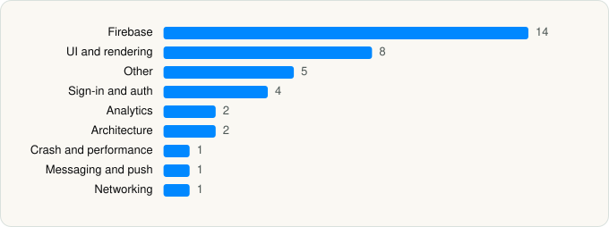

<picture><source media="(prefers-color-scheme: dark)" srcset="../../../../assets/logo/logo-dark.svg"></picture> [Tech Stack](../../../../README.md) / [Koupon Inc.](../../../../companies/koupon-inc.md) / Koupon

# Koupon: Vouchers & Discounts

<picture><source media="(prefers-color-scheme: dark)" srcset="../../../../assets/badges/ios-dark.svg"></picture> <picture><source media="(prefers-color-scheme: dark)" srcset="../../../../assets/badges/inactive-dark.svg"></picture> <picture><source media="(prefers-color-scheme: dark)" srcset="../../../../assets/badges/floor-dark.svg"></picture> <picture><source media="(prefers-color-scheme: dark)" srcset="../../../../assets/badges/encrypted-dark.svg"></picture>

[App Store](https://apps.apple.com/app/id6472232952) · [latest.json](latest.json)

| | |
|---|---|
| Company | [Koupon Inc.](../../../../companies/koupon-inc.md) |
| Store id | `6472232952` |
| Bundle / package id | `sto.koupon` |
| Latest version | 3.1.4 (analysed 2026-11-04) |
| Versions tracked | 1 |
| SDKs in latest version | 38 |
| Languages | C/C++, Metal (shaders), Objective-C, React Native / JavaScript, Swift |
| UI | Lottie (animations), SwiftUI, UIKit |
| Build | Swift Package Manager (SwiftPM) |
| Minimum OS | iOS 15.0 (built with Xcode 26.3, SDK iphoneos26.2) |
| Devices / ABIs | iPhone |
| Localisations | 0 |
| Capabilities | 4 |
| Declares tracking | Yes |
| Tracked | No. Kept for history. |

## SDKs by category

<picture><source media="(prefers-color-scheme: dark)" srcset="../../../../assets/charts/apps/ios/koupon-inc/koupon-dark.svg"></picture>

- **Firebase** (14): FBLPromises 2.4.1, Firebase 12.15.0, FirebaseAuth 12.15.0, FirebaseCore 12.15.0, FirebaseCoreInternal 12.15.0, FirebaseFirestore 12.15.0, FirebaseInstallations 12.15.0, FirebaseRemoteConfig 12.15.0, GoogleDataTransport 10.1.0, GoogleUtilities 8.1.2, gRPC, leveldb 1.22.6, nanopb 3.30910.0, Promises 2.4.1
- **UI and rendering** (8): FlashList, hermes 0.12.0, Lottie 4.6.0, React Native, React Native Reanimated, react-native-svg, RNSVGFilters 15.15.5, SDWebImage 5.21.7
- **Other** (5): dayjs, Lodash, Moment.js, RNDeviceInfoPrivacyInfo 14.1.1, xcprivacy 1.20240722.0
- **Sign-in and auth** (4): AppAuth 2.1.0, GoogleSignIn 9.2.0, GTMAppAuth 5.0.0, GTMSessionFetcher 3.5.0
- **Analytics** (2): Amplitude, AppsFlyerLib 6.18.0
- **Architecture** (2): CodePush, React Navigation
- **Crash and performance** (1): FirebaseCrashlytics 12.15.0
- **Messaging and push** (1): FirebaseMessaging 12.15.0
- **Networking** (1): Axios

Frameworks (19)

AdSupport (IDFA), Authentication Services (Sign in with Apple / passkeys), AVFoundation (audio/video), AVKit, Combine (reactive), Core Image, Core Location, Core Motion, DeviceCheck / App Attest, Local Authentication (Face ID / Touch ID), Media Player, MetricKit (diagnostics), Network.framework, Photos, SafariServices, StoreKit (in-app purchase), SwiftUI, UIKit, User Notifications

Capabilities (4)

Associated Domains (Universal Links), Background Push, Push Notifications (APNs), Sign in with Apple

## Version history

| Version | Analysed | Store update | SDKs | Change | SDK list is a floor | Binary encrypted | File |
|---|---|---|---|---|---|---|---|
| 3.1.4 | 2026-11-04 | 2026-10-30 | 38 |  | Yes | Yes | [3.1.4.json](3.1.4.json) |

---

Generated by `scripts/build_readme.py` from the JSON files. Do not edit by hand.
