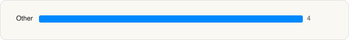

<picture><source media="(prefers-color-scheme: dark)" srcset="../../../../assets/logo/logo-dark.svg"></picture> [Tech Stack](../../../../README.md) / [Kraftfahrt-Bundesamt](../../../../companies/kraftfahrt-bundesamt.md) / i-Kfz

# i-Kfz

<picture><source media="(prefers-color-scheme: dark)" srcset="../../../../assets/badges/ios-dark.svg"></picture> <picture><source media="(prefers-color-scheme: dark)" srcset="../../../../assets/badges/inactive-dark.svg"></picture> <picture><source media="(prefers-color-scheme: dark)" srcset="../../../../assets/badges/floor-dark.svg"></picture> <picture><source media="(prefers-color-scheme: dark)" srcset="../../../../assets/badges/encrypted-dark.svg"></picture>

[App Store](https://apps.apple.com/app/id6742321547) · [latest.json](latest.json)

| | |
|---|---|
| Company | [Kraftfahrt-Bundesamt](../../../../companies/kraftfahrt-bundesamt.md) |
| Store id | `6742321547` |
| Bundle / package id | `de.kba.ikfz` |
| Latest version | 1.1.8 (analysed 2026-11-05) |
| Versions tracked | 1 |
| SDKs in latest version | 4 |
| Languages | C/C++, Objective-C, Swift |
| UI | SwiftUI, UIKit |
| Build | Swift Package Manager (SwiftPM) |
| Minimum OS | iOS 17.0 (built with Xcode 27.0, SDK iphoneos27.0) |
| Devices / ABIs | iPhone |
| Localisations | 2 |
| Capabilities | 2 |
| Declares tracking | No |
| Tracked | No. Kept for history. |

## SDKs by category

<picture><source media="(prefers-color-scheme: dark)" srcset="../../../../assets/charts/apps/ios/kraftfahrt-bundesamt/i-kfz-dark.svg"></picture>

- **Other** (4): AusweisApp2 2.3.2, AusweisApp2SDKWrapper 1.0, DocumentSecurity, LifetimeTracker

Frameworks (13)

AVFoundation (audio/video), Combine (reactive), Core Bluetooth, Core Image, Core NFC, CryptoKit, DeviceCheck / App Attest, Local Authentication (Face ID / Touch ID), MessageUI (mail / SMS compose), Network.framework, StoreKit (in-app purchase), SwiftUI, UIKit

Capabilities (2)

Associated Domains (Universal Links), NFC

## Version history

| Version | Analysed | Store update | SDKs | Change | SDK list is a floor | Binary encrypted | File |
|---|---|---|---|---|---|---|---|
| 1.1.8 | 2026-11-05 | 2026-09-29 | 4 |  | Yes | Yes | [1.1.8.json](1.1.8.json) |

---

Generated by `scripts/build_readme.py` from the JSON files. Do not edit by hand.
