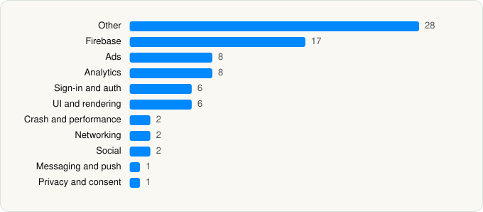

<picture><source media="(prefers-color-scheme: dark)" srcset="../../../../assets/logo/logo-dark.svg"></picture> [Tech Stack](../../../../README.md) / [Kuku Technologies Limited](../../../../companies/kuku-technologies-limited.md) / FreeDrama

# FreeDrama: Watch Short Stories

<picture><source media="(prefers-color-scheme: dark)" srcset="../../../../assets/badges/ios-dark.svg"></picture> <picture><source media="(prefers-color-scheme: dark)" srcset="../../../../assets/badges/active-dark.svg"></picture> <picture><source media="(prefers-color-scheme: dark)" srcset="../../../../assets/badges/floor-dark.svg"></picture> <picture><source media="(prefers-color-scheme: dark)" srcset="../../../../assets/badges/encrypted-dark.svg"></picture>

[App Store](https://apps.apple.com/app/id6768240254) · [latest.json](latest.json)

| | |
|---|---|
| Company | [Kuku Technologies Limited](../../../../companies/kuku-technologies-limited.md) |
| Store id | `6768240254` |
| Bundle / package id | `com.vlv.kukufm.freedrama` |
| Latest version | 3.8.7 (analysed 2026-11-02) |
| Versions tracked | 1 |
| SDKs in latest version | 81 |
| Languages | C/C++, Objective-C, Swift |
| UI | Lottie (animations), SwiftUI, UIKit |
| Build | Swift Package Manager (SwiftPM) |
| Minimum OS | iOS 17.6 (built with Xcode 27.1, SDK iphoneos27.1) |
| Devices / ABIs | iPhone, iPad |
| Localisations | 3 |
| Capabilities | 7 |
| Declares tracking | Yes |
| Tracked | Yes |

## SDKs by category

<picture><source media="(prefers-color-scheme: dark)" srcset="../../../../assets/charts/apps/ios/kuku-technologies-limited/freedrama-dark.svg"></picture>

- **Other** (28): absl 1.20240116.2, abslWrapper, AdsGlobalPackage, DatePickerDialog 4.0.0, DropDown 2.3.13, DTExchangeAdapter 8.4.8, FloatRatingView 4.0.0, IASDKCore 8.4.8, InMobiAdapter 11.4.0, KDCircularProgress 1.5.4, LiftoffMonetizeAdapter 7.7.5, MetaAdapter 6.21.1, MintegralAdapter 8.1.5, MintegralAdSDK, MolocoAdapter 1.0, MTGSDK 1.0, MTGSDKBanner 1.0, MTGSDKBidding 1.0, MTGSDKNativeAdvanced 1.0, MTGSDKReward 1.0, MTGSDKSplash 1.0, opensslWrapper, PAGAdSDK 8.2.7, PangleAdapter 8.2.0, PremiumAdsGoogleAdapter, UnityAdapter 4.19.0, UnityAds 1.0, VungleAdsSDK 1.0
- **Firebase** (17): abseil, AppCheck 11.2.0, FBLPromises, Firebase, FirebaseAuth, FirebaseCore, FirebaseCoreInternal, FirebaseDynamicLinks, FirebaseFirestore, FirebaseInstallations, FirebaseRemoteConfig, GoogleDataTransport, GoogleUtilities 8.1.0, gRPC, leveldb, nanopb, Promises
- **Ads** (8): AppLovin 13.6.3, FBAudienceNetwork 1.0, Google Mobile Ads (AdMob), GoogleMobileAds 13.7.0, InMobiSDK 11.4.0, MolocoSDK 4.8.1, MTGSDKInterstitialVideo 1.0, MTGSDKNewInterstitial 1.0
- **Analytics** (8): AppsFlyerLib 1.0, FacebookAEM, FacebookCore, FBAEMKit 1.0, FBSDKCoreKit 1.0, FirebaseAnalytics 10.28.0, GoogleAppMeasurement 10.28.0, GoogleAppMeasurementIdentitySupport 10.28.0
- **Sign-in and auth** (6): AppAuth 2.0.0, FacebookLogin, FBSDKLoginKit 1.0, GoogleSignIn 9.0.0, GTMAppAuth 5.0.0, GTMSessionFetcher
- **UI and rendering** (6): DGCharts 5.1.0, DotLottiePlayer 0.1.57, Lottie, MarqueeLabel, SDWebImage, SDWebImageSwiftUI
- **Crash and performance** (2): FirebaseCrashlytics, Sentry 8.49.0
- **Networking** (2): Alamofire 5.10.2, Reachability
- **Social** (2): FacebookShare, FBSDKShareKit 1.0
- **Messaging and push** (1): FirebaseMessaging
- **Privacy and consent** (1): UserMessagingPlatform 3.1.0

Frameworks (32)

ActivityKit (Live Activities), AdSupport (IDFA), App Intents, App Tracking Transparency (ATT), Authentication Services (Sign in with Apple / passkeys), AVFoundation (audio/video), AVKit, Combine (reactive), Core Data, Core Image, Core Location, Core ML, Core Motion, CryptoKit, DeviceCheck / App Attest, Local Authentication (Face ID / Touch ID), Media Player, MessageUI (mail / SMS compose), MetalKit, MetricKit (diagnostics), Network.framework, PassKit (Wallet / Apple Pay), Photos, SafariServices, SiriKit (Intents), Speech (recognition), StoreKit (in-app purchase), Swift Charts, SwiftUI, UIKit, User Notifications, WidgetKit (widgets)

Capabilities (7)

App Groups, Associated Domains (Universal Links), Background App Refresh, Background Audio, Background Push, Push Notifications (APNs), Sign in with Apple

## Version history

| Version | Analysed | Store update | SDKs | Change | SDK list is a floor | Binary encrypted | File |
|---|---|---|---|---|---|---|---|
| 3.8.7 | 2026-11-02 | 2026-10-23 | 81 |  | Yes | Yes | [3.8.7.json](3.8.7.json) |

---

Generated by `scripts/build_readme.py` from the JSON files. Do not edit by hand.
