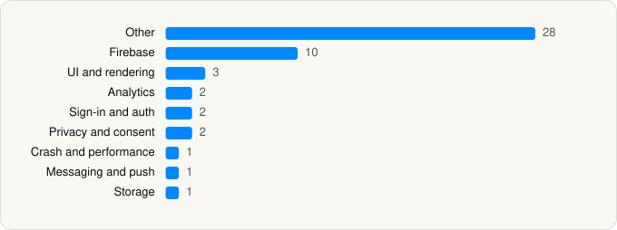

<picture><source media="(prefers-color-scheme: dark)" srcset="../../../../assets/logo/logo-dark.svg"></picture> [Tech Stack](../../../../README.md) / [l'Assurance Maladie](../../../../companies/l-assurance-maladie.md) / Mon espace santé

# Mon espace santé

<picture><source media="(prefers-color-scheme: dark)" srcset="../../../../assets/badges/ios-dark.svg"></picture> <picture><source media="(prefers-color-scheme: dark)" srcset="../../../../assets/badges/inactive-dark.svg"></picture> <picture><source media="(prefers-color-scheme: dark)" srcset="../../../../assets/badges/floor-dark.svg"></picture> <picture><source media="(prefers-color-scheme: dark)" srcset="../../../../assets/badges/encrypted-dark.svg"></picture>

[App Store](https://apps.apple.com/app/id1589255019) · [latest.json](latest.json)

| | |
|---|---|
| Company | [l'Assurance Maladie](../../../../companies/l-assurance-maladie.md) |
| Store id | `1589255019` |
| Bundle / package id | `fr.assurancemaladie.monespacesante` |
| Latest version | 1.46.0 (analysed 2026-11-23) |
| Versions tracked | 1 |
| SDKs in latest version | 51 |
| Languages | C/C++, Flutter / Dart, Objective-C, Swift |
| UI | SwiftUI, UIKit |
| Build | Swift Package Manager (SwiftPM) |
| Minimum OS | iOS 15.0 (built with Xcode 26.3, SDK iphoneos26.2) |
| Devices / ABIs | iPhone |
| Localisations | 1 |
| Capabilities | 5 |
| Declares tracking | No |
| Tracked | No. Kept for history. |

## SDKs by category

<picture><source media="(prefers-color-scheme: dark)" srcset="../../../../assets/charts/apps/ios/l-assurance-maladie/mon-espace-sant-dark.svg"></picture>

- **Other** (28): appExtension, audio 0.0.1, avfoundation 0.0.1, c 1.0, darwin 10.0.0, device 1.0.0, DKImagePickerController 4.3.9, DKPhotoGallery 0.0.19, DTTJailbreakDetection 0.4.0, flutter 0.1.5, foundation 0.0.1, launcher 0.0.1, libwebp 1.6.0, notifications 0.0.1, picker 0.0.1, plugin 0.0.1, plus 0.0.1, proxy 0.0.1, redirect 0.0.1, review 2.0.0, scanner 7.0.0, session 0.0.1, TCCore 1.0, TCPrivacy 1.0, TCSDK 1.0, Tracker 2.23.10, visibility 0.0.1, wkwebview 0.0.1
- **Firebase** (10): FBLPromises 2.4.1, Firebase 12.17.0, FirebaseCore 12.17.0, FirebaseCoreInternal 12.17.0, FirebaseInstallations 12.17.0, FirebaseRemoteConfig 12.17.0, GoogleDataTransport 10.1.1, GoogleUtilities 8.1.2, nanopb 3.30910.0, Promises 2.4.1
- **UI and rendering** (3): PDFium 144.0.7811, SDWebImage 0.15.0, SwiftyGif 5.4.5
- **Analytics** (2): analytics 1.1.2, PianoAnalytics 3.1.11
- **Sign-in and auth** (2): AppAuth 2.1.0, GTMSessionFetcher 3.5.0
- **Privacy and consent** (2): consents 1.0.0, PianoConsents
- **Crash and performance** (1): FirebaseCrashlytics 12.17.0
- **Messaging and push** (1): FirebaseMessaging 12.17.0
- **Storage** (1): GoogleToolboxForMac 4.2.1

Frameworks (25)

Authentication Services (Sign in with Apple / passkeys), AVFoundation (audio/video), AVKit, Combine (reactive), Contacts, Core Data, Core Image, Core Location, Core Motion, CryptoKit, Local Authentication (Face ID / Touch ID), Media Player, MetricKit (diagnostics), Network.framework, PDFKit, Photos, PhotosUI, SafariServices, SiriKit (Intents), StoreKit (in-app purchase), SwiftUI, UIKit, User Notifications, Vision, VisionKit (document/data scanning)

Capabilities (5)

App Groups, Associated Domains (Universal Links), Background App Refresh, Background Push, Push Notifications (APNs)

## Version history

| Version | Analysed | Store update | SDKs | Change | SDK list is a floor | Binary encrypted | File |
|---|---|---|---|---|---|---|---|
| 1.46.0 | 2026-11-23 |  | 51 |  | Yes | Yes | [1.46.0.json](1.46.0.json) |

---

Generated by `scripts/build_readme.py` from the JSON files. Do not edit by hand.
