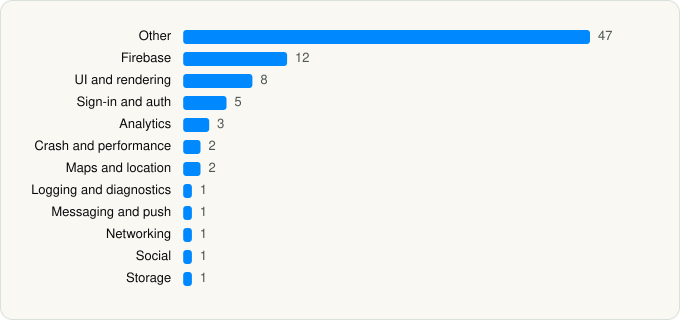

<picture><source media="(prefers-color-scheme: dark)" srcset="../../../../assets/logo/logo-dark.svg"></picture> [Tech Stack](../../../../README.md) / [LIFE HOME HEALTH CARE](../../../../companies/life-home-health-care.md) / LIFE Pharmacy

# LIFE Pharmacy

<picture><source media="(prefers-color-scheme: dark)" srcset="../../../../assets/badges/ios-dark.svg"></picture> <picture><source media="(prefers-color-scheme: dark)" srcset="../../../../assets/badges/inactive-dark.svg"></picture> <picture><source media="(prefers-color-scheme: dark)" srcset="../../../../assets/badges/floor-dark.svg"></picture> <picture><source media="(prefers-color-scheme: dark)" srcset="../../../../assets/badges/encrypted-dark.svg"></picture>

[App Store](https://apps.apple.com/app/id1450835575) · [latest.json](latest.json)

| | |
|---|---|
| Company | [LIFE HOME HEALTH CARE](../../../../companies/life-home-health-care.md) |
| Store id | `1450835575` |
| Bundle / package id | `ae.rhinosme.lifepharmacy` |
| Latest version | 2.9.2 (analysed 2026-11-19) |
| Versions tracked | 1 |
| SDKs in latest version | 84 |
| Languages | C/C++, Kotlin Multiplatform, Metal (shaders), Objective-C, Swift |
| UI | Lottie (animations), SwiftUI, UIKit |
| Build | Swift Package Manager (SwiftPM) |
| Minimum OS | iOS 15 (built with Xcode 27.1, SDK iphoneos27.1) |
| Devices / ABIs | iPhone |
| Localisations | 2 |
| Capabilities | 7 |
| Declares tracking | No |
| Tracked | No. Kept for history. |

## SDKs by category

<picture><source media="(prefers-color-scheme: dark)" srcset="../../../../assets/charts/apps/ios/life-home-health-care/life-pharmacy-dark.svg"></picture>

- **Other** (47): ActiveLabel 1.1.0, ATGValidator 1.5.0, AutoScrollCollectionView 1.0.1, BoltsSwift 1.5.0, Cache 6.0.0, CBPinEntryView 1.7.1, CHIPageControl 0.2.0, Cosmos 25.0.1, CropViewController 2.6.1, DropDown 2.3.13, FBSDKGamingServicesKit 1.0, FSPagerView 0.8.3, GooglePlaces 7.4.0, HorizontalDial 4.0.0, Imaginary 5.0.0, InjectHotReload 1.5.0, InstantSearchInsights 2.3.2, iOSDropDown 0.4.0, IQDropDownTextField 4.0.4, IQKeyboardManager 6.5.19, KMPlaceholderTextView 1.4.0, LGButton 1.1.6, Lightbox 2.5.0, LiveChat 2.0.24, MaterialProgressBar 1.2.0, MPGSDK 0.9, MultiSlider 2.2.1, netfox 1.21.0, ObjectMapper 4.4.2, PINCache 3.0.4, PINOperation 1.2.3, PKHUD 5.3.0, Player 0.14.0, PopBounceButton 1.2.2, ProgressHUD 14.1.1, SKCountryPicker 2.0.2, Smartech 3.5.8, SmartPush 3.5.5, SVProgressHUD 2.3.1, SweeterSwift 1.2.6, Swift 3.2.0, SwiftValidator 4.0.0, SwiftyRate 3.5.6, TagListView 1.4.1, Tags 0.3.2, Toaster 2.3.0, TransitionButton 0.5.3
- **Firebase** (12): AppCheck 11.2.0, FBLPromises 2.4.0, Firebase 11.15.0, FirebaseCore 11.15.0, FirebaseCoreInternal 11.15.0, FirebaseInstallations 11.15.0, FirebasePerformance 11.15.0, FirebaseRemoteConfig 11.15.0, GoogleDataTransport 10.1.0, GoogleUtilities 8.1.0, nanopb 3.30910.0, Promises 2.4.0
- **UI and rendering** (8): Kingfisher 8.9.0, Lottie 3.2.3, MarqueeLabel 4.5.3, pop 1.0.12, SkeletonView 1.30.4, SnapKit 5.7.1, SVGKit 3.0.0, SwiftyGif 5.4.5
- **Sign-in and auth** (5): AppAuth 2.0.0, FBSDKLoginKit 1.0, GoogleSignIn 9.1.0, GTMAppAuth 5.0.0, GTMSessionFetcher 3.5.0
- **Analytics** (3): Facebook SDK, FBAEMKit 1.0, FBSDKCoreKit 1.0
- **Crash and performance** (2): Bugsnag 6.36.0, FirebaseCrashlytics 11.15.0
- **Maps and location** (2): GMSCore 6.51.0, GoogleMaps 7.4.0
- **Logging and diagnostics** (1): CocoaLumberjack 3.9.1
- **Messaging and push** (1): OneSignal 1.0
- **Networking** (1): Alamofire 5.11.2
- **Social** (1): FBSDKShareKit 1.0
- **Storage** (1): FlagPhoneNumber 0.8.0

Frameworks (31)

ActivityKit (Live Activities), AdServices (Apple Search Ads attribution), AdSupport (IDFA), App Intents, App Tracking Transparency (ATT), Authentication Services (Sign in with Apple / passkeys), AVFoundation (audio/video), AVKit, Combine (reactive), Core Data, Core Image, Core Location, CryptoKit, DeviceCheck / App Attest, Local Authentication (Face ID / Touch ID), MapKit, MessageUI (mail / SMS compose), MetricKit (diagnostics), Natural Language, Network.framework, PassKit (Wallet / Apple Pay), Photos, PhotosUI, SafariServices, SiriKit (Intents), StoreKit (in-app purchase), SwiftUI, UIKit, User Notifications, Vision, WidgetKit (widgets)

Capabilities (7)

App Groups, Apple Pay, Associated Domains (Universal Links), Background Push, Keychain Sharing, Push Notifications (APNs), Sign in with Apple

## Version history

| Version | Analysed | Store update | SDKs | Change | SDK list is a floor | Binary encrypted | File |
|---|---|---|---|---|---|---|---|
| 2.9.2 | 2026-11-19 |  | 84 |  | Yes | Yes | [2.9.2.json](2.9.2.json) |

---

Generated by `scripts/build_readme.py` from the JSON files. Do not edit by hand.
