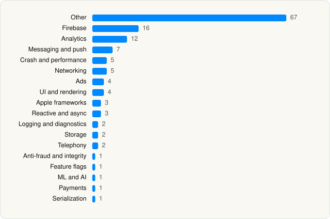

<picture><source media="(prefers-color-scheme: dark)" srcset="../../../../assets/logo/logo-dark.svg"></picture> [Tech Stack](../../../../README.md) / [Life360](../../../../companies/life360.md) / Life360

# Life360: Family Safety & GPS

<picture><source media="(prefers-color-scheme: dark)" srcset="../../../../assets/badges/ios-dark.svg"></picture> <picture><source media="(prefers-color-scheme: dark)" srcset="../../../../assets/badges/active-dark.svg"></picture> <picture><source media="(prefers-color-scheme: dark)" srcset="../../../../assets/badges/floor-dark.svg"></picture> <picture><source media="(prefers-color-scheme: dark)" srcset="../../../../assets/badges/encrypted-dark.svg"></picture>

[App Store](https://apps.apple.com/app/id384830320) · [latest.json](latest.json)

| | |
|---|---|
| Company | [Life360](../../../../companies/life360.md) |
| Store id | `384830320` |
| Bundle / package id | `com.life360.safetymap` |
| Latest version | 26.41.0 (analysed 2026-11-02) |
| Versions tracked | 1 |
| SDKs in latest version | 137 |
| Languages | C/C++, Metal (shaders), Objective-C, Swift |
| UI | Lottie (animations), SwiftUI, UIKit |
| Build | Swift Package Manager (SwiftPM) |
| Minimum OS | iOS 18.0 (built with Xcode 27.1, SDK iphoneos27.1) |
| Devices / ABIs | iPhone |
| Localisations | 21 |
| Capabilities | 12 |
| Declares tracking | Yes |
| Tracked | Yes |

## SDKs by category

<picture><source media="(prefers-color-scheme: dark)" srcset="../../../../assets/charts/apps/ios/life360/life360-dark.svg"></picture>

- **Other** (67): abslWrapper, AccelerationEvents, AdaEmbedFramework 1.0, AirportArrivalDetection, AppHarbrSDK 1.36.0, AppIconKit, ArityCoreEngine 4.11.3, AsyncAlgorithms 1.0, Atomics 1.0, AtomicsShims 1.0, AxisAlignment, Clocks 1.0, CNIOAtomics 1.0, CNIOBoringSSL 1.0, CNIOBoringSSLShims 1.0, CNIODarwin 1.0, CNIOLinux 1.0, CNIOLLHTTP 1.0, CNIOWASI 1.0, CNIOWindows 1.0, CocoaLumberjackSwift 1.0, CocoaLumberjackSwiftSupport 1.0, CocoaMQTT 1.0, CollisionEvent, CombineSchedulers 1.0, CommonSimulation, ConcurrencyExtras 1.0, ContainersPreview 1.0, CoreEngine 3.11.18, CryptoSwift 1.0, CustomDump 1.0, CZoneDetect 1.0, Dependencies 1.0, DistractedBehavior, dskoball 1.0, FluentAdFlowAdsWidget 1.0, GISTools 1.0, IsAppEncrypted 1.0, IssueReporting 1.0, MotionTransition, mpde 1.0, MVTTools 1.0, NiftCardFlow 1.0, NiftCardFlowSource 1.0, NonEmpty 1.0, opensslWrapper, PerceptionCore 1.0, RollbarCommon 1.0, RollbarCrash 1.0, RollbarNotifier 1.0, RollbarReport 1.0, S2GeometrySwift 1.0, SDKConfigurations 4.0.0, SENTSDK, Settings-Debug, Settings-Release, SimpleToast 1.0, SwiftASN1 1.0, SwiftNavigation 1.0, SwiftTimeZoneLookup 1.0, SwiftUINavigation 1.0, Threads, UID2 1.0, UID2GMAPlugin 1.0, VungleAdsSDK 1.0, XCTestDynamicOverlay 1.0, zlib 1.0
- **Firebase** (16): abseil 1.0, FBLPromises 1.0, Firebase 1.0, FirebaseAppCheck 1.0, FirebaseCore 1.0, FirebaseCoreInternal 1.0, FirebaseFirestore, FirebaseInstallations 1.0, FirebasePerformance 1.0, FirebaseRemoteConfig 1.0, GoogleDataTransport 1.0, GoogleUtilities 1.0, gRPC, leveldb, nanopb 1.0, Promises 1.0
- **Analytics** (12): Amplitude 1.0, AnalyticsConnector 1.0, AppsFlyerLib 1.0, Branch 1.0, FacebookAEM 1.0, FacebookCore 1.0, FBAEMKit 1.0, FBSDKCoreKit 1.0, FirebaseAnalytics 1.0, GoogleAppMeasurement 1.0, GoogleAppMeasurementIdentitySupport 1.0, Heap 1.0
- **Messaging and push** (7): BrazeUI 1.0, FirebaseMessaging 1.0, MessagingAPI 6.0.1, MessagingSDK 6.0.2, SupportProvidersSDK 8.0.4, SupportSDK 8.0.4, ZendeskCoreSDK 5.0.4
- **Crash and performance** (5): Datadog 1.0, DatadogCore 1.0, DatadogRUM 1.0, FirebaseCrashlytics 1.0, Sentry 1.0
- **Networking** (5): CGRPCZlib 1.0, MqttCocoaAsyncSocket 1.0, NIO 1.0, NIOPosix 1.0, NIOSSL 1.0
- **Ads** (4): FBAudienceNetwork 1.0, Google Mobile Ads (AdMob), GoogleAdsOnDeviceConversion 1.0, GoogleMobileAds 1.0
- **UI and rendering** (4): CommonUISDK 9.0.2, Lottie 1.0, SDWebImage 1.0, SDWebImageSwiftUI 1.0
- **Apple frameworks** (3): DequeModule 1.0, InternalCollectionsUtilities 1.0, OrderedCollections 1.0
- **Reactive and async** (3): RxCocoa 1.0, RxRelay 1.0, RxSwift 1.0
- **Logging and diagnostics** (2): CocoaLumberjack 1.0, Logging 1.0
- **Storage** (2): GZIP 1.0, UserMessagingPlatformTarget 1.0
- **Telephony** (2): libPhoneNumber 1.0, PhoneNumberKit 1.0
- **Anti-fraud and integrity** (1): Persona2 2.23.3
- **Feature flags** (1): Statsig 1.0
- **ML and AI** (1): SENTTensorFlowLiteC 2.20.0
- **Payments** (1): LinkKit 6.4.3
- **Serialization** (1): SwiftProtobuf 1.0

Frameworks (41)

ActivityKit (Live Activities), AdServices (Apple Search Ads attribution), AdSupport (IDFA), App Intents, App Tracking Transparency (ATT), Authentication Services (Sign in with Apple / passkeys), AVFoundation (audio/video), AVKit, Background Tasks, CallKit (VoIP), Combine (reactive), Contacts, Core Bluetooth, Core Data, Core Image, Core Location, Core ML, Core Motion, CryptoKit, EventKit (Calendar / Reminders), Local Authentication (Face ID / Touch ID), MapKit, Media Player, MessageUI (mail / SMS compose), MetalKit, MetricKit (diagnostics), Network.framework, PassKit (Wallet / Apple Pay), PDFKit, Photos, PhotosUI, SafariServices, SiriKit (Intents), StoreKit (in-app purchase), Swift Charts, SwiftUI, UIKit, User Notifications, Vision, VisionKit (document/data scanning), WidgetKit (widgets)

Capabilities (12)

App Groups, Associated Domains (Universal Links), Background App Refresh, Background Audio, Background Location, Background Processing, Background Push, Bluetooth (central), Communication Notifications, Keychain Sharing, Push Notifications (APNs), Time-Sensitive Notifications

## Version history

| Version | Analysed | Store update | SDKs | Change | SDK list is a floor | Binary encrypted | File |
|---|---|---|---|---|---|---|---|
| 26.41.0 | 2026-11-02 | 2026-10-27 | 137 |  | Yes | Yes | [26.41.0.json](26.41.0.json) |

---

Generated by `scripts/build_readme.py` from the JSON files. Do not edit by hand.
