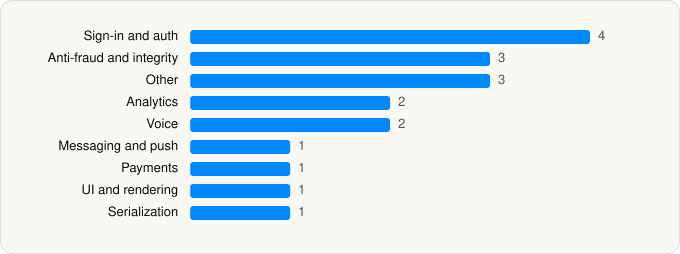

<picture><source media="(prefers-color-scheme: dark)" srcset="../../../../assets/logo/logo-dark.svg"></picture> [Tech Stack](../../../../README.md) / [LinkedIn Corporation](../../../../companies/linkedin-corporation.md) / LinkedIn

# LinkedIn: Community & Network

<picture><source media="(prefers-color-scheme: dark)" srcset="../../../../assets/badges/ios-dark.svg"></picture> <picture><source media="(prefers-color-scheme: dark)" srcset="../../../../assets/badges/inactive-dark.svg"></picture> <picture><source media="(prefers-color-scheme: dark)" srcset="../../../../assets/badges/floor-dark.svg"></picture> <picture><source media="(prefers-color-scheme: dark)" srcset="../../../../assets/badges/encrypted-dark.svg"></picture>

[App Store](https://apps.apple.com/app/id288429040) · [latest.json](latest.json)

| | |
|---|---|
| Company | [LinkedIn Corporation](../../../../companies/linkedin-corporation.md) |
| Store id | `288429040` |
| Bundle / package id | `com.linkedin.LinkedIn` |
| Latest version | 2026.0601.2241 (analysed 2026-06-19) |
| Versions tracked | 1 |
| SDKs in latest version | 18 |
| Languages | C/C++, Metal (shaders), Objective-C, Swift |
| UI | Lottie (animations), SwiftUI, UIKit |
| Build | Swift Package Manager (SwiftPM) |
| Minimum OS | iOS 16.6 (built with Xcode 26.0, SDK iphoneos26.0) |
| Devices / ABIs | iPhone, iPad |
| Localisations | 35 |
| Capabilities | 20 |
| Declares tracking | No |
| Tracked | No. Kept for history. |

## SDKs by category

<picture><source media="(prefers-color-scheme: dark)" srcset="../../../../assets/charts/apps/ios/linkedin-corporation/linkedin-dark.svg"></picture>

- **Sign-in and auth** (4): AppAuth 1.0.0, GoogleSignIn 1.0.0, GTMAppAuth 1.0.0, GTMSessionFetcher 1.0.0
- **Anti-fraud and integrity** (3): FraudProtection 2.0.2, Persona 2.0.1, Persona2
- **Other** (3): AVFoundationCollector 3.24.0, AzureCommunicationCommon 1.2.0, CoreCollector 3.24.0
- **Analytics** (2): Qualtrics 2.22.0, Segment 1.0.0
- **Voice** (2): AzureCommunicationCalling 2.15.0, WebRTC 1.0
- **Messaging and push** (1): Conversations 1.0.0
- **Payments** (1): WalletLibrary 1.0
- **UI and rendering** (1): Lottie 1.0.0
- **Serialization** (1): SwiftProtobuf

Frameworks (45)

ActivityKit (Live Activities), AdServices (Apple Search Ads attribution), AdSupport (IDFA), App Tracking Transparency (ATT), Authentication Services (Sign in with Apple / passkeys), AVFoundation (audio/video), AVKit, Background Tasks, CallKit (VoIP), Combine (reactive), Contacts, Core Bluetooth, Core Data, Core Image, Core Location, Core ML, Core Motion, Core NFC, CryptoKit, DeviceCheck / App Attest, EventKit (Calendar / Reminders), Local Authentication (Face ID / Touch ID), Media Player, MessageUI (mail / SMS compose), MetalKit, MetricKit (diagnostics), Natural Language, Network.framework, PassKit (Wallet / Apple Pay), PDFKit, Photos, PhotosUI, PushKit (VoIP push), SafariServices, SiriKit (Intents), Speech (recognition), StoreKit (in-app purchase), Swift Charts, SwiftUI, UIKit, User Notifications, Vision, VisionKit (document/data scanning), Watch Connectivity, WidgetKit (widgets)

Capabilities (20)

App Attest, App Groups, Associated Domains (Universal Links), Background App Refresh, Background Audio, Background Push, Bluetooth (central), Bluetooth (peripheral), CloudKit, Communication Notifications, iCloud, iCloud Key-Value Storage, Keychain Sharing, NFC, Push Notifications (APNs), Sign in with Apple, SiriKit, Time-Sensitive Notifications, VoIP, Wallet passes

## Version history

| Version | Analysed | Store update | SDKs | Change | SDK list is a floor | Binary encrypted | File |
|---|---|---|---|---|---|---|---|
| 2026.0601.2241 | 2026-06-19 |  | 18 |  | Yes | Yes | [2026.0601.2241.json](2026.0601.2241.json) |

## Model-written summary

> Native iOS LinkedIn app with SwiftUI/UIKit, 18 Metal shaders, 5 extensions including Live Activities, modular first-party modules, and third-party SDKs for auth/analytics/voice

Written by a language model from the detected signals (`inferred[]`). It is commentary, not measurement.

---

Generated by `scripts/build_readme.py` from the JSON files. Do not edit by hand.
