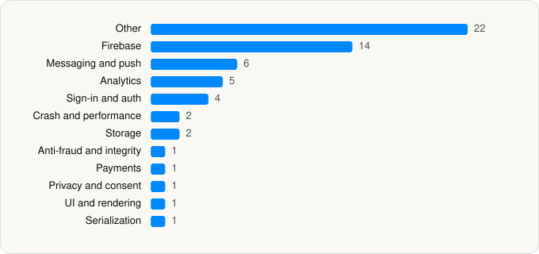

<picture><source media="(prefers-color-scheme: dark)" srcset="../../../../assets/logo/logo-dark.svg"></picture> [Tech Stack](../../../../README.md) / [Live Fast Die Young](../../../../companies/live-fast-die-young.md) / LFDY

# LFDY

<picture><source media="(prefers-color-scheme: dark)" srcset="../../../../assets/badges/ios-dark.svg"></picture> <picture><source media="(prefers-color-scheme: dark)" srcset="../../../../assets/badges/inactive-dark.svg"></picture> <picture><source media="(prefers-color-scheme: dark)" srcset="../../../../assets/badges/floor-dark.svg"></picture> <picture><source media="(prefers-color-scheme: dark)" srcset="../../../../assets/badges/encrypted-dark.svg"></picture>

[App Store](https://apps.apple.com/app/id6466177782) · [latest.json](latest.json)

| | |
|---|---|
| Company | [Live Fast Die Young](../../../../companies/live-fast-die-young.md) |
| Store id | `6466177782` |
| Bundle / package id | `co.stikky.app.lfdy` |
| Latest version | 1.0.60 (analysed 2026-11-27) |
| Versions tracked | 1 |
| SDKs in latest version | 60 |
| Languages | C/C++, Flutter / Dart, Objective-C, Swift |
| UI | SwiftUI, UIKit |
| Build | Swift Package Manager (SwiftPM) |
| Minimum OS | iOS 15.0 (built with Xcode 26.6, SDK iphoneos26.5) |
| Devices / ABIs | iPhone |
| Localisations | 4 |
| Capabilities | 5 |
| Declares tracking | Yes |
| Tracked | No. Kept for history. |

## SDKs by category

<picture><source media="(prefers-color-scheme: dark)" srcset="../../../../assets/charts/apps/ios/live-fast-die-young/lfdy-dark.svg"></picture>

- **Other** (22): apple 0.0.1, avfoundation 0.0.1, c 1.0, codes 0.0.1, darwin 0.0.4, event 0.0.1, Flutter 1.0, foundation 0.0.1, helper 1.2.1, http 0.0.1, js 0.1.0, KlaviyoCore 5.4.1, KlaviyoSwift 5.4.1, KlaviyoSwiftExtension 5.4.1, links 7.0.0, OrderedSet 6.0.3, plus 0.0.1, SDKConfigurations 4.0.1, transparency 0.0.1, UsercentricsPrivacyInfo 2.24.1, UsercentricsUI 2.24.1, wkwebview 0.0.1
- **Firebase** (14): AppCheck 11.3.2, FBLPromises 2.4.1, Firebase 12.19.0, FirebaseCore 12.19.3, FirebaseCoreInternal 12.19.0, FirebaseFirestore 12.19.3, FirebaseInstallations 12.19.0, FirebasePerformance 12.19.0, FirebaseRemoteConfig 12.19.0, GoogleDataTransport 10.1.1, GoogleUtilities 8.1.4, leveldb 1.22.6, nanopb 3.30910.0, Promises 2.4.1
- **Messaging and push** (6): FirebaseMessaging 12.19.0, MessagingAPI 6.0.2, MessagingSDK 6.3.0, SupportProvidersSDK 9.0.0, SupportSDK 9.3.0, ZendeskCoreSDK 5.0.5
- **Analytics** (5): Amplitude 1.0, AnalyticsConnector 1.3.3, Facebook SDK, FBAEMKit 1.0, FBSDKCoreKit 1.0
- **Sign-in and auth** (4): AppAuth 2.1.0, GoogleSignIn 9.2.0, GTMAppAuth 5.0.0, GTMSessionFetcher 3.5.0
- **Crash and performance** (2): FirebaseCrashlytics 12.19.0, Sentry 8.58.3
- **Storage** (2): format 0.0.1, KlaviyoForms 5.4.1
- **Anti-fraud and integrity** (1): RecaptchaInterop 101.0.0
- **Payments** (1): ShopifyCheckoutSheetKit 3.9.1
- **Privacy and consent** (1): Usercentrics 1.0
- **UI and rendering** (1): CommonUISDK 9.3.0
- **Serialization** (1): AnyCodable 0.6.7

Frameworks (24)

AdServices (Apple Search Ads attribution), AdSupport (IDFA), App Tracking Transparency (ATT), Authentication Services (Sign in with Apple / passkeys), AVFoundation (audio/video), Combine (reactive), Contacts, Core Data, Core Image, Core Location, CryptoKit, DeviceCheck / App Attest, Local Authentication (Face ID / Touch ID), MessageUI (mail / SMS compose), MetricKit (diagnostics), Network.framework, PDFKit, Photos, SafariServices, StoreKit (in-app purchase), SwiftUI, UIKit, User Notifications, Vision

Capabilities (5)

Apple Pay, Associated Domains (Universal Links), Background App Refresh, Background Push, Push Notifications (APNs)

## Version history

| Version | Analysed | Store update | SDKs | Change | SDK list is a floor | Binary encrypted | File |
|---|---|---|---|---|---|---|---|
| 1.0.60 | 2026-11-27 |  | 60 |  | Yes | Yes | [1.0.60.json](1.0.60.json) |

---

Generated by `scripts/build_readme.py` from the JSON files. Do not edit by hand.
