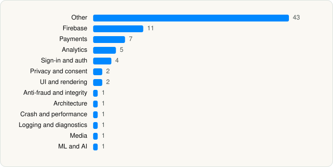

<picture><source media="(prefers-color-scheme: dark)" srcset="../../../../assets/logo/logo-dark.svg"></picture> [Tech Stack](../../../../README.md) / [Luka, Inc.](../../../../companies/luka-inc.md) / Replika

# Replika - AI Companion Chat

<picture><source media="(prefers-color-scheme: dark)" srcset="../../../../assets/badges/ios-dark.svg"></picture> <picture><source media="(prefers-color-scheme: dark)" srcset="../../../../assets/badges/inactive-dark.svg"></picture> <picture><source media="(prefers-color-scheme: dark)" srcset="../../../../assets/badges/floor-dark.svg"></picture> <picture><source media="(prefers-color-scheme: dark)" srcset="../../../../assets/badges/encrypted-dark.svg"></picture>

[App Store](https://apps.apple.com/app/id1158555867) · [latest.json](latest.json)

| | |
|---|---|
| Company | [Luka, Inc.](../../../../companies/luka-inc.md) |
| Store id | `1158555867` |
| Bundle / package id | `ai.replika.app` |
| Latest version | 12.5.2 (analysed 2026-11-06) |
| Versions tracked | 4 |
| SDKs in latest version | 80 |
| Languages | C/C++, Objective-C, Swift, Unity (C# / IL2CPP) |
| UI | Lottie (animations), SwiftUI, UIKit |
| Build | Swift Package Manager (SwiftPM) |
| Minimum OS | iOS 17.0 (built with Xcode 27.0, SDK iphoneos27.0) |
| Devices / ABIs | iPhone |
| Localisations | 5 |
| Capabilities | 10 |
| Declares tracking | Yes |
| Tracked | No. Kept for history. |

## SDKs by category

<picture><source media="(prefers-color-scheme: dark)" srcset="../../../../assets/charts/apps/ios/luka-inc/replika-dark.svg"></picture>

- **Other** (43): ARExperienceUI, AssistantUI, AuthUI, BezelKit, BotProfileUI, ChatUI, CommonOnboardingUI, CommonUI, ConsumablesPurchaseUI, DailyRewardsUI, DiaryUI, FeatureLimitsUI, FeaturePopupUI, Gallery, HomeScreenUI, IncdOnboarding 5.47.0, InsightsUI, Integrations, JointSelfiesUI, MainSettingsUI, Masonry 1.0, MemoryUI, MemoryV4, MemoryV5, MigrationUI, OnboardingPersonalizationUI, OnboardingPersonalizationV4UI, OnboardingUI, PaidFeaturePopupV4, PermissionsUI, PortraitFTEUI, RatingPopupUI, Store3DUI, StoreContainer, StoreFrontUI, StoreUI, ThinkingProcess, TrainingModeUI, VideoAvatars, VoiceActivityDetection, VoiceCallActivityUI, VoiceCallUI, VoiceMessagesUI
- **Firebase** (11): FBLPromises, Firebase, FirebaseAuth, FirebaseCore, FirebaseCoreInternal, FirebaseInstallations, FirebaseRemoteConfig, GoogleDataTransport, GoogleUtilities, nanopb, Promises
- **Payments** (7): OnboardingSubscriptionScreen, PointsWalletUI, Stripe, SubscriptionManagementUI, SubscriptionScreenV16UI, SubscriptionUI, WalletWidgetUI
- **Analytics** (5): AppsFlyerLib 1.0, FacebookAEM, FacebookCore, FBAEMKit 1.0, FBSDKCoreKit 1.0
- **Sign-in and auth** (4): AppAuth, GoogleSignIn, GTMAppAuth, GTMSessionFetcher
- **Privacy and consent** (2): Consent, iubenda 2.9.6
- **UI and rendering** (2): Lottie 4.5.2, SDWebImage
- **Anti-fraud and integrity** (1): RecaptchaEnterprise 1.0
- **Architecture** (1): NeedleFoundation
- **Crash and performance** (1): FirebaseCrashlytics
- **Logging and diagnostics** (1): CocoaLumberjack
- **Media** (1): uLipSync (lip-sync)
- **ML and AI** (1): UnityFramework 1.0

Frameworks (37)

ActivityKit (Live Activities), AdSupport (IDFA), App Intents, App Tracking Transparency (ATT), ARKit, Authentication Services (Sign in with Apple / passkeys), AVFoundation (audio/video), AVKit, CallKit (VoIP), Combine (reactive), Contacts, Core Data, Core Image, Core Location, Core ML, Core Motion, CryptoKit, DeviceCheck / App Attest, Local Authentication (Face ID / Touch ID), MapKit, Media Player, MessageUI (mail / SMS compose), MetricKit (diagnostics), Network.framework, PassKit (Wallet / Apple Pay), PDFKit, Photos, PhotosUI, SafariServices, SiriKit (Intents), StoreKit (in-app purchase), Swift Charts, SwiftUI, UIKit, User Notifications, Vision, WidgetKit (widgets)

Capabilities (10)

App Attest, App Groups, Apple Pay, Associated Domains (Universal Links), Background Push, Communication Notifications, Push Notifications (APNs), Sign in with Apple, SiriKit, VoIP

## Version history

| Version | Analysed | Store update | SDKs | Change | SDK list is a floor | Binary encrypted | File |
|---|---|---|---|---|---|---|---|
| 12.5.2 | 2026-11-06 | 2026-11-05 | 80 | +0 / −0 | Yes | Yes | [12.5.2.json](12.5.2.json) |
| 12.5.1 | 2026-11-03 | 2026-11-02 | 80 | +0 / −0 | Yes | Yes | [12.5.1.json](12.5.1.json) |
| 12.5.0 | 2026-11-02 | 2026-10-27 | 80 | +0 / −3 | Yes | Yes | [12.5.0.json](12.5.0.json) |
| 12.4.2 | 2026-10-24 | 2026-10-13 | 83 |  | Yes | Yes | [12.4.2.json](12.4.2.json) |

### SDK changes between versions

- 12.4.2 → 12.5.0: removed Objection, ReactiveObjC, TransformerKit

---

Generated by `scripts/build_readme.py` from the JSON files. Do not edit by hand.
