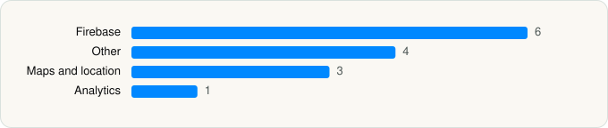

<picture><source media="(prefers-color-scheme: dark)" srcset="../../../../assets/logo/logo-dark.svg"></picture> [Tech Stack](../../../../README.md) / [Lyft, Inc.](../../../../companies/lyft-inc.md) / Lyft

# Lyft

<picture><source media="(prefers-color-scheme: dark)" srcset="../../../../assets/badges/ios-dark.svg"></picture> <picture><source media="(prefers-color-scheme: dark)" srcset="../../../../assets/badges/active-dark.svg"></picture> <picture><source media="(prefers-color-scheme: dark)" srcset="../../../../assets/badges/floor-dark.svg"></picture> <picture><source media="(prefers-color-scheme: dark)" srcset="../../../../assets/badges/encrypted-dark.svg"></picture>

[App Store](https://apps.apple.com/app/id529379082) · [latest.json](latest.json)

| | |
|---|---|
| Company | [Lyft, Inc.](../../../../companies/lyft-inc.md) |
| Store id | `529379082` |
| Bundle / package id | `com.zimride.instant` |
| Latest version | 2026.41.3 (analysed 2026-10-24) |
| Versions tracked | 1 |
| SDKs in latest version | 14 |
| Languages | C/C++, Metal (shaders), Objective-C, Swift |
| UI | SwiftUI, UIKit |
| Build | Swift Package Manager (SwiftPM) |
| Minimum OS | iOS 17.0 (built with Xcode 27.1, SDK iphoneos27.1) |
| Devices / ABIs | iPhone |
| Localisations | 14 |
| Capabilities | 14 |
| Declares tracking | Yes |
| Tracked | Yes |

## SDKs by category

<picture><source media="(prefers-color-scheme: dark)" srcset="../../../../assets/charts/apps/ios/lyft-inc/lyft-dark.svg"></picture>

- **Firebase** (6): FBLPromises 2.4.0, FirebaseCore 12.1.0, FirebaseCoreInternal 12.1.0, FirebaseInstallations 12.1.0, GoogleUtilities 8.1.0, nanopb 3.30910.0
- **Other** (4): TMXProfiling 1.0, TMXProfiling-companion 1.0, TMXProfilingConnections 1.0, TMXProfilingConnections-companion 1.0
- **Maps and location** (3): GMSCore 26.33.0, GoogleMaps 11.1.0, Mapbox 15256
- **Analytics** (1): UserLeapKit 4.8.5

Frameworks (38)

ActivityKit (Live Activities), AdServices (Apple Search Ads attribution), AdSupport (IDFA), App Intents, App Tracking Transparency (ATT), Authentication Services (Sign in with Apple / passkeys), AVFoundation (audio/video), AVKit, CallKit (VoIP), Combine (reactive), Contacts, Core Data, Core Image, Core Location, Core Motion, Core NFC, CryptoKit, DeviceCheck / App Attest, EventKit (Calendar / Reminders), Local Authentication (Face ID / Touch ID), MapKit, MessageUI (mail / SMS compose), MetalKit, MetricKit (diagnostics), Network.framework, PassKit (Wallet / Apple Pay), PDFKit, Photos, PhotosUI, SafariServices, SiriKit (Intents), Speech (recognition), StoreKit (in-app purchase), SwiftUI, UIKit, User Notifications, Vision, WidgetKit (widgets)

Capabilities (14)

App Attest, App Groups, Apple Pay, Associated Domains (Universal Links), Background Audio, Background Location, Background Push, Bluetooth (central), iCloud Key-Value Storage, NFC, Push Notifications (APNs), Sign in with Apple, SiriKit, Time-Sensitive Notifications

## Version history

| Version | Analysed | Store update | SDKs | Change | SDK list is a floor | Binary encrypted | File |
|---|---|---|---|---|---|---|---|
| 2026.41.3 | 2026-10-24 | 2026-10-23 | 14 |  | Yes | Yes | [2026.41.3.json](2026.41.3.json) |

---

Generated by `scripts/build_readme.py` from the JSON files. Do not edit by hand.
