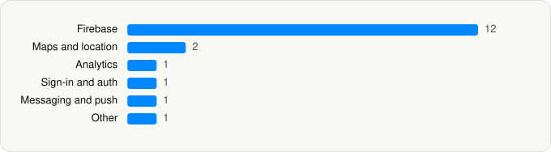

<picture><source media="(prefers-color-scheme: dark)" srcset="../../../../assets/logo/logo-dark.svg"></picture> [Tech Stack](../../../../README.md) / [Lyft, Inc.](../../../../companies/lyft-inc.md) / TfL Santander Cycles

# TfL Santander Cycles

<picture><source media="(prefers-color-scheme: dark)" srcset="../../../../assets/badges/ios-dark.svg"></picture> <picture><source media="(prefers-color-scheme: dark)" srcset="../../../../assets/badges/inactive-dark.svg"></picture> <picture><source media="(prefers-color-scheme: dark)" srcset="../../../../assets/badges/floor-dark.svg"></picture> <picture><source media="(prefers-color-scheme: dark)" srcset="../../../../assets/badges/encrypted-dark.svg"></picture>

[App Store](https://apps.apple.com/app/id6748404131) · [latest.json](latest.json)

| | |
|---|---|
| Company | [Lyft, Inc.](../../../../companies/lyft-inc.md) |
| Store id | `6748404131` |
| Bundle / package id | `com.lyft.ios.londonapp` |
| Latest version | 2026.36.36 (analysed 2026-11-17) |
| Versions tracked | 1 |
| SDKs in latest version | 18 |
| Languages | C/C++, Objective-C, Swift |
| UI | SwiftUI, UIKit |
| Build | Swift Package Manager (SwiftPM) |
| Minimum OS | iOS 17.0 (built with Xcode 26.6, SDK iphoneos26.5) |
| Devices / ABIs | iPhone |
| Localisations | 9 |
| Capabilities | 4 |
| Declares tracking | Yes |
| Tracked | No. Kept for history. |

## SDKs by category

<picture><source media="(prefers-color-scheme: dark)" srcset="../../../../assets/charts/apps/ios/lyft-inc/tfl-santander-cycles-dark.svg"></picture>

- **Firebase** (12): FBLPromises 2.4.0, Firebase 12.1.0, FirebaseAuth 12.1.0, FirebaseCore 12.1.0, FirebaseCoreInternal 12.1.0, FirebaseInstallations 12.1.0, FirebaseRemoteConfig 12.1.0, GoogleDataTransport 10.1.0, GoogleUtilities 8.1.0, leveldb 1.22.6, nanopb 3.30910.0, Promises 2.4.0
- **Maps and location** (2): Mapbox 1.0.10, MapboxMaps 10.10.1
- **Analytics** (1): Branch
- **Sign-in and auth** (1): GTMSessionFetcher 3.5.0
- **Messaging and push** (1): FirebaseMessaging 12.1.0
- **Other** (1): Turf 2.6.1

Frameworks (28)

AdServices (Apple Search Ads attribution), AdSupport (IDFA), App Tracking Transparency (ATT), Authentication Services (Sign in with Apple / passkeys), AVFoundation (audio/video), Combine (reactive), Contacts, Core Data, Core Image, Core Location, Core NFC, CryptoKit, DeviceCheck / App Attest, EventKit (Calendar / Reminders), HealthKit, MapKit, MetalKit, MetricKit (diagnostics), Network.framework, PDFKit, Photos, PhotosUI, SafariServices, StoreKit (in-app purchase), SwiftUI, UIKit, User Notifications, Vision

Capabilities (4)

Associated Domains (Universal Links), Background Push, HealthKit, Push Notifications (APNs)

## Version history

| Version | Analysed | Store update | SDKs | Change | SDK list is a floor | Binary encrypted | File |
|---|---|---|---|---|---|---|---|
| 2026.36.36 | 2026-11-17 |  | 18 |  | Yes | Yes | [2026.36.36.json](2026.36.36.json) |

---

Generated by `scripts/build_readme.py` from the JSON files. Do not edit by hand.
