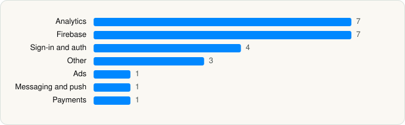

<picture><source media="(prefers-color-scheme: dark)" srcset="../../../../assets/logo/logo-dark.svg"></picture> [Tech Stack](../../../../README.md) / [MARKETING AFFILIATES LTDA](../../../../companies/marketing-affiliates-ltda.md) / BeFitWay

# BeFitWay: Calorie Counter

<picture><source media="(prefers-color-scheme: dark)" srcset="../../../../assets/badges/ios-dark.svg"></picture> <picture><source media="(prefers-color-scheme: dark)" srcset="../../../../assets/badges/inactive-dark.svg"></picture> <picture><source media="(prefers-color-scheme: dark)" srcset="../../../../assets/badges/floor-dark.svg"></picture> <picture><source media="(prefers-color-scheme: dark)" srcset="../../../../assets/badges/encrypted-dark.svg"></picture>

[App Store](https://apps.apple.com/app/id6812807809) · [latest.json](latest.json)

| | |
|---|---|
| Company | [MARKETING AFFILIATES LTDA](../../../../companies/marketing-affiliates-ltda.md) |
| Store id | `6812807809` |
| Bundle / package id | `com.bianchini.befitway` |
| Latest version | 1.0.6 (analysed 2026-11-18) |
| Versions tracked | 1 |
| SDKs in latest version | 24 |
| Languages | C/C++, Objective-C, Swift |
| UI | SwiftUI, UIKit |
| Build | Swift Package Manager (SwiftPM) |
| Minimum OS | iOS 15.0 (built with Xcode 26.6, SDK iphoneos26.5) |
| Devices / ABIs | iPhone, iPad |
| Localisations | 3 |
| Capabilities | 4 |
| Declares tracking | Yes |
| Tracked | No. Kept for history. |

## SDKs by category

<picture><source media="(prefers-color-scheme: dark)" srcset="../../../../assets/charts/apps/ios/marketing-affiliates-ltda/befitway-dark.svg"></picture>

- **Analytics** (7): FacebookAEM, FacebookCore, FBAEMKit 1.0, FBSDKCoreKit 1.0, FirebaseAnalytics 12.19.2, GoogleAppMeasurement 12.19.2, GoogleAppMeasurementIdentitySupport 12.19.2
- **Firebase** (7): FBLPromises, FirebaseCore, FirebaseCoreInternal, FirebaseInstallations, GoogleDataTransport, GoogleUtilities, nanopb
- **Sign-in and auth** (4): AppAuth, GoogleSignIn, GTMAppAuth, GTMSessionFetcher
- **Other** (3): Capacitor 1.0, Cordova 1.0, IONCameraLib
- **Ads** (1): GoogleAdsOnDeviceConversion 3.7.0
- **Messaging and push** (1): FirebaseMessaging
- **Payments** (1): RevenueCat

Frameworks (20)

AdServices (Apple Search Ads attribution), AdSupport (IDFA), App Tracking Transparency (ATT), Authentication Services (Sign in with Apple / passkeys), AVFoundation (audio/video), AVKit, Combine (reactive), Core Bluetooth, Core Location, CryptoKit, DeviceCheck / App Attest, HealthKit, Local Authentication (Face ID / Touch ID), Photos, PhotosUI, SafariServices, StoreKit (in-app purchase), SwiftUI, UIKit, User Notifications

Capabilities (4)

Background Push, HealthKit, Push Notifications (APNs), Sign in with Apple

## Version history

| Version | Analysed | Store update | SDKs | Change | SDK list is a floor | Binary encrypted | File |
|---|---|---|---|---|---|---|---|
| 1.0.6 | 2026-11-18 |  | 24 |  | Yes | Yes | [1.0.6.json](1.0.6.json) |

---

Generated by `scripts/build_readme.py` from the JSON files. Do not edit by hand.
