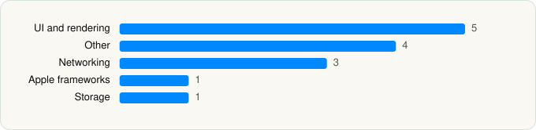

<picture><source media="(prefers-color-scheme: dark)" srcset="../../../../assets/logo/logo-dark.svg"></picture> [Tech Stack](../../../../README.md) / [Mastodon GmbH](../../../../companies/mastodon-gmbh.md) / Mastodon

# Mastodon

<picture><source media="(prefers-color-scheme: dark)" srcset="../../../../assets/badges/ios-dark.svg"></picture> <picture><source media="(prefers-color-scheme: dark)" srcset="../../../../assets/badges/inactive-dark.svg"></picture> <picture><source media="(prefers-color-scheme: dark)" srcset="../../../../assets/badges/floor-dark.svg"></picture> <picture><source media="(prefers-color-scheme: dark)" srcset="../../../../assets/badges/encrypted-dark.svg"></picture>

[App Store](https://apps.apple.com/app/id1571998974) · [latest.json](latest.json)

| | |
|---|---|
| Company | [Mastodon GmbH](../../../../companies/mastodon-gmbh.md) |
| Store id | `1571998974` |
| Bundle / package id | `org.joinmastodon.app` |
| Latest version | 2026.07 (analysed 2026-11-04) |
| Versions tracked | 2 |
| SDKs in latest version | 14 |
| Languages | C/C++, Objective-C, Swift |
| UI | SwiftUI, UIKit |
| Build | Swift Package Manager (SwiftPM) |
| Minimum OS | iOS 18.6 (built with Xcode 26.6, SDK iphoneos26.5) |
| Devices / ABIs | iPhone, iPad |
| Localisations | 53 |
| Capabilities | 5 |
| Declares tracking | No |
| Tracked | No. Kept for history. |

## SDKs by category

<picture><source media="(prefers-color-scheme: dark)" srcset="../../../../assets/charts/apps/ios/mastodon-gmbh/mastodon-dark.svg"></picture>

- **UI and rendering** (5): SDWebImage, SDWebImageSwiftUI, SwiftSoup 1.0, TOCropViewController, XLPagerTabStrip
- **Other** (4): Atomics 1.0, Bodega 1.0, CoreDataStack, Kanna
- **Networking** (3): Alamofire, NIO, NIOPosix
- **Apple frameworks** (1): OrderedCollections
- **Storage** (1): SQLite 1.0

Frameworks (19)

Authentication Services (Sign in with Apple / passkeys), AVFoundation (audio/video), AVKit, Combine (reactive), Core Data, Core Image, CryptoKit, Local Authentication (Face ID / Touch ID), Natural Language, Network.framework, Photos, PhotosUI, SafariServices, SiriKit (Intents), SwiftUI, UIKit, User Notifications, VisionKit (document/data scanning), WidgetKit (widgets)

Capabilities (5)

App Groups, Associated Domains (Universal Links), Background Push, Push Notifications (APNs), SiriKit

## Version history

| Version | Analysed | Store update | SDKs | Change | SDK list is a floor | Binary encrypted | File |
|---|---|---|---|---|---|---|---|
| 2026.07 | 2026-11-04 | 2026-08-10 | 14 | +2 / −0 | Yes | Yes | [2026.07.json](2026.07.json) |
| 2026.03 | 2026-06-19 |  | 12 |  | Yes | Yes | [2026.03.json](2026.03.json) |

### SDK changes between versions

- 2026.03 → 2026.07: added Atomics, Bodega

---

Generated by `scripts/build_readme.py` from the JSON files. Do not edit by hand.
