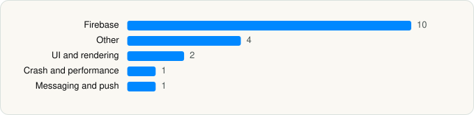

<picture><source media="(prefers-color-scheme: dark)" srcset="../../../../assets/logo/logo-dark.svg"></picture> [Tech Stack](../../../../README.md) / [موهبة](../../../../companies/mawhiba.md) / Mawhiba

# Mawhiba \| موهبة

<picture><source media="(prefers-color-scheme: dark)" srcset="../../../../assets/badges/ios-dark.svg"></picture> <picture><source media="(prefers-color-scheme: dark)" srcset="../../../../assets/badges/inactive-dark.svg"></picture> <picture><source media="(prefers-color-scheme: dark)" srcset="../../../../assets/badges/floor-dark.svg"></picture> <picture><source media="(prefers-color-scheme: dark)" srcset="../../../../assets/badges/encrypted-dark.svg"></picture>

[App Store](https://apps.apple.com/app/id6741471889) · [latest.json](latest.json)

| | |
|---|---|
| Company | [موهبة](../../../../companies/mawhiba.md) |
| Store id | `6741471889` |
| Bundle / package id | `com.mawhiba.mawhibaapp` |
| Latest version | 2.7.5 (analysed 2026-11-08) |
| Versions tracked | 1 |
| SDKs in latest version | 18 |
| Languages | C/C++, Flutter / Dart, Objective-C, Swift |
| UI | SwiftUI, UIKit |
| Build | Swift Package Manager (SwiftPM) |
| Minimum OS | iOS 18.6 (built with Xcode 26.6, SDK iphoneos26.5) |
| Devices / ABIs | iPhone, iPad |
| Localisations | 2 |
| Capabilities | 3 |
| Declares tracking | No |
| Tracked | No. Kept for history. |

## SDKs by category

<picture><source media="(prefers-color-scheme: dark)" srcset="../../../../assets/charts/apps/ios/mawhiba/mawhiba-dark.svg"></picture>

- **Firebase** (10): FBLPromises 2.4.1, Firebase 16.7.0, FirebaseCore 12.19.3, FirebaseCoreInternal 12.19.0, FirebaseInstallations 12.19.0, FirebaseRemoteConfig 12.19.0, GoogleDataTransport 10.1.1, GoogleUtilities 8.1.5, nanopb 3.30910.0, Promises 2.4.1
- **Other** (4): DKImagePickerController 4.3.9, DKPhotoGallery 0.0.19, Flutter 1.0, storage 6.0.0
- **UI and rendering** (2): SDWebImage 5.21.7, SwiftyGif 5.4.5
- **Crash and performance** (1): FirebaseCrashlytics 12.19.0
- **Messaging and push** (1): FirebaseMessaging 12.19.0

Frameworks (17)

Authentication Services (Sign in with Apple / passkeys), AVFoundation (audio/video), AVKit, Combine (reactive), Core Image, Local Authentication (Face ID / Touch ID), Media Player, Network.framework, PDFKit, Photos, PhotosUI, SafariServices, Speech (recognition), StoreKit (in-app purchase), SwiftUI, UIKit, User Notifications

Capabilities (3)

Background App Refresh, Background Push, Push Notifications (APNs)

## Version history

| Version | Analysed | Store update | SDKs | Change | SDK list is a floor | Binary encrypted | File |
|---|---|---|---|---|---|---|---|
| 2.7.5 | 2026-11-08 |  | 18 |  | Yes | Yes | [2.7.5.json](2.7.5.json) |

---

Generated by `scripts/build_readme.py` from the JSON files. Do not edit by hand.
