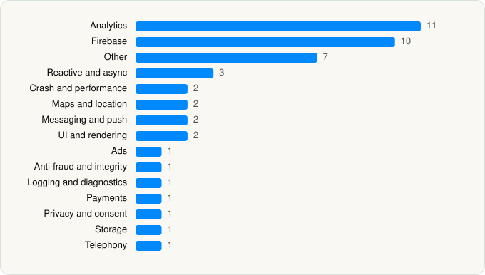

<picture><source media="(prefers-color-scheme: dark)" srcset="../../../../assets/logo/logo-dark.svg"></picture> [Tech Stack](../../../../README.md) / [McDonald's Global Markets LLC](../../../../companies/mcdonald-s-global-markets-llc.md) / McDonald's

# McDonald's

<picture><source media="(prefers-color-scheme: dark)" srcset="../../../../assets/badges/ios-dark.svg"></picture> <picture><source media="(prefers-color-scheme: dark)" srcset="../../../../assets/badges/inactive-dark.svg"></picture> <picture><source media="(prefers-color-scheme: dark)" srcset="../../../../assets/badges/floor-dark.svg"></picture> <picture><source media="(prefers-color-scheme: dark)" srcset="../../../../assets/badges/encrypted-dark.svg"></picture>

[App Store](https://apps.apple.com/app/id1217507712) · [latest.json](latest.json)

| | |
|---|---|
| Company | [McDonald's Global Markets LLC](../../../../companies/mcdonald-s-global-markets-llc.md) |
| Store id | `1217507712` |
| Bundle / package id | `com.mcdonalds.mobileapp` |
| Latest version | 3.55.1 (analysed 2026-11-20) |
| Versions tracked | 1 |
| SDKs in latest version | 46 |
| Languages | C/C++, Metal (shaders), Objective-C, Swift |
| UI | Lottie (animations), SwiftUI, UIKit |
| Build | Swift Package Manager (SwiftPM) |
| Minimum OS | iOS 17.0 (built with Xcode 26.5, SDK iphoneos26.5) |
| Devices / ABIs | iPhone, iPad |
| Localisations | 137 |
| Capabilities | 6 |
| Declares tracking | Yes |
| Tracked | No. Kept for history. |

## SDKs by category

<picture><source media="(prefers-color-scheme: dark)" srcset="../../../../assets/charts/apps/ios/mcdonald-s-global-markets-llc/mcdonald-s-dark.svg"></picture>

- **Analytics** (11): BrazeKit 14.2.1, FacebookAEM, FacebookCore, FBAEMKit 1.0, FBSDKCoreKit 1.0, FirebaseAnalytics 12.19.2, GoogleAppMeasurement 12.19.2, GoogleAppMeasurementIdentitySupport 12.19.2, Kochava 10.0.2, mParticle, mParticle-Braze
- **Firebase** (10): FBLPromises, Firebase, FirebaseCore, FirebaseCoreInternal, FirebaseInstallations, FirebaseRemoteConfig, GoogleDataTransport, GoogleUtilities, nanopb, Promises
- **Other** (7): AkamaiBAP 4.4.0, FTRAuth 1.0.2, FTRCommon 1.0.2, GooglePlaces 10.15.0, GooglePlacesTarget, GoogleTagManager 9.2.0, PaySDK 1.1.21
- **Reactive and async** (3): RxCocoa, RxRelay, RxSwift
- **Crash and performance** (2): FirebaseCrashlytics, Sentry 9.28.0
- **Maps and location** (2): GMSCore 26.24.0, GoogleMaps
- **Messaging and push** (2): BrazeUI, FirebaseMessaging
- **UI and rendering** (2): Kingfisher, Lottie 4.6.1
- **Ads** (1): GoogleAdsOnDeviceConversion 3.7.0
- **Anti-fraud and integrity** (1): Forter 3.0.4
- **Logging and diagnostics** (1): CocoaLumberjack
- **Payments** (1): Adyen
- **Privacy and consent** (1): OTPublishersHeadlessSDK 202606.2.0
- **Storage** (1): MultiplatformLibrary 1.0
- **Telephony** (1): PhoneNumberKit

Frameworks (29)

ActivityKit (Live Activities), AdServices (Apple Search Ads attribution), AdSupport (IDFA), App Tracking Transparency (ATT), Authentication Services (Sign in with Apple / passkeys), AVFoundation (audio/video), AVKit, Combine (reactive), Contacts, Core Data, Core Image, Core Location, Core Motion, CryptoKit, DeviceCheck / App Attest, Local Authentication (Face ID / Touch ID), MapKit, MetricKit (diagnostics), Network.framework, PassKit (Wallet / Apple Pay), PDFKit, PhotosUI, SafariServices, StoreKit (in-app purchase), SwiftUI, UIKit, User Notifications, Vision, WidgetKit (widgets)

Capabilities (6)

Apple Pay, Associated Domains (Universal Links), Background App Refresh, Background Location, Background Push, Push Notifications (APNs)

## Version history

| Version | Analysed | Store update | SDKs | Change | SDK list is a floor | Binary encrypted | File |
|---|---|---|---|---|---|---|---|
| 3.55.1 | 2026-11-20 |  | 46 |  | Yes | Yes | [3.55.1.json](3.55.1.json) |

---

Generated by `scripts/build_readme.py` from the JSON files. Do not edit by hand.
