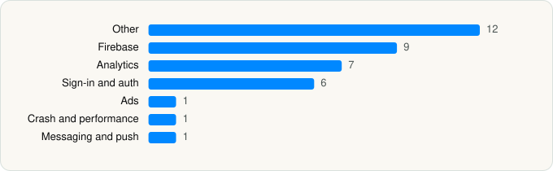

<picture><source media="(prefers-color-scheme: dark)" srcset="../../../../assets/logo/logo-dark.svg"></picture> [Tech Stack](../../../../README.md) / [Meetrix Online](../../../../companies/meetrix-online.md) / drawnames

# drawnames \| Secret Santa app

<picture><source media="(prefers-color-scheme: dark)" srcset="../../../../assets/badges/ios-dark.svg"></picture> <picture><source media="(prefers-color-scheme: dark)" srcset="../../../../assets/badges/inactive-dark.svg"></picture> <picture><source media="(prefers-color-scheme: dark)" srcset="../../../../assets/badges/floor-dark.svg"></picture> <picture><source media="(prefers-color-scheme: dark)" srcset="../../../../assets/badges/encrypted-dark.svg"></picture>

[App Store](https://apps.apple.com/app/id932002377) · [latest.json](latest.json)

| | |
|---|---|
| Company | [Meetrix Online](../../../../companies/meetrix-online.md) |
| Store id | `932002377` |
| Bundle / package id | `com.meetrixonline.DrawNamesUS` |
| Latest version | 1.81.13 (analysed 2026-11-08) |
| Versions tracked | 1 |
| SDKs in latest version | 37 |
| Languages | C/C++, Flutter / Dart, Objective-C, Swift |
| UI | SwiftUI, UIKit |
| Build | Swift Package Manager (SwiftPM) |
| Minimum OS | iOS 15.6 (built with Xcode 27.0, SDK iphoneos27.0) |
| Devices / ABIs | iPhone |
| Localisations | 34 |
| Capabilities | 6 |
| Declares tracking | Yes |
| Tracked | No. Kept for history. |

## SDKs by category

<picture><source media="(prefers-color-scheme: dark)" srcset="../../../../assets/charts/apps/ios/meetrix-online/drawnames-secret-santa-app-dark.svg"></picture>

- **Other** (12): apple, c 1.0, channel, darwin, FacebookBasics, Flutter 1.0, foundation, links, notifications, plus, review, transparency
- **Firebase** (9): FBLPromises, Firebase, FirebaseCore, FirebaseCoreInternal, FirebaseInstallations, FirebaseRemoteConfig, GoogleDataTransport, GoogleUtilities, nanopb
- **Analytics** (7): FacebookAEM, FacebookCore, FBAEMKit 1.0, FBSDKCoreKit 1.0, FirebaseAnalytics 12.18.0, GoogleAppMeasurement 12.18.0, GoogleAppMeasurementIdentitySupport 12.18.0
- **Sign-in and auth** (6): AppAuth, FacebookLogin, FBSDKLoginKit 1.0, GoogleSignIn, GTMAppAuth, GTMSessionFetcher
- **Ads** (1): GoogleAdsOnDeviceConversion 3.6.0
- **Crash and performance** (1): Sentry 8.58.4
- **Messaging and push** (1): FirebaseMessaging

Frameworks (21)

AdSupport (IDFA), App Tracking Transparency (ATT), Authentication Services (Sign in with Apple / passkeys), AVFoundation (audio/video), Combine (reactive), Core Data, Core Image, CryptoKit, DeviceCheck / App Attest, Local Authentication (Face ID / Touch ID), MessageUI (mail / SMS compose), MetricKit (diagnostics), Network.framework, PDFKit, Photos, PhotosUI, SafariServices, StoreKit (in-app purchase), SwiftUI, UIKit, User Notifications

Capabilities (6)

App Groups, Associated Domains (Universal Links), Background App Refresh, Background Push, Push Notifications (APNs), Sign in with Apple

## Version history

| Version | Analysed | Store update | SDKs | Change | SDK list is a floor | Binary encrypted | File |
|---|---|---|---|---|---|---|---|
| 1.81.13 | 2026-11-08 |  | 37 |  | Yes | Yes | [1.81.13.json](1.81.13.json) |

---

Generated by `scripts/build_readme.py` from the JSON files. Do not edit by hand.
