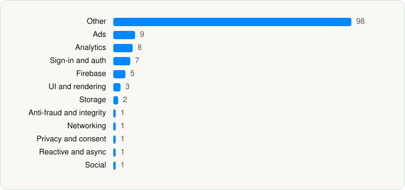

<picture><source media="(prefers-color-scheme: dark)" srcset="../../../../assets/logo/logo-dark.svg"></picture> [Tech Stack](../../../../README.md) / [Meitu Technology Co., Ltd.](../../../../companies/meitu-technology-co-ltd.md) / Meitu

# Meitu: AI Photo & Video Editor

<picture><source media="(prefers-color-scheme: dark)" srcset="../../../../assets/badges/ios-dark.svg"></picture> <picture><source media="(prefers-color-scheme: dark)" srcset="../../../../assets/badges/inactive-dark.svg"></picture> <picture><source media="(prefers-color-scheme: dark)" srcset="../../../../assets/badges/floor-dark.svg"></picture> <picture><source media="(prefers-color-scheme: dark)" srcset="../../../../assets/badges/encrypted-dark.svg"></picture>

[App Store](https://apps.apple.com/app/id416048305) · [latest.json](latest.json)

| | |
|---|---|
| Company | [Meitu Technology Co., Ltd.](../../../../companies/meitu-technology-co-ltd.md) |
| Store id | `416048305` |
| Bundle / package id | `com.meitu.mtxx` |
| Latest version | 12.23.0 (analysed 2026-11-15) |
| Versions tracked | 1 |
| SDKs in latest version | 137 |
| Languages | C/C++, Kotlin Multiplatform, Metal (shaders), Objective-C, Swift |
| UI | Lottie (animations), SwiftUI, UIKit |
| Build | Swift Package Manager (SwiftPM) |
| Minimum OS | iOS 15.0 (built with Xcode 27.1, SDK iphoneos27.1) |
| Devices / ABIs | iPhone, iPad |
| Localisations | 17 |
| Capabilities | 7 |
| Declares tracking | Yes |
| Tracked | No. Kept for history. |

## SDKs by category

<picture><source media="(prefers-color-scheme: dark)" srcset="../../../../assets/charts/apps/ios/meitu-technology-co-ltd/meitu-dark.svg"></picture>

- **Other** (98): AdsGlobalSDK 8.2.0, AlipaySDK, APBToygerFacade, APBToygerFacadeSuitable, baidumobadsdk, BDASignalSDK 1.0.6, BeautyLocalMaterial, BigoADSRes 5.3.0, CameraModuleLocalMaterial, CosmesisLocalMaterial, CSJAdSDK 7.8.0, DeviceKit 5.7.0, Filters, GDTMobSDK 1.0, HappyDNS 1.0.0, HBPAgentDesignkitTheme 8.25.5, highlightjs, KakaoSDKCommon 2.22.7, libpag 4.5.36, libWeiboSDK 3.3.8, LocalMaterial, Lodash, Material, MBCUIKit-Extension 0.4.0, Meitu 1.6.6, MJRefresh, MTACAccountConfigMT, MTACColorTheme 4.3.4, MTAccountWebUI, MTADSDK, MTAIPhoto 3.5.0, MTAITool 11.5.6, MTAurora, MTBBaidu 8.9.10, MTBCore 8.9.10, MTBeeHive 11.1.6, MTBExchange 8.9.10, MTBGDT 8.9.10, MTBMaterialCapture 8.9.10, MTBPangle 8.9.10, MTBusinessBaseKit 12.6.0, MTCommunityKit 11.20.0, MTCPUISDK, MTDebug, MTDefocus, MTEffectCore, MTFilterCore, MTFSDK, MTGenerateSignKit 1.4.2, MTIDCamera, MTIDLocalMaterial, MTIDPhotoLocalizationModule 1.0.2, MTIDPhotoLocalMaterial 2.0.5, MTIDPhotoModule 2.0.5, MTIEImageBaseEditor 1.8.0, MTIEImageBaseMaterial 1.8.0, MTImageKit, MTLComponentLocation 10.2.0, MTLegoBlocksLib 0.3.0, MTMediaKitAuroraConfig, MTMediaKitUIMagnifierConfig, MTMTXXPlug, MTPaySDK, MTPayWindow 6.10.2, MTPublishModule 11.8.2, MTPuzzleModule 11.10.0, MTRoboNeoModule 11.27.0, MTScanerSDK 1.1.0, MTToutiao 8.9.10, MTTrustKitConfig-MTXX 0.1.17, MTVBeauty, MTVConfig, MTVEffectTimeline 2.1.5, MTVIPModule 0.1.0, MTVLocalMaterial, MTWebKit 5.10.0, MTWebKitJSShare 5.10.0, MTYunPan 0.7.26, MTZJZSDK, mvgif 1.0.0, NetDiagLocalization, OpenWrapSDK 5.2.0, PAGAdSDK 8.2.0, PayBaseConfigMT, plist 4.3.4, PopRock 0.1.4, projectMapData 2.0.1, PVGImageCodec 1.0.0, QNRTCKit 4.0.4, sqlcipher 1.2.2, SVProgressHUD, TikTokBusinessSDK 8.2.0, ToygerService, Tquic 95.4624.0, TrustKit 3.1.5, VideoAIWaterMark, WCDBSwift 1.0.2, WeiboSDK
- **Ads** (9): AppLovin 13.6.4, BigoADS 5.3.0, FBAudienceNetwork 1.0, Google Mobile Ads (AdMob), GoogleMobileAds 13.7.0, InMobiSDK 11.4.1, MolocoSDK 4.9.0, Pubmatic 1.6.3, VungleAds 7.7.6
- **Analytics** (8): Adjust 1.0, AnalyticsConfigMT, AppsFlyerLib 6.17.7, Facebook SDK, FBAEMKit 1.0, FBSDKCoreKit 1.0, TikTokOpenSDK 2.5.0, TikTokOpenShareSDK 2.5.0
- **Sign-in and auth** (7): AppAuth 1.7.5, BioAuthEngine, Facebook Login, FBSDKLoginKit 1.0, GoogleSignIn 7.1.0, GTMAppAuth 4.1.1, GTMSessionFetcher 3.5.0
- **Firebase** (5): FBLPromises 2.4.0, FirebaseCore 11.15.0, FirebaseCoreInternal 11.15.0, FirebaseInstallations 11.15.0, GoogleUtilities 8.1.0
- **UI and rendering** (3): AntMarkdown 2.1.0, Highlight.js 11.10.0, Lottie 4.5.0
- **Storage** (2): sqliterk 1.2.2, ZIPFoundation 0.9.19
- **Anti-fraud and integrity** (1): GT3Captcha
- **Networking** (1): Alamofire 5.9.0
- **Privacy and consent** (1): UserMessagingPlatform 2.7.0
- **Reactive and async** (1): RxCocoa
- **Social** (1): FBSDKShareKit 1.0

Frameworks (40)

ActivityKit (Live Activities), AdServices (Apple Search Ads attribution), AdSupport (IDFA), App Intents, App Tracking Transparency (ATT), ARKit, Authentication Services (Sign in with Apple / passkeys), AVFoundation (audio/video), AVKit, Combine (reactive), Core Bluetooth, Core Data, Core Image, Core Location, Core ML, Core Motion, CryptoKit, DeviceCheck / App Attest, EventKit (Calendar / Reminders), Local Authentication (Face ID / Touch ID), MapKit, Media Player, MessageUI (mail / SMS compose), MetalKit, MetricKit (diagnostics), Network.framework, PassKit (Wallet / Apple Pay), PDFKit, Photos, PhotosUI, PushKit (VoIP push), SafariServices, SiriKit (Intents), SpriteKit, StoreKit (in-app purchase), SwiftUI, UIKit, User Notifications, Vision, WidgetKit (widgets)

Capabilities (7)

App Groups, Associated Domains (Universal Links), Background Audio, Keychain Sharing, Push Notifications (APNs), Sign in with Apple, Wallet passes

## Version history

| Version | Analysed | Store update | SDKs | Change | SDK list is a floor | Binary encrypted | File |
|---|---|---|---|---|---|---|---|
| 12.23.0 | 2026-11-15 |  | 137 |  | Yes | Yes | [12.23.0.json](12.23.0.json) |

---

Generated by `scripts/build_readme.py` from the JSON files. Do not edit by hand.
