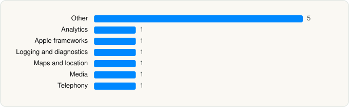

<picture><source media="(prefers-color-scheme: dark)" srcset="../../../../assets/logo/logo-dark.svg"></picture> [Tech Stack](../../../../README.md) / [Meta Platforms, Inc.](../../../../companies/meta-platforms-inc.md) / Facebook

# Facebook

<picture><source media="(prefers-color-scheme: dark)" srcset="../../../../assets/badges/ios-dark.svg"></picture> <picture><source media="(prefers-color-scheme: dark)" srcset="../../../../assets/badges/active-dark.svg"></picture> <picture><source media="(prefers-color-scheme: dark)" srcset="../../../../assets/badges/floor-dark.svg"></picture> <picture><source media="(prefers-color-scheme: dark)" srcset="../../../../assets/badges/encrypted-dark.svg"></picture>

[App Store](https://apps.apple.com/app/id284882215) · [latest.json](latest.json)

| | |
|---|---|
| Company | [Meta Platforms, Inc.](../../../../companies/meta-platforms-inc.md) |
| Store id | `284882215` |
| Bundle / package id | `com.facebook.Facebook` |
| Latest version | 564.0.0 (analysed 2026-06-23) |
| Versions tracked | 1 |
| SDKs in latest version | 11 |
| Languages | C/C++, Metal (shaders), Objective-C, Swift |
| UI | SwiftUI, UIKit |
| Build | Unknown / Xcode native |
| Minimum OS | iOS 15.1 (built with Xcode 26.2, SDK iphoneos26.2) |
| Devices / ABIs | iPhone, iPad |
| Localisations | 36 |
| Capabilities | 18 |
| Declares tracking | Yes |
| Tracked | Yes |

## SDKs by category

<picture><source media="(prefers-color-scheme: dark)" srcset="../../../../assets/charts/apps/ios/meta-platforms-inc/facebook-dark.svg"></picture>

- **Other** (5): FBCommunicationSoundKit, FBComposerLiteExtension, FBMediaProcessingKit, FBPhotosSyncKit, FBStickersKit
- **Analytics** (1): Facebook SDK
- **Apple frameworks** (1): InternalCollectionsUtilities
- **Logging and diagnostics** (1): FBBrowserIntegrityLoggingKit
- **Maps and location** (1): Mapbox
- **Media** (1): SpotifyiOS 5.0.1
- **Telephony** (1): libPhoneNumber

Frameworks (48)

ActivityKit (Live Activities), AdServices (Apple Search Ads attribution), AdSupport (IDFA), App Intents, App Tracking Transparency (ATT), ARKit, Authentication Services (Sign in with Apple / passkeys), AVFoundation (audio/video), AVKit, Background Tasks, CallKit (VoIP), Combine (reactive), Contacts, Core Bluetooth, Core Image, Core Location, Core ML, Core Motion, Core NFC, CryptoKit, DeviceCheck / App Attest, EventKit (Calendar / Reminders), Local Authentication (Face ID / Touch ID), MapKit, Media Player, MessageUI (mail / SMS compose), MetalKit, MetricKit (diagnostics), Natural Language, Network.framework, PassKit (Wallet / Apple Pay), Photos, PhotosUI, PushKit (VoIP push), RealityKit, SafariServices, SceneKit, SiriKit (Intents), Speech (recognition), SpriteKit, StoreKit (in-app purchase), Swift Charts, SwiftUI, UIKit, User Notifications, Vision, VisionKit (document/data scanning), WidgetKit (widgets)

Capabilities (18)

App Groups, Associated Domains (Universal Links), Background App Refresh, Background Audio, Background Processing, Background Push, Bluetooth (peripheral), CloudKit, Communication Notifications, External Accessory, iCloud, iCloud Key-Value Storage, Keychain Sharing, NFC, Push Notifications (APNs), SiriKit, Time-Sensitive Notifications, VoIP

## Version history

| Version | Analysed | Store update | SDKs | Change | SDK list is a floor | Binary encrypted | File |
|---|---|---|---|---|---|---|---|
| 564.0.0 | 2026-06-23 |  | 11 |  | Yes | Yes | [564.0.0.json](564.0.0.json) |

## Model-written summary

> SwiftUI/UIKit iOS app with 9 app extensions, App Intents, 47 Metal shaders, Mapbox markers, and App Attest

Written by a language model from the detected signals (`inferred[]`). It is commentary, not measurement.

---

Generated by `scripts/build_readme.py` from the JSON files. Do not edit by hand.
