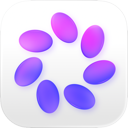
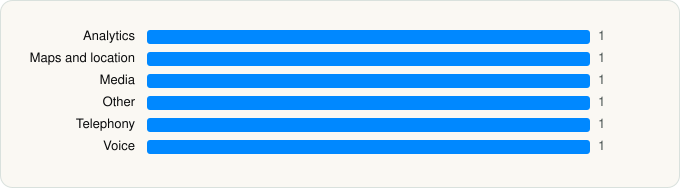

<picture><source media="(prefers-color-scheme: dark)" srcset="../../../../assets/logo/logo-dark.svg"></picture> [Tech Stack](../../../../README.md) / [Meta Platforms, Inc.](../../../../companies/meta-platforms-inc.md) / Meta AI

# Meta AI

<picture><source media="(prefers-color-scheme: dark)" srcset="../../../../assets/badges/ios-dark.svg"></picture> <picture><source media="(prefers-color-scheme: dark)" srcset="../../../../assets/badges/active-dark.svg"></picture> <picture><source media="(prefers-color-scheme: dark)" srcset="../../../../assets/badges/floor-dark.svg"></picture> <picture><source media="(prefers-color-scheme: dark)" srcset="../../../../assets/badges/encrypted-dark.svg"></picture>

[App Store](https://apps.apple.com/app/id1558240027) · [latest.json](latest.json)

| | |
|---|---|
| Company | [Meta Platforms, Inc.](../../../../companies/meta-platforms-inc.md) |
| Store id | `1558240027` |
| Bundle / package id | `com.facebook.stellaapp` |
| Latest version | 295.0.0 (analysed 2026-10-23) |
| Versions tracked | 4 |
| SDKs in latest version | 6 |
| Languages | C/C++, Metal (shaders), Objective-C, Swift |
| UI | SwiftUI, UIKit |
| Build | Unknown / Xcode native |
| Minimum OS | iOS 17.2 (built with Xcode 27.0, SDK iphoneos27.0) |
| Devices / ABIs | iPhone, iPad |
| Localisations | 43 |
| Capabilities | 14 |
| Declares tracking | No |
| Tracked | Yes |

## SDKs by category

<picture><source media="(prefers-color-scheme: dark)" srcset="../../../../assets/charts/apps/ios/meta-platforms-inc/meta-ai-dark.svg"></picture>

- **Analytics** (1): Facebook SDK
- **Maps and location** (1): Mapbox
- **Media** (1): SpotifyiOS 6.3.0
- **Other** (1): ConnectIQ 1.0
- **Telephony** (1): libPhoneNumber
- **Voice** (1): LiveKit 1.0

Frameworks (46)

ActivityKit (Live Activities), AdServices (Apple Search Ads attribution), AdSupport (IDFA), App Intents, App Tracking Transparency (ATT), ARKit, Authentication Services (Sign in with Apple / passkeys), AVFoundation (audio/video), AVKit, Background Tasks, CallKit (VoIP), Combine (reactive), Contacts, Core Bluetooth, Core Image, Core Location, Core ML, Core Motion, CryptoKit, DeviceCheck / App Attest, EventKit (Calendar / Reminders), HealthKit, Local Authentication (Face ID / Touch ID), MapKit, Media Player, MessageUI (mail / SMS compose), MetalKit, MetricKit (diagnostics), MusicKit, Natural Language, Network.framework, PassKit (Wallet / Apple Pay), PencilKit, Photos, PhotosUI, RealityKit, SafariServices, SceneKit, SiriKit (Intents), Speech (recognition), StoreKit (in-app purchase), SwiftUI, UIKit, User Notifications, Vision, WidgetKit (widgets)

Capabilities (14)

App Groups, Associated Domains (Universal Links), Background App Refresh, Background Audio, Background Location, Background Processing, Background Push, Bluetooth (central), CarPlay, External Accessory, HealthKit, Keychain Sharing, Push Notifications (APNs), Time-Sensitive Notifications

## Version history

| Version | Analysed | Store update | SDKs | Change | SDK list is a floor | Binary encrypted | File |
|---|---|---|---|---|---|---|---|
| 295.0.0 | 2026-10-23 | 2026-10-19 | 6 | +0 / −0 | Yes | Yes | [295.0.0.json](295.0.0.json) |
| 276.0.0 | 2026-06-23 |  | 6 | +1 / −0 | Yes | Yes | [276.0.0.json](276.0.0.json) |
| 275.0.0 | 2026-06-09 |  | 5 | +0 / −0 | Yes | Yes | [275.0.0.json](275.0.0.json) |
| 274.1.1 | 2026-06-01 |  | 5 |  | Yes | Yes | [274.1.1.json](274.1.1.json) |

### SDK changes between versions

- 275.0.0 → 276.0.0: added Mapbox

---

Generated by `scripts/build_readme.py` from the JSON files. Do not edit by hand.
