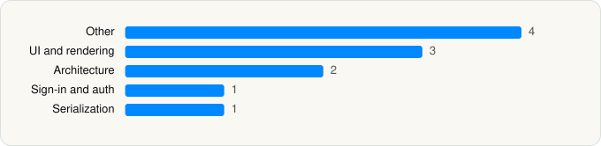

<picture><source media="(prefers-color-scheme: dark)" srcset="../../../../assets/logo/logo-dark.svg"></picture> [Tech Stack](../../../../README.md) / [Microsoft Corporation](../../../../companies/microsoft-corporation.md) / Microsoft Authenticator

# Microsoft Authenticator

<picture><source media="(prefers-color-scheme: dark)" srcset="../../../../assets/badges/ios-dark.svg"></picture> <picture><source media="(prefers-color-scheme: dark)" srcset="../../../../assets/badges/inactive-dark.svg"></picture> <picture><source media="(prefers-color-scheme: dark)" srcset="../../../../assets/badges/floor-dark.svg"></picture> <picture><source media="(prefers-color-scheme: dark)" srcset="../../../../assets/badges/encrypted-dark.svg"></picture>

[App Store](https://apps.apple.com/app/id983156458) · [latest.json](latest.json)

| | |
|---|---|
| Company | [Microsoft Corporation](../../../../companies/microsoft-corporation.md) |
| Store id | `983156458` |
| Bundle / package id | `com.microsoft.azureauthenticator` |
| Latest version | 6.8.48 (analysed 2026-06-19) |
| Versions tracked | 1 |
| SDKs in latest version | 11 |
| Languages | C/C++, Objective-C, Swift |
| UI | Lottie (animations), SwiftUI, UIKit |
| Build | Unknown / Xcode native |
| Minimum OS | iOS 17.0 (built with Xcode 26.3, SDK iphoneos26.2) |
| Devices / ABIs | iPhone, iPad |
| Localisations | 44 |
| Capabilities | 11 |
| Declares tracking | No |
| Tracked | No. Kept for history. |

## SDKs by category

<picture><source media="(prefers-color-scheme: dark)" srcset="../../../../assets/charts/apps/ios/microsoft-corporation/microsoft-authenticator-dark.svg"></picture>

- **Other** (4): CorrelationVector 1.0.0, PowerLiftKit 5.6.0, PresenterSplitView 1.0, PromiseKit 6.22.1
- **UI and rendering** (3): FluentIcons 1.1.207, FluentUI 0.5.3, Lottie 4.4.2
- **Architecture** (2): Swinject 2.8.6, SwinjectAutoregistration 2.8.4
- **Sign-in and auth** (1): AppAuth 1.0
- **Serialization** (1): SwiftProtobuf 1.26.0

Frameworks (9)

AVFoundation (audio/video), Background Tasks, CloudKit, Core Data, Core Location, StoreKit (in-app purchase), SwiftUI, UIKit, User Notifications

Capabilities (11)

App Groups, Associated Domains (Universal Links), AutoFill Credentials, Background App Refresh, Background Processing, Background Push, CloudKit, iCloud, Keychain Sharing, Push Notifications (APNs), Time-Sensitive Notifications

## Version history

| Version | Analysed | Store update | SDKs | Change | SDK list is a floor | Binary encrypted | File |
|---|---|---|---|---|---|---|---|
| 6.8.48 | 2026-06-19 |  | 11 |  | Yes | Yes | [6.8.48.json](6.8.48.json) |

## Model-written summary

> iOS Microsoft Authenticator with SwiftUI/UIKit, MSAL/IntuneMAM/VerifiableCredentialWallet modules, SSO and autofill extensions, App Attest, Secure Enclave, and FluentUI

Written by a language model from the detected signals (`inferred[]`). It is commentary, not measurement.

---

Generated by `scripts/build_readme.py` from the JSON files. Do not edit by hand.
