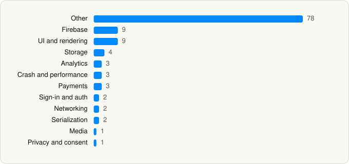

<picture><source media="(prefers-color-scheme: dark)" srcset="../../../../assets/logo/logo-dark.svg"></picture> [Tech Stack](../../../../README.md) / [Microsoft Corporation](../../../../companies/microsoft-corporation.md) / Microsoft Bing Search

# Microsoft Bing Search

<picture><source media="(prefers-color-scheme: dark)" srcset="../../../../assets/badges/ios-dark.svg"></picture> <picture><source media="(prefers-color-scheme: dark)" srcset="../../../../assets/badges/inactive-dark.svg"></picture> <picture><source media="(prefers-color-scheme: dark)" srcset="../../../../assets/badges/floor-dark.svg"></picture> <picture><source media="(prefers-color-scheme: dark)" srcset="../../../../assets/badges/encrypted-dark.svg"></picture>

[App Store](https://apps.apple.com/app/id345323231) · [latest.json](latest.json)

| | |
|---|---|
| Company | [Microsoft Corporation](../../../../companies/microsoft-corporation.md) |
| Store id | `345323231` |
| Bundle / package id | `com.microsoft.bing` |
| Latest version | 33.4.440605001 (analysed 2026-06-19) |
| Versions tracked | 2 |
| SDKs in latest version | 117 |
| Languages | C/C++, Metal (shaders), Objective-C, React Native / JavaScript, Swift |
| UI | Lottie (animations), SwiftUI, UIKit |
| Build | Swift Package Manager (SwiftPM) |
| Minimum OS | iOS 16.0 (built with Xcode 26.3, SDK iphoneos26.2) |
| Devices / ABIs | iPhone, iPad |
| Localisations | 45 |
| Capabilities | 7 |
| Declares tracking | Yes |
| Tracked | No. Kept for history. |

## SDKs by category

<picture><source media="(prefers-color-scheme: dark)" srcset="../../../../assets/charts/apps/ios/microsoft-corporation/microsoft-bing-search-dark.svg"></picture>

- **Other** (78): Accounts, AnswerCards, AnswerCardsAds, AnswerCardsComposeEmail, AnswerCardsFinance, AnswerCardsFlashcard, AnswerCardsJob, AnswerCardsLocal, AnswerCardsM365, AnswerCardsMedia, AnswerCardsPersonalArtifacts, AnswerCardsQuiz, AnswerCardsRecipe, AnswerCardsSafetyHelpline, AnswerCardsShopping, AnswerCardsShoppingCuration, AnswerCardsSports, AnswerCardsWeather, AppAppearanceSettings, Attachments, AutoSuggestions, Banning, Camera, CameraSearch, ChainOfThought, ChatAPI, ChatInfra, ChatModal, ChatSessions, Citations, Composer, CopilotDesignSystem, CopilotPayAPI, CopilotVision, DeepResearch, DeveloperOptions, Discover, FeatureLimit, Feedback, FlexLayout-Dynamic 1.0, FoundationExtensions, GenUI, GLTFKit2 1.0, GroupChat, Healthcare, Home, KumoDesignSystem, Lodash, Lumi, M365Redirection, MainContent, MapFoundation, MapLibre 6.11.0, MediaFoundation, Memory, MsnWebBridge, Notifications, Pages, PagesAPI, PagesWebView, Podcast, Promotions, ReadAloud, Recipe, Reminders, Root, SapphireMiniApp, SapphireUIComponent, Share, Shopping, ThinkDeeper, TurnLimits, UserSurvey, VideoGen, ViewComponents, VoiceCall, VoiceSettings, YouTubePlayerKit
- **Firebase** (9): FBLPromises, Firebase, FirebaseCore, FirebaseCoreInternal, FirebaseInstallations, GoogleDataTransport, GoogleUtilities, nanopb, Promises
- **UI and rendering** (9): FluentIcons, Highlight.js 11.7.0, HighlightSwift, iosMath, Lottie 4.6.0, MarkdownText, React Native, SDWebImage, SDWebImageSwiftUI
- **Storage** (4): MMKV 1.3.14, MMKVCore 1.3.14, Realm, RealmSwift
- **Analytics** (3): Adjust 1.0, AdjustSdk, Attribution
- **Crash and performance** (3): AppCenter, FirebaseCrashlytics, Sentry 8.58.0
- **Payments** (3): CopilotPayCheckout, ManageSubscription, ShopifyCheckoutSheetKit
- **Sign-in and auth** (2): Auth0, Authentication
- **Networking** (2): Alamofire, Axios
- **Serialization** (2): SwiftProtobuf, SwiftyJSON
- **Media** (1): PlaybackKit
- **Privacy and consent** (1): AnswerCardsConsent

Frameworks (37)

ActivityKit (Live Activities), AdServices (Apple Search Ads attribution), AdSupport (IDFA), App Intents, App Tracking Transparency (ATT), Authentication Services (Sign in with Apple / passkeys), AVFoundation (audio/video), AVKit, Background Tasks, Combine (reactive), Contacts, Core Data, Core Image, Core Location, CryptoKit, DeviceCheck / App Attest, Local Authentication (Face ID / Touch ID), MapKit, Media Player, MessageUI (mail / SMS compose), MetalKit, MetricKit (diagnostics), Network.framework, PDFKit, Photos, PhotosUI, RealityKit, SafariServices, SceneKit, SiriKit (Intents), Speech (recognition), StoreKit (in-app purchase), Swift Charts, SwiftUI, UIKit, User Notifications, WidgetKit (widgets)

Capabilities (7)

App Groups, Associated Domains (Universal Links), Background Audio, Background Processing, Keychain Sharing, Push Notifications (APNs), VoIP

## Version history

| Version | Analysed | Store update | SDKs | Change | SDK list is a floor | Binary encrypted | File |
|---|---|---|---|---|---|---|---|
| 33.4.440605001 | 2026-06-19 |  | 117 | +7 / −0 | Yes | Yes | [33.4.440605001.json](33.4.440605001.json) |
| 33.4.440603001 | 2026-06-09 |  | 110 |  | Yes | Yes | [33.4.440603001.json](33.4.440603001.json) |

### SDK changes between versions

- 33.4.440603001 → 33.4.440605001: added AdjustSdk, Axios, FirebaseCore, Highlight.js, Lodash, MMKVCore, React Native

---

Generated by `scripts/build_readme.py` from the JSON files. Do not edit by hand.
