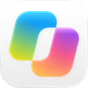
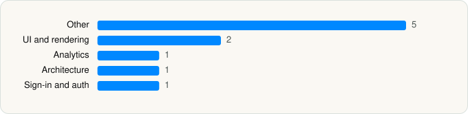

<picture><source media="(prefers-color-scheme: dark)" srcset="../../../../assets/logo/logo-dark.svg"></picture> [Tech Stack](../../../../README.md) / [Microsoft Corporation](../../../../companies/microsoft-corporation.md) / Microsoft Copilot

# Microsoft Copilot

<picture><source media="(prefers-color-scheme: dark)" srcset="../../../../assets/badges/ios-dark.svg"></picture> <picture><source media="(prefers-color-scheme: dark)" srcset="../../../../assets/badges/active-dark.svg"></picture> <picture><source media="(prefers-color-scheme: dark)" srcset="../../../../assets/badges/floor-dark.svg"></picture> <picture><source media="(prefers-color-scheme: dark)" srcset="../../../../assets/badges/encrypted-dark.svg"></picture>

[App Store](https://apps.apple.com/app/id541164041) · [latest.json](latest.json)

| | |
|---|---|
| Company | [Microsoft Corporation](../../../../companies/microsoft-corporation.md) |
| Store id | `541164041` |
| Bundle / package id | `com.microsoft.officemobile` |
| Latest version | 2.115.1 (analysed 2026-10-24) |
| Versions tracked | 1 |
| SDKs in latest version | 10 |
| Languages | C/C++, Metal (shaders), Objective-C, React Native / JavaScript, Swift |
| UI | SwiftUI, UIKit |
| Build | Swift Package Manager (SwiftPM) |
| Minimum OS | iOS 26.0 (built with Xcode 26.4.1, SDK iphoneos26.4) |
| Devices / ABIs | iPhone, iPad |
| Localisations | 37 |
| Capabilities | 13 |
| Declares tracking | Yes |
| Tracked | Yes |

## SDKs by category

<picture><source media="(prefers-color-scheme: dark)" srcset="../../../../assets/charts/apps/ios/microsoft-corporation/microsoft-copilot-dark.svg"></picture>

- **Other** (5): AzureCommunicationCommon 1.2.0, intl, LocalizedStringKit, Lodash, minsdx
- **UI and rendering** (2): React Native, react-native-svg
- **Analytics** (1): Amplitude
- **Architecture** (1): Redux
- **Sign-in and auth** (1): GoogleSignIn

Frameworks (45)

ActivityKit (Live Activities), AdServices (Apple Search Ads attribution), AdSupport (IDFA), App Intents, App Tracking Transparency (ATT), Authentication Services (Sign in with Apple / passkeys), AVFoundation (audio/video), AVKit, Background Tasks, CallKit (VoIP), Combine (reactive), Contacts, Core Data, Core Image, Core ML, Core Motion, CryptoKit, DeviceCheck / App Attest, Group Activities (SharePlay), Local Authentication (Face ID / Touch ID), MapKit, Media Player, MessageUI (mail / SMS compose), MetalKit, MetricKit (diagnostics), Natural Language, Network.framework, PassKit (Wallet / Apple Pay), PDFKit, PencilKit, Photos, PhotosUI, SafariServices, SiriKit (Intents), Speech (recognition), SpriteKit, StoreKit (in-app purchase), Swift Charts, SwiftUI, UIKit, User Notifications, Vision, VisionKit (document/data scanning), Watch Connectivity, WidgetKit (widgets)

Capabilities (13)

App Groups, Associated Domains (Universal Links), Background App Refresh, Background Audio, Background Processing, Background Push, CarPlay, CloudKit, Custom Fonts, iCloud, Keychain Sharing, Push Notifications (APNs), Sign in with Apple

## Version history

| Version | Analysed | Store update | SDKs | Change | SDK list is a floor | Binary encrypted | File |
|---|---|---|---|---|---|---|---|
| 2.115.1 | 2026-10-24 | 2026-10-19 | 10 |  | Yes | Yes | [2.115.1.json](2.115.1.json) |

---

Generated by `scripts/build_readme.py` from the JSON files. Do not edit by hand.
