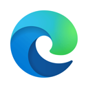
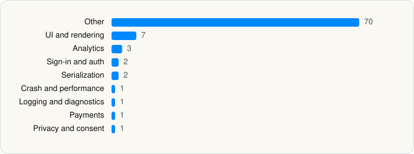

<picture><source media="(prefers-color-scheme: dark)" srcset="../../../../assets/logo/logo-dark.svg"></picture> [Tech Stack](../../../../README.md) / [Microsoft Corporation](../../../../companies/microsoft-corporation.md) / Microsoft Edge

# Microsoft Edge

<picture><source media="(prefers-color-scheme: dark)" srcset="../../../../assets/badges/ios-dark.svg"></picture> <picture><source media="(prefers-color-scheme: dark)" srcset="../../../../assets/badges/active-dark.svg"></picture> <picture><source media="(prefers-color-scheme: dark)" srcset="../../../../assets/badges/floor-dark.svg"></picture> <picture><source media="(prefers-color-scheme: dark)" srcset="../../../../assets/badges/encrypted-dark.svg"></picture>

[App Store](https://apps.apple.com/app/id1288723196) · [latest.json](latest.json)

| | |
|---|---|
| Company | [Microsoft Corporation](../../../../companies/microsoft-corporation.md) |
| Store id | `1288723196` |
| Bundle / package id | `com.microsoft.msedge` |
| Latest version | 156.4314.56 (analysed 2026-11-02) |
| Versions tracked | 2 |
| SDKs in latest version | 88 |
| Languages | C/C++, Metal (shaders), Objective-C, Swift |
| UI | Lottie (animations), SwiftUI, UIKit |
| Build | Swift Package Manager (SwiftPM) |
| Minimum OS | iOS 18.0 (built with Xcode 27.0, SDK iphoneos27.0) |
| Devices / ABIs | iPhone, iPad |
| Localisations | 48 |
| Capabilities | 10 |
| Declares tracking | Yes |
| Tracked | Yes |

## SDKs by category

<picture><source media="(prefers-color-scheme: dark)" srcset="../../../../assets/charts/apps/ios/microsoft-corporation/microsoft-edge-dark.svg"></picture>

- **Other** (70): Accounts, AnswerCards, AnswerCardsComposeEmail, AnswerCardsFinance, AnswerCardsFlashcard, AnswerCardsJob, AnswerCardsM365, AnswerCardsMedia, AnswerCardsPersonalArtifacts, AnswerCardsQuiz, AnswerCardsRecipe, AnswerCardsSafetyHelpline, AnswerCardsSports, AnswerCardsWeather, Attachments, AutoSuggestions, Banning, BingKit 1.0, Camera, ChainOfThought, ChatInfra, ChatModal, ChatSessions, Citations, Composer, CopilotDesignSystem, CopilotRealTimeAudioProvider, CopilotUIKit, CopilotVision, crypto 3.1.2, CTXMAMAppCore 24.2.0, CTXMAMCore 24.2.0, CTXMAMNetwork 24.2.0, DeepResearch, DeveloperOptions, FeatureLimit, Feedback, FluentUIResources-ios 0.35.0, FoundationExtensions, GroupChat, Home, MainContent, MCPCommon 2.1.2, MCPCore 2.1.2, MCPPluginUnencryptedFile 2.1.2, MediaFoundation, MicrosoftTunnelApi 2.1.2, MsnWebBridge, MSTAPNextPluginSecurityOpenssl 2.1.2, MSTAPNextPluginVpnMicrosoftTunnel 2.1.2, Notifications, OneAuth 1.0, Pages, PagesAPI, PagesWebView, Podcast, Promotions, ReadAloud, Recipe, Reminders, Root, Share, ssl 3.1.2, ThinkDeeper, TurnLimits, VideoGen, ViewComponents, VoiceCall, VoiceSettings, YouTubePlayerKit
- **UI and rendering** (7): Highlight.js 11.9.0, HighlightSwift, iosMath, Lottie 4.6.0, MarkdownText, SDWebImage, SDWebImageSwiftUI
- **Analytics** (3): Adjust 1.0, AdjustSdk 1.0, Attribution
- **Sign-in and auth** (2): Auth0, Authentication
- **Serialization** (2): SwiftProtobuf, SwiftyJSON
- **Crash and performance** (1): Sentry 9.30.2
- **Logging and diagnostics** (1): CitrixLogger 24.2.0
- **Payments** (1): ManageSubscription
- **Privacy and consent** (1): AnswerCardsConsent

Frameworks (40)

ActivityKit (Live Activities), AdServices (Apple Search Ads attribution), AdSupport (IDFA), App Intents, App Tracking Transparency (ATT), ARKit, Authentication Services (Sign in with Apple / passkeys), AVFoundation (audio/video), AVKit, Background Tasks, CallKit (VoIP), Combine (reactive), Contacts, Core Data, Core Image, Core Location, Core ML, CryptoKit, Group Activities (SharePlay), Local Authentication (Face ID / Touch ID), Media Player, MessageUI (mail / SMS compose), MetricKit (diagnostics), Network.framework, PassKit (Wallet / Apple Pay), PDFKit, Photos, PhotosUI, SafariServices, SceneKit, SiriKit (Intents), Speech (recognition), StoreKit (in-app purchase), Swift Charts, SwiftUI, UIKit, User Notifications, Vision, VisionKit (document/data scanning), WidgetKit (widgets)

Capabilities (10)

App Groups, Associated Domains (Universal Links), AutoFill Credentials, Background App Refresh, Background Audio, Background Processing, Background Push, Keychain Sharing, Push Notifications (APNs), Sign in with Apple

## Version history

| Version | Analysed | Store update | SDKs | Change | SDK list is a floor | Binary encrypted | File |
|---|---|---|---|---|---|---|---|
| 156.4314.56 | 2026-11-02 | 2026-11-02 | 88 | +3 / −0 | Yes | Yes | [156.4314.56.json](156.4314.56.json) |
| 148.3967.97 | 2026-06-19 |  | 85 |  | Yes | Yes | [148.3967.97.json](148.3967.97.json) |

### SDK changes between versions

- 148.3967.97 → 156.4314.56: added AdjustSdk, Highlight.js, Sentry

---

Generated by `scripts/build_readme.py` from the JSON files. Do not edit by hand.
