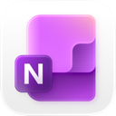
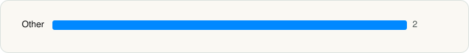

<picture><source media="(prefers-color-scheme: dark)" srcset="../../../../assets/logo/logo-dark.svg"></picture> [Tech Stack](../../../../README.md) / [Microsoft Corporation](../../../../companies/microsoft-corporation.md) / Microsoft OneNote

# Microsoft OneNote

<picture><source media="(prefers-color-scheme: dark)" srcset="../../../../assets/badges/ios-dark.svg"></picture> <picture><source media="(prefers-color-scheme: dark)" srcset="../../../../assets/badges/inactive-dark.svg"></picture> <picture><source media="(prefers-color-scheme: dark)" srcset="../../../../assets/badges/floor-dark.svg"></picture> <picture><source media="(prefers-color-scheme: dark)" srcset="../../../../assets/badges/encrypted-dark.svg"></picture>

[App Store](https://apps.apple.com/app/id410395246) · [latest.json](latest.json)

| | |
|---|---|
| Company | [Microsoft Corporation](../../../../companies/microsoft-corporation.md) |
| Store id | `410395246` |
| Bundle / package id | `com.microsoft.onenote` |
| Latest version | 16.109.3 (analysed 2026-06-11) |
| Versions tracked | 1 |
| SDKs in latest version | 2 |
| Languages | C/C++, Metal (shaders), Objective-C, React Native / JavaScript, Swift |
| UI | SwiftUI, UIKit |
| Build | Swift Package Manager (SwiftPM) |
| Minimum OS | iOS 18.0 (built with Xcode 26.2, SDK iphoneos26.2) |
| Devices / ABIs | iPhone, iPad |
| Localisations | 37 |
| Capabilities | 10 |
| Declares tracking | No |
| Tracked | No. Kept for history. |

## SDKs by category

<picture><source media="(prefers-color-scheme: dark)" srcset="../../../../assets/charts/apps/ios/microsoft-corporation/microsoft-onenote-dark.svg"></picture>

- **Other** (2): intl, LocalizedStringKit

Frameworks (17)

App Intents, AVFoundation (audio/video), AVKit, Background Tasks, Core Data, Core ML, MetalKit, Natural Language, PassKit (Wallet / Apple Pay), SpriteKit, StoreKit (in-app purchase), SwiftUI, UIKit, User Notifications, Vision, Watch Connectivity, WidgetKit (widgets)

Capabilities (10)

App Groups, Associated Domains (Universal Links), Background App Refresh, Background Audio, Background Processing, Background Push, Custom Fonts, iCloud Key-Value Storage, Keychain Sharing, Push Notifications (APNs)

## Version history

| Version | Analysed | Store update | SDKs | Change | SDK list is a floor | Binary encrypted | File |
|---|---|---|---|---|---|---|---|
| 16.109.3 | 2026-06-11 |  | 2 |  | Yes | Yes | [16.109.3.json](16.109.3.json) |

## Model-written summary

> SwiftUI/UIKit hybrid with React Native for Microsoft OneNote, featuring on-device UNET ML, 10 Metal shaders, Intune MAM, and Aria/Loki Microsoft backends

Written by a language model from the detected signals (`inferred[]`). It is commentary, not measurement.

---

Generated by `scripts/build_readme.py` from the JSON files. Do not edit by hand.
