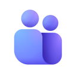
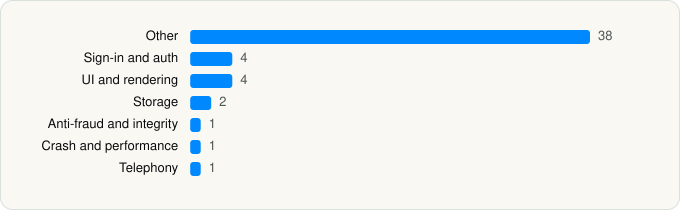

<picture><source media="(prefers-color-scheme: dark)" srcset="../../../../assets/logo/logo-dark.svg"></picture> [Tech Stack](../../../../README.md) / [Microsoft Corporation](../../../../companies/microsoft-corporation.md) / Microsoft Teams

# Microsoft Teams

<picture><source media="(prefers-color-scheme: dark)" srcset="../../../../assets/badges/ios-dark.svg"></picture> <picture><source media="(prefers-color-scheme: dark)" srcset="../../../../assets/badges/active-dark.svg"></picture> <picture><source media="(prefers-color-scheme: dark)" srcset="../../../../assets/badges/floor-dark.svg"></picture> <picture><source media="(prefers-color-scheme: dark)" srcset="../../../../assets/badges/encrypted-dark.svg"></picture>

[App Store](https://apps.apple.com/app/id1113153706) · [latest.json](latest.json)

| | |
|---|---|
| Company | [Microsoft Corporation](../../../../companies/microsoft-corporation.md) |
| Store id | `1113153706` |
| Bundle / package id | `com.microsoft.skype.teams` |
| Latest version | 8.19.3 (analysed 2026-11-06) |
| Versions tracked | 3 |
| SDKs in latest version | 51 |
| Languages | C/C++, Metal (shaders), Objective-C, Swift |
| UI | Lottie (animations), SwiftUI, UIKit |
| Build | Swift Package Manager (SwiftPM) |
| Minimum OS | iOS 17.0 (built with Xcode 26.3, SDK iphoneos26.2) |
| Devices / ABIs | iPhone, iPad |
| Localisations | 52 |
| Capabilities | 19 |
| Declares tracking | No |
| Tracked | Yes |

## SDKs by category

<picture><source media="(prefers-color-scheme: dark)" srcset="../../../../assets/charts/apps/ios/microsoft-corporation/microsoft-teams-dark.svg"></picture>

- **Other** (38): AdaptiveCards 2.12.1, AudioUI, AXPConfig, BizChatCopilot, CalendarEvents, CalendarUI, CallingUI, CallingVideoExtensibility, CallingVideoRenderer, CentroLib, Communities, ContributorAI, ContributorBookmark, CopilotImageRenderer, CopilotRealTimeAudioProvider, CopilotUIKit, DateTools, EditorAugmentation, FileBrowser, FluentUIResources-ios 0.35.0, Gallery 0.0.11, hermes.ios, LocalizedStringKit 6.7.3, Lodash, LoopKit, MeetingArtifacts, MessagingUI, MSIX 0.5.3, OneAuth 11.1.1, OnePlayerCore 9.5.41, OnePlayerExtensions 9.5.41, OnePlayerUI 9.5.41, QOTDNavigationContributor, SAMCategories, SharedLinks, SHConfig, VideoMessaging 0.0.1, WalkieTalkie
- **Sign-in and auth** (4): AppAuth 1.7.3, GoogleSignIn 7.1.0, GTMAppAuth 4.1.1, GTMSessionFetcher 3.3.2
- **UI and rendering** (4): Kingfisher 7.11.0, Lottie 4.5.0, MsgAnimations 0.0.1, SDWebImage 5.19.0
- **Storage** (2): ExtensibilityPlatform, PlatformAppStore
- **Anti-fraud and integrity** (1): Persona
- **Crash and performance** (1): AppCenter
- **Telephony** (1): PhoneNumberKit 3.8.0

Frameworks (42)

ActivityKit (Live Activities), App Intents, ARKit, Authentication Services (Sign in with Apple / passkeys), AVFoundation (audio/video), AVKit, Background Tasks, CallKit (VoIP), Combine (reactive), Contacts, Core Bluetooth, Core Data, Core Image, Core Location, Core ML, Core Motion, CryptoKit, DeviceCheck / App Attest, EventKit (Calendar / Reminders), Group Activities (SharePlay), Local Authentication (Face ID / Touch ID), MapKit, Media Player, MessageUI (mail / SMS compose), MetalKit, MetricKit (diagnostics), Natural Language, Network.framework, Photos, PhotosUI, PushKit (VoIP push), RealityKit, SafariServices, SiriKit (Intents), Speech (recognition), StoreKit (in-app purchase), SwiftUI, UIKit, User Notifications, Vision, VisionKit (document/data scanning), WidgetKit (widgets)

Capabilities (19)

App Attest, App Groups, Associated Domains (Universal Links), Background App Refresh, Background Audio, Background Location, Background Push, Background: push-to-talk, Bluetooth (central), CarPlay, CloudKit, Communication Notifications, External Accessory, iCloud, iCloud Key-Value Storage, Keychain Sharing, Push Notifications (APNs), SiriKit, VoIP

## Version history

| Version | Analysed | Store update | SDKs | Change | SDK list is a floor | Binary encrypted | File |
|---|---|---|---|---|---|---|---|
| 8.19.3 | 2026-11-06 | 2026-11-05 | 51 | +0 / −0 | Yes | Yes | [8.19.3.json](8.19.3.json) |
| 8.19.2 | 2026-11-02 | 2026-10-30 | 51 | +0 / −0 | Yes | Yes | [8.19.2.json](8.19.2.json) |
| 8.19.1 | 2026-10-24 | 2026-10-23 | 51 |  | Yes | Yes | [8.19.1.json](8.19.1.json) |

---

Generated by `scripts/build_readme.py` from the JSON files. Do not edit by hand.
