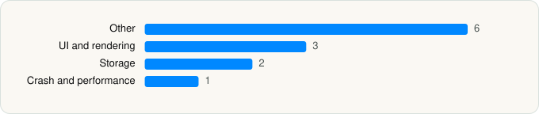

<picture><source media="(prefers-color-scheme: dark)" srcset="../../../../assets/logo/logo-dark.svg"></picture> [Tech Stack](../../../../README.md) / [Microsoft Corporation](../../../../companies/microsoft-corporation.md) / Microsoft To Do

# Microsoft To Do

<picture><source media="(prefers-color-scheme: dark)" srcset="../../../../assets/badges/ios-dark.svg"></picture> <picture><source media="(prefers-color-scheme: dark)" srcset="../../../../assets/badges/inactive-dark.svg"></picture> <picture><source media="(prefers-color-scheme: dark)" srcset="../../../../assets/badges/floor-dark.svg"></picture> <picture><source media="(prefers-color-scheme: dark)" srcset="../../../../assets/badges/encrypted-dark.svg"></picture>

[App Store](https://apps.apple.com/app/id1212616790) · [latest.json](latest.json)

| | |
|---|---|
| Company | [Microsoft Corporation](../../../../companies/microsoft-corporation.md) |
| Store id | `1212616790` |
| Bundle / package id | `com.microsoft.to-do` |
| Latest version | 2.177 (analysed 2026-11-02) |
| Versions tracked | 2 |
| SDKs in latest version | 12 |
| Languages | C/C++, Objective-C, React Native / JavaScript, Swift |
| UI | Lottie (animations), SwiftUI, UIKit |
| Build | Unknown / Xcode native |
| Minimum OS | iOS 17.6 (built with Xcode 26.2, SDK iphoneos26.2) |
| Devices / ABIs | iPhone, iPad |
| Localisations | 36 |
| Capabilities | 8 |
| Declares tracking | No |
| Tracked | No. Kept for history. |

## SDKs by category

<picture><source media="(prefers-color-scheme: dark)" srcset="../../../../assets/charts/apps/ios/microsoft-corporation/microsoft-to-do-dark.svg"></picture>

- **Other** (6): FluentUIResources-ios 0.34.4, GNETextSearch 1.0, Lodash, Moment.js, ODSPSharedAccounts 2.3.9, OfficeFloodgateSDK 8.2.0
- **UI and rendering** (3): hermes 0.11.0, Lottie 4.4.3, React Native
- **Storage** (2): KeychainAccess 3.2.1, SQLite.swift 0.15.3
- **Crash and performance** (1): AppCenter 5.0.5

Frameworks (25)

AdSupport (IDFA), Authentication Services (Sign in with Apple / passkeys), AVFoundation (audio/video), AVKit, Background Tasks, Combine (reactive), Core Data, Core Image, CryptoKit, Group Activities (SharePlay), Local Authentication (Face ID / Touch ID), MessageUI (mail / SMS compose), MetricKit (diagnostics), Network.framework, Photos, SafariServices, SiriKit (Intents), Speech (recognition), StoreKit (in-app purchase), SwiftUI, UIKit, User Notifications, VisionKit (document/data scanning), Watch Connectivity, WidgetKit (widgets)

Capabilities (8)

App Groups, Associated Domains (Universal Links), Background App Refresh, Background Processing, Background Push, Keychain Sharing, Push Notifications (APNs), Time-Sensitive Notifications

## Version history

| Version | Analysed | Store update | SDKs | Change | SDK list is a floor | Binary encrypted | File |
|---|---|---|---|---|---|---|---|
| 2.177 | 2026-11-02 | 2026-07-06 | 12 | +0 / −0 | Yes | Yes | [2.177.json](2.177.json) |
| 2.169 | 2026-06-19 | 2026-03-09 | 12 |  | Yes | Yes | [2.169.json](2.169.json) |

---

Generated by `scripts/build_readme.py` from the JSON files. Do not edit by hand.
