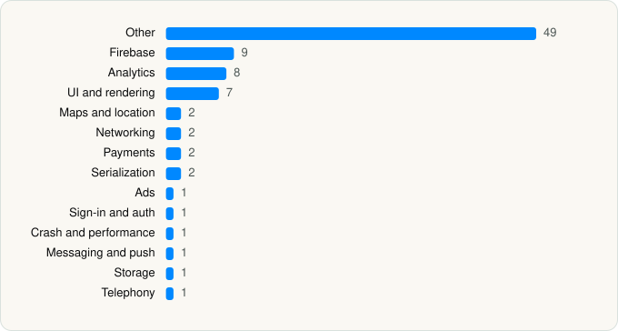

<picture><source media="(prefers-color-scheme: dark)" srcset="../../../../assets/logo/logo-dark.svg"></picture> [Tech Stack](../../../../README.md) / [Ministry of Hajj and Umrah](../../../../companies/ministry-of-hajj-and-umrah.md) / Nusuk

# Nusuk \| نسك

<picture><source media="(prefers-color-scheme: dark)" srcset="../../../../assets/badges/ios-dark.svg"></picture> <picture><source media="(prefers-color-scheme: dark)" srcset="../../../../assets/badges/inactive-dark.svg"></picture> <picture><source media="(prefers-color-scheme: dark)" srcset="../../../../assets/badges/floor-dark.svg"></picture> <picture><source media="(prefers-color-scheme: dark)" srcset="../../../../assets/badges/encrypted-dark.svg"></picture>

[App Store](https://apps.apple.com/app/id6469515422) · [latest.json](latest.json)

| | |
|---|---|
| Company | [Ministry of Hajj and Umrah](../../../../companies/ministry-of-hajj-and-umrah.md) |
| Store id | `6469515422` |
| Bundle / package id | `com.moh.nusukapp` |
| Latest version | 11.19.2 (analysed 2026-11-18) |
| Versions tracked | 1 |
| SDKs in latest version | 87 |
| Languages | C/C++, Metal (shaders), Objective-C, Swift |
| UI | Lottie (animations), SwiftUI, UIKit |
| Build | Swift Package Manager (SwiftPM) |
| Minimum OS | iOS 18.0 (built with Xcode 27.1, SDK iphoneos27.1) |
| Devices / ABIs | iPhone |
| Localisations | 45 |
| Capabilities | 8 |
| Declares tracking | Yes |
| Tracked | No. Kept for history. |

## SDKs by category

<picture><source media="(prefers-color-scheme: dark)" srcset="../../../../assets/charts/apps/ios/ministry-of-hajj-and-umrah/nusuk-dark.svg"></picture>

- **Other** (49): Adahi, Adhan, Almatar, AlmatarSDK, Athkar, Certificate, ClockTower, CommonModule, ComponentsUI, ContentsquareCore 0.2.0, ContentsquareModule 4.52.3, ContentsquareModuleWrapper, ContentsquareSDK, ContentsquareUICore 0.1.0, CSCrashReporter 1.0, Factory, FactoryKit, FamilyAndFriends, FAQHelper, FoundationUI, Game, GenericLocalization, GolfCarts, Hadith, Haircut, Hajj, Home, Manasek, ManasekHelper, Maps, Motawef, Notifications, PrayerTimesModule, Qibla, Quran, Rawdah, Sebha, ServiceType, SideMenu, SitumSDK 1.0, Strapi, SupportCenter, Survey, Thikr, TygoSim, Umrah, UmrahJourney, VisaService, Zamzam
- **Firebase** (9): FBLPromises, Firebase, FirebaseCore, FirebaseCoreInternal, FirebaseInstallations, GoogleDataTransport, GoogleUtilities, nanopb, Promises
- **Analytics** (8): Adjust 1.0, AdjustSdk, AppsFlyerLib 1.0, FirebaseAnalytics 12.19.2, GoogleAppMeasurement 12.19.2, GoogleAppMeasurementIdentitySupport 12.19.2, Heap, Kochava 9.1.0
- **UI and rendering** (7): DotLottiePlayer 0.1.57, Kingfisher, Lottie 1.0, SDWebImage, SDWebImageSwiftUI, SkeletonView, SnapKit
- **Maps and location** (2): GMSCore 6.136.0, GoogleMaps
- **Networking** (2): Alamofire, Networking
- **Payments** (2): PaymentGate, PaymentSDK 6.6.41
- **Serialization** (2): CSSwiftProtobuf, SwiftyJSON
- **Ads** (1): GoogleAdsOnDeviceConversion 3.7.0
- **Sign-in and auth** (1): Authentication
- **Crash and performance** (1): FirebaseCrashlytics
- **Messaging and push** (1): FirebaseMessaging
- **Storage** (1): GRDB
- **Telephony** (1): PhoneNumberKit

Frameworks (35)

ActivityKit (Live Activities), AdServices (Apple Search Ads attribution), App Intents, App Tracking Transparency (ATT), AVFoundation (audio/video), AVKit, Background Tasks, Combine (reactive), Contacts, Core Bluetooth, Core Data, Core Image, Core Location, Core ML, Core Motion, CryptoKit, DeviceCheck / App Attest, EventKit (Calendar / Reminders), MapKit, Media Player, MessageUI (mail / SMS compose), MetalKit, Network.framework, PassKit (Wallet / Apple Pay), PDFKit, Photos, SafariServices, SiriKit (Intents), StoreKit (in-app purchase), SwiftUI, UIKit, User Notifications, Vision, Watch Connectivity, WidgetKit (widgets)

Capabilities (8)

App Attest, App Groups, Apple Pay, Associated Domains (Universal Links), Background Audio, Background Location, Background Push, Push Notifications (APNs)

## Version history

| Version | Analysed | Store update | SDKs | Change | SDK list is a floor | Binary encrypted | File |
|---|---|---|---|---|---|---|---|
| 11.19.2 | 2026-11-18 |  | 87 |  | Yes | Yes | [11.19.2.json](11.19.2.json) |

---

Generated by `scripts/build_readme.py` from the JSON files. Do not edit by hand.
