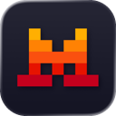
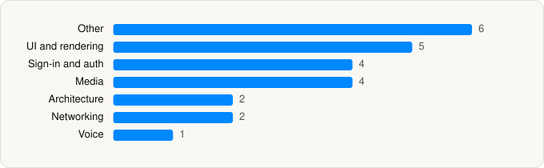

<picture><source media="(prefers-color-scheme: dark)" srcset="../../../../assets/logo/logo-dark.svg"></picture> [Tech Stack](../../../../README.md) / [Mistral AI](../../../../companies/mistral-ai.md) / Le Chat by Mistral AI

# Le Chat by Mistral AI

<picture><source media="(prefers-color-scheme: dark)" srcset="../../../../assets/badges/ios-dark.svg"></picture> <picture><source media="(prefers-color-scheme: dark)" srcset="../../../../assets/badges/active-dark.svg"></picture> <picture><source media="(prefers-color-scheme: dark)" srcset="../../../../assets/badges/floor-dark.svg"></picture> <picture><source media="(prefers-color-scheme: dark)" srcset="../../../../assets/badges/encrypted-dark.svg"></picture>

[App Store](https://apps.apple.com/app/id6740410176) · [latest.json](latest.json)

| | |
|---|---|
| Company | [Mistral AI](../../../../companies/mistral-ai.md) |
| Store id | `6740410176` |
| Bundle / package id | `ai.mistral.chat` |
| Latest version | 2.16.0 (analysed 2026-10-24) |
| Versions tracked | 1 |
| SDKs in latest version | 24 |
| Languages | C/C++, Metal (shaders), Objective-C, React Native / JavaScript, Swift |
| UI | SwiftUI, UIKit |
| Build | Swift Package Manager (SwiftPM) |
| Minimum OS | iOS 16.4 (built with Xcode 26.6, SDK iphoneos26.5) |
| Devices / ABIs | iPhone, iPad |
| Localisations | 10 |
| Capabilities | 5 |
| Declares tracking | No |
| Tracked | Yes |

## SDKs by category

<picture><source media="(prefers-color-scheme: dark)" srcset="../../../../assets/charts/apps/ios/mistral-ai/le-chat-dark.svg"></picture>

- **Other** (6): dayjs, EXConstants 57.0.17, ExpoModulesJSI 1.0, EXUpdates 57.0.21, hermesvm 1.0.0, MCEmojiPicker 1.2.3
- **UI and rendering** (5): React Native, React Native Reanimated, react-native-svg, RNSVGFilters 15.15.4, SDWebImage 5.21.7
- **Sign-in and auth** (4): AppAuth 1.7.6, GoogleSignIn 7.1.0, GTMAppAuth 4.1.1, GTMSessionFetcher 3.5.0
- **Media** (4): libavcodec 7.0.2, libavformat 7.0.2, libavutil 7.0.2, libswresample 7.0.2
- **Architecture** (2): MobX, React Navigation
- **Networking** (2): Axios, ReachabilitySwift 5.2.4
- **Voice** (1): LiveKit 1.0

Frameworks (28)

ActivityKit (Live Activities), App Intents, Authentication Services (Sign in with Apple / passkeys), AVFoundation (audio/video), AVKit, Combine (reactive), Core Data, Core Image, Core Location, Core Motion, CryptoKit, Local Authentication (Face ID / Touch ID), Media Player, MetalKit, MetricKit (diagnostics), Network.framework, PDFKit, Photos, PhotosUI, SafariServices, SiriKit (Intents), StoreKit (in-app purchase), Swift Charts, SwiftUI, UIKit, User Notifications, VisionKit (document/data scanning), WidgetKit (widgets)

Capabilities (5)

App Groups, Associated Domains (Universal Links), Background Audio, Push Notifications (APNs), Sign in with Apple

## Version history

| Version | Analysed | Store update | SDKs | Change | SDK list is a floor | Binary encrypted | File |
|---|---|---|---|---|---|---|---|
| 2.16.0 | 2026-10-24 | 2026-10-23 | 24 |  | Yes | Yes | [2.16.0.json](2.16.0.json) |

---

Generated by `scripts/build_readme.py` from the JSON files. Do not edit by hand.
