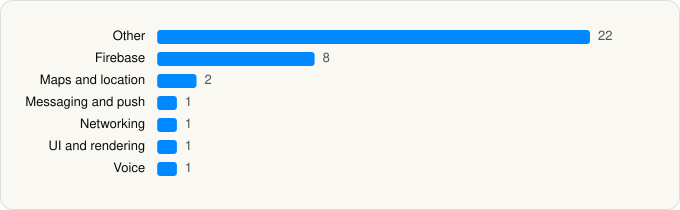

<picture><source media="(prefers-color-scheme: dark)" srcset="../../../../assets/logo/logo-dark.svg"></picture> [Tech Stack](../../../../README.md) / [MOHAMMED BIN HALABI](../../../../companies/mohammed-bin-halabi.md) / Q \| كيو

# Q \| كيو

<picture><source media="(prefers-color-scheme: dark)" srcset="../../../../assets/badges/ios-dark.svg"></picture> <picture><source media="(prefers-color-scheme: dark)" srcset="../../../../assets/badges/inactive-dark.svg"></picture> <picture><source media="(prefers-color-scheme: dark)" srcset="../../../../assets/badges/floor-dark.svg"></picture> <picture><source media="(prefers-color-scheme: dark)" srcset="../../../../assets/badges/encrypted-dark.svg"></picture>

[App Store](https://apps.apple.com/app/id6754709202) · [latest.json](latest.json)

| | |
|---|---|
| Company | [MOHAMMED BIN HALABI](../../../../companies/mohammed-bin-halabi.md) |
| Store id | `6754709202` |
| Bundle / package id | `sa.qeu.app` |
| Latest version | 2.6.2 (analysed 2026-11-10) |
| Versions tracked | 1 |
| SDKs in latest version | 37 |
| Languages | C/C++, Flutter / Dart, Metal (shaders), Objective-C, Swift |
| UI | SwiftUI, UIKit |
| Build | Swift Package Manager (SwiftPM) |
| Minimum OS | iOS 15.0 (built with Xcode 26.6, SDK iphoneos26.5) |
| Devices / ABIs | iPhone |
| Localisations | 2 |
| Capabilities | 7 |
| Declares tracking | No |
| Tracked | No. Kept for history. |

## SDKs by category

<picture><source media="(prefers-color-scheme: dark)" srcset="../../../../assets/charts/apps/ios/mohammed-bin-halabi/q-dark.svg"></picture>

- **Other** (22): apple 1.2.0, CryptoSwift 1.10.0, darwin 10.0.0, denoise 0.2.0, flutter 1.0.0, foundation 0.0.1, incoming 0.0.1, links 7.0.0, notifications 0.0.1, plus 0.0.1, PusherSwift 10.1.10, PusherTweetNacl 1.2.0, review 2.0.0, SwiftEntryKit 2.0.0, SwiftyRSA 1.7.0, TapAdditionsKitV2 0.0.18, TapApplicationV2 0.0.3, TapKeychainV2 1.0.2, TapSwiftFixesV2 1.0.3, test 0.0.1, vibration 3.0.0, wkwebview 0.0.1
- **Firebase** (8): FBLPromises 2.4.1, Firebase 16.6.0, FirebaseCore 12.18.0, FirebaseCoreInternal 12.18.0, FirebaseInstallations 12.18.0, GoogleDataTransport 10.1.1, GoogleUtilities 8.1.3, nanopb 3.30910.0
- **Maps and location** (2): GMSCore 25.0.0, GoogleMaps 9.4.0
- **Messaging and push** (1): FirebaseMessaging 12.18.0
- **Networking** (1): NWWebSocket 0.5.10
- **UI and rendering** (1): SnapKit 5.7.1
- **Voice** (1): WebRTC 1.0

Frameworks (26)

ActivityKit (Live Activities), AVFoundation (audio/video), AVKit, CallKit (VoIP), Combine (reactive), Contacts, Core Data, Core Image, Core Location, CryptoKit, MapKit, MetalKit, Network.framework, PassKit (Wallet / Apple Pay), Photos, PhotosUI, PushKit (VoIP push), SafariServices, SiriKit (Intents), Speech (recognition), StoreKit (in-app purchase), SwiftUI, UIKit, User Notifications, Vision, WidgetKit (widgets)

Capabilities (7)

App Groups, Apple Pay, Associated Domains (Universal Links), Background Audio, Background Push, Push Notifications (APNs), VoIP

## Version history

| Version | Analysed | Store update | SDKs | Change | SDK list is a floor | Binary encrypted | File |
|---|---|---|---|---|---|---|---|
| 2.6.2 | 2026-11-10 |  | 37 |  | Yes | Yes | [2.6.2.json](2.6.2.json) |

---

Generated by `scripts/build_readme.py` from the JSON files. Do not edit by hand.
