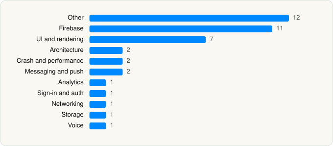

<picture><source media="(prefers-color-scheme: dark)" srcset="../../../../assets/logo/logo-dark.svg"></picture> [Tech Stack](../../../../README.md) / [MTN Nigeria](../../../../companies/mtn-nigeria.md) / myMTN NG

# myMTN NG

<picture><source media="(prefers-color-scheme: dark)" srcset="../../../../assets/badges/ios-dark.svg"></picture> <picture><source media="(prefers-color-scheme: dark)" srcset="../../../../assets/badges/inactive-dark.svg"></picture> <picture><source media="(prefers-color-scheme: dark)" srcset="../../../../assets/badges/floor-dark.svg"></picture> <picture><source media="(prefers-color-scheme: dark)" srcset="../../../../assets/badges/encrypted-dark.svg"></picture>

[App Store](https://apps.apple.com/app/id1570860098) · [latest.json](latest.json)

| | |
|---|---|
| Company | [MTN Nigeria](../../../../companies/mtn-nigeria.md) |
| Store id | `1570860098` |
| Bundle / package id | `ng.mtn.nextgen` |
| Latest version | 2.0.32 (analysed 2026-11-14) |
| Versions tracked | 1 |
| SDKs in latest version | 41 |
| Languages | C/C++, Metal (shaders), Objective-C, React Native / JavaScript, Swift |
| UI | Lottie (animations), SwiftUI, UIKit |
| Build | Swift Package Manager (SwiftPM) |
| Minimum OS | iOS 15 (built with Xcode 26.4, SDK iphoneos26.4) |
| Devices / ABIs | iPhone |
| Localisations | 0 |
| Capabilities | 3 |
| Declares tracking | No |
| Tracked | No. Kept for history. |

## SDKs by category

<picture><source media="(prefers-color-scheme: dark)" srcset="../../../../assets/charts/apps/ios/mtn-nigeria/mymtn-ng-dark.svg"></picture>

- **Other** (12): Clarity 1.0, dayjs, Lodash, Moment.js, OpenSSL 3.6.2000, QBImagePicker 0.51.1, ReactNativeBlobUtilPrivacyInfo 0.19.11, RNDeviceInfoPrivacyInfo 13.2.0, RNImageCropPickerPrivacyInfo 0.51.1, RNImagePickerPrivacyInfo 7.2.3, TZImagePickerController, TZImagePickerControllerPrivacy 3.8.12
- **Firebase** (11): FBLPromises 2.4.1, Firebase 11.4.0, FirebaseCore 11.4.0, FirebaseCoreInternal 11.15.0, FirebaseDynamicLinks 11.4.0, FirebaseInstallations 11.4.0, FirebaseRemoteConfig 11.4.0, GoogleDataTransport 10.1.1, GoogleUtilities 8.1.4, nanopb 3.30910.0, Promises 2.4.1
- **UI and rendering** (7): hermes 0.12.0, Lottie 4.6.0, React Native, React Native Reanimated, react-native-svg, RNSVGFilters 15.11.2, SDWebImage 5.21.7
- **Architecture** (2): CodePush, React Navigation
- **Crash and performance** (2): FirebaseCrashlytics 11.4.0, Sentry 8.56.2
- **Messaging and push** (2): Airship 19.3.2, FirebaseMessaging 11.4.0
- **Analytics** (1): Amplitude
- **Sign-in and auth** (1): Auth0 2.7.2
- **Networking** (1): Axios
- **Storage** (1): ZIPFoundation 0.9.20
- **Voice** (1): LiveKit 1.0

Frameworks (29)

ActivityKit (Live Activities), Authentication Services (Sign in with Apple / passkeys), AVFoundation (audio/video), AVKit, Background Tasks, Combine (reactive), Contacts, Core Bluetooth, Core Data, Core Image, Core Location, Core Motion, CryptoKit, DeviceCheck / App Attest, Local Authentication (Face ID / Touch ID), MapKit, Media Player, MessageUI (mail / SMS compose), MetalKit, MetricKit (diagnostics), Network.framework, PDFKit, Photos, PhotosUI, SafariServices, StoreKit (in-app purchase), SwiftUI, UIKit, User Notifications

Capabilities (3)

Associated Domains (Universal Links), Background Push, Push Notifications (APNs)

## Version history

| Version | Analysed | Store update | SDKs | Change | SDK list is a floor | Binary encrypted | File |
|---|---|---|---|---|---|---|---|
| 2.0.32 | 2026-11-14 |  | 41 |  | Yes | Yes | [2.0.32.json](2.0.32.json) |

---

Generated by `scripts/build_readme.py` from the JSON files. Do not edit by hand.
