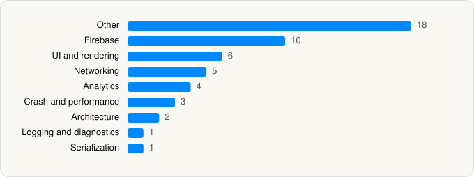

<picture><source media="(prefers-color-scheme: dark)" srcset="../../../../assets/logo/logo-dark.svg"></picture> [Tech Stack](../../../../README.md) / [myntra.com](../../../../companies/myntra-com.md) / Myntra

# Myntra - Fashion Shopping App

<picture><source media="(prefers-color-scheme: dark)" srcset="../../../../assets/badges/ios-dark.svg"></picture> <picture><source media="(prefers-color-scheme: dark)" srcset="../../../../assets/badges/inactive-dark.svg"></picture> <picture><source media="(prefers-color-scheme: dark)" srcset="../../../../assets/badges/floor-dark.svg"></picture> <picture><source media="(prefers-color-scheme: dark)" srcset="../../../../assets/badges/encrypted-dark.svg"></picture>

[App Store](https://apps.apple.com/app/id907394059) · [latest.json](latest.json)

| | |
|---|---|
| Company | [myntra.com](../../../../companies/myntra-com.md) |
| Store id | `907394059` |
| Bundle / package id | `com.myntra.Myntra` |
| Latest version | 4.2611.12 (analysed 2026-11-27) |
| Versions tracked | 1 |
| SDKs in latest version | 50 |
| Languages | C/C++, Metal (shaders), Objective-C, React Native / JavaScript, Swift |
| UI | SwiftUI, UIKit |
| Build | Swift Package Manager (SwiftPM) |
| Minimum OS | iOS 15.1 (built with Xcode 26.0.1, SDK iphoneos26.0) |
| Devices / ABIs | iPhone, iPad |
| Localisations | 1 |
| Capabilities | 6 |
| Declares tracking | Yes |
| Tracked | No. Kept for history. |

## SDKs by category

<picture><source media="(prefers-color-scheme: dark)" srcset="../../../../assets/charts/apps/ios/myntra-com/myntra-dark.svg"></picture>

- **Other** (18): Airborne 1.0, BrightcovePlayerSDK 6.8.7, BSImagePicker 3.3.3, CSCrashReporter 1.0, CSNotificationView 0.5.4, dayjs, Fabric 1.5.0, HyperCore 1.0, HyperSDK 2.2, JuspaySafeBrowser 1.0, Lodash, PayUCommonUI 1.2.1, PayUParamsKit 5.4.1, PayUUPICoreKit 9.1.0, RNCameraRollPrivacyInfo 7.10.2, SQLCipher 4.10.0, STATIC 4.43.3, SVProgressHUD
- **Firebase** (10): FBLPromises 2.4.0, Firebase 11.15.0, FirebaseCore 11.15.0, FirebaseCoreInternal 11.15.0, FirebaseInstallations 11.15.0, FirebaseRemoteConfig 11.15.0, GoogleDataTransport 10.1.0, GoogleUtilities 8.1.0, nanopb 3.30910.0, Promises 2.4.0
- **UI and rendering** (6): hermes 0.12.0, React Native, React Native Reanimated, react-native-svg, RiveRuntime 6.9.4, RNSVGFilters 15.11.2
- **Networking** (5): Axios, PayUNetworkingKit 4.1.1, PayUNetworkReachability 1.1.0, SocketIO 15.2.0, Starscream 3.1.1
- **Analytics** (4): Amplitude, AppsFlyerLib 6.17.7, Facebook SDK, PayUAnalytics 3.0.1
- **Crash and performance** (3): Bugsnag 8.2.0, FirebaseCrashlytics 11.15.0, NewRelic 7.7.10
- **Architecture** (2): React Navigation, Redux
- **Logging and diagnostics** (1): PayULoggerKit 4.0.1
- **Serialization** (1): CSSwiftProtobuf

Frameworks (32)

AdSupport (IDFA), App Tracking Transparency (ATT), ARKit, AVFoundation (audio/video), AVKit, Background Tasks, Combine (reactive), Contacts, Core Data, Core Image, Core Location, Core Motion, CryptoKit, EventKit (Calendar / Reminders), Local Authentication (Face ID / Touch ID), MapKit, Media Player, MessageUI (mail / SMS compose), MetalKit, MetricKit (diagnostics), Network.framework, PassKit (Wallet / Apple Pay), Photos, PhotosUI, SafariServices, SceneKit, SiriKit (Intents), Speech (recognition), StoreKit (in-app purchase), SwiftUI, UIKit, User Notifications

Capabilities (6)

App Groups, Apple Pay, Associated Domains (Universal Links), Background Processing, Background Push, Push Notifications (APNs)

## Version history

| Version | Analysed | Store update | SDKs | Change | SDK list is a floor | Binary encrypted | File |
|---|---|---|---|---|---|---|---|
| 4.2611.12 | 2026-11-27 |  | 50 |  | Yes | Yes | [4.2611.12.json](4.2611.12.json) |

---

Generated by `scripts/build_readme.py` from the JSON files. Do not edit by hand.
