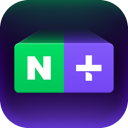
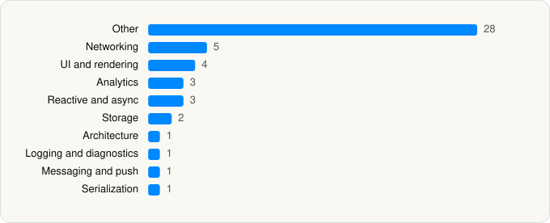

<picture><source media="(prefers-color-scheme: dark)" srcset="../../../../assets/logo/logo-dark.svg"></picture> [Tech Stack](../../../../README.md) / [NAVER Corp.](../../../../companies/naver-corp.md) / 네이버플러스 스토어

# 네이버플러스 스토어

<picture><source media="(prefers-color-scheme: dark)" srcset="../../../../assets/badges/ios-dark.svg"></picture> <picture><source media="(prefers-color-scheme: dark)" srcset="../../../../assets/badges/active-dark.svg"></picture> <picture><source media="(prefers-color-scheme: dark)" srcset="../../../../assets/badges/floor-dark.svg"></picture> <picture><source media="(prefers-color-scheme: dark)" srcset="../../../../assets/badges/encrypted-dark.svg"></picture>

[App Store](https://apps.apple.com/app/id6738063154) · [latest.json](latest.json)

| | |
|---|---|
| Company | [NAVER Corp.](../../../../companies/naver-corp.md) |
| Store id | `6738063154` |
| Bundle / package id | `com.nhncorp.NaverShopping` |
| Latest version | 2.9.11 (analysed 2026-11-05) |
| Versions tracked | 1 |
| SDKs in latest version | 49 |
| Languages | C/C++, Metal (shaders), Objective-C, Swift |
| UI | Lottie (animations), SwiftUI, UIKit |
| Build | Swift Package Manager (SwiftPM) |
| Minimum OS | iOS 16.0 (built with Xcode 27.0, SDK iphoneos27.0) |
| Devices / ABIs | iPhone |
| Localisations | 0 |
| Capabilities | 7 |
| Declares tracking | Yes |
| Tracked | Yes |

## SDKs by category

<picture><source media="(prefers-color-scheme: dark)" srcset="../../../../assets/charts/apps/ios/naver-corp/app-dark.svg"></picture>

- **Other** (28): ApiGatewayHMAC 1.9.0, ClovaCardDetectorSwift 3.2550.86, ClovaVisionImageSwift 3.2550.86, CombineCocoa 0.2.2, CryptoSwift 1.8.1, CVCardDetector 1.0, Dynamic 8.25.0, FeaturePointRecognizer 1.0, FMDB 2.7.12, LiveViewerSDK 4.34.0, NeloSDK 1.9.2, NidCore 8.4.0, NMapsGeometry 1.0.2, NMapsMap 3.24.0, NSDSFoundation, NShoppingCommon 1.0, NShoppingJS 1.0, NShoppingNetwork 1.0, NShoppingProductCard 1.0, NShoppingUI 1.0, NTrackerSDK 3.1.5, PrismVideoPlayer 4.2603.5, ShoppingLiveNetworkSDK 1.0.9, ShoppingPlayerSDK 1.1.6, ShortPickSDK 3.1.1, SwifterSwift, ULL 4.2603.5, ULLPlayer 1.19.6
- **Networking** (5): Alamofire 5.9.0, GCDWebServer 3.5.4, Moya 14.0.0, SocketIO 16.1.1, Starscream 4.0.8
- **UI and rendering** (4): DGCharts 5.1.0, Kingfisher, Lottie 4.4.3, SnapKit
- **Analytics** (3): AppsFlyerLib 1.0, BrazeKit 14.1.0, ShoppingAnalyticsSDK 1.1.4
- **Reactive and async** (3): RxCocoa 6.9.0, RxRelay 6.9.0, RxSwift 6.9.0
- **Storage** (2): KeychainAccess 4.1.0, NTrackerPerformancePluginInterface 0.4.0
- **Architecture** (1): Swinject 2.8.8
- **Logging and diagnostics** (1): NShoppingLogger 1.0
- **Messaging and push** (1): BrazeUI
- **Serialization** (1): SwiftyJSON 5.0.2

Frameworks (32)

ActivityKit (Live Activities), AdSupport (IDFA), App Intents, App Tracking Transparency (ATT), Authentication Services (Sign in with Apple / passkeys), AVFoundation (audio/video), AVKit, Background Tasks, Combine (reactive), Contacts, Core Image, Core Location, Core Motion, CryptoKit, Local Authentication (Face ID / Touch ID), MapKit, Media Player, MessageUI (mail / SMS compose), MetalKit, Network.framework, Photos, PhotosUI, SafariServices, SceneKit, SiriKit (Intents), SpriteKit, StoreKit (in-app purchase), Swift Charts, SwiftUI, UIKit, User Notifications, WidgetKit (widgets)

Capabilities (7)

App Groups, Associated Domains (Universal Links), Background App Refresh, Background Audio, Background Push, Keychain Sharing, Push Notifications (APNs)

## Version history

| Version | Analysed | Store update | SDKs | Change | SDK list is a floor | Binary encrypted | File |
|---|---|---|---|---|---|---|---|
| 2.9.11 | 2026-11-05 |  | 49 |  | Yes | Yes | [2.9.11.json](2.9.11.json) |

---

Generated by `scripts/build_readme.py` from the JSON files. Do not edit by hand.
